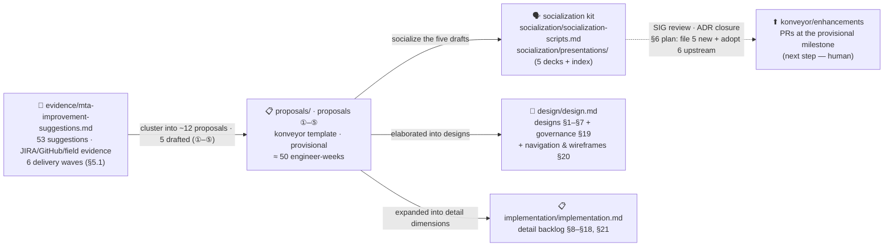

# MTA Improvement Program — workspace guide

Evidence-based improvement proposals for Red Hat Migration Toolkit for
Applications (MTA) 8.3 and upstream Konveyor, worked into fileable
enhancement proposals. Author: `@jcordes73` · November 2026.

## What this workspace is

The program flowed through five stages, and the directory structure mirrors
them. The main flow runs **evidence → proposals → socialization → upstream
filing** (stages 1, 2, 4, 5); the two stage-3 design documents are a
**result of the proposals** — they elaborate the five drafts into
filing-ready detail. Each stage is grounded in the one before it — start
anywhere, but the numbering is consistent across all layers:



## Workspace layout

```
mta-improvements/
├── evidence/        stage 1 — the evidence base (suggestions catalog)
├── proposals/       stage 2 — the five enhancement proposals ①–⑤
├── design/          stage 3 — design/design.md (§1–§7, §19–§20), elaborating the proposals
├── implementation/  stage 3 — implementation/implementation.md (detail backlog §8–§18, §21)
├── socialization/   stage 4 — SIG-meeting scripts + presentations/ (5 decks + index)
├── upstream/        stage 5 — ready-to-post upstream issue comments and issue texts
└── deliverables/    code — ui-mockup/ (PF6 HTML mock) · ui-react/ (Vite port) · hub-backend/ (Quarkus Hub)
```

## Files and directories

| Path | What it is |
|---|---|
| **[evidence/mta-improvement-suggestions.md](evidence/mta-improvement-suggestions.md)** | The evidence base: 53 suggestions across 19 areas (Hub/UI, analysis quality, reporting, agentic AI, extensibility, …), each with problem / proposed improvement / benefit / effort / workarounds / references. All claims grounded in a live MTA 8.3.3 audit and a portfolio-scale field deployment (2026-11 — source of Suggestions 37–40) plus v0.5 platform additions extending upstream RFEs (41 multi-tenancy → enhancements#110, 42 audit logging → enhancements#266), 23 validated Red Hat JIRA keys, and ~25 upstream GitHub issues. §5.1 sequences the work into 6 waves. |
| **[proposals/](proposals/README.md)** | Five complete, fileable enhancement proposals in `konveyor/enhancements` template format (status `provisional`, author `@jcordes73`, evidence-based reviewers/approvers). See the [directory README](proposals/README.md) and the table below. |
| **[design/design.md](design/design.md)** | The program design (v0.5, Part I): repository landscape (§1), Konveyor enhancement process alignment (§2), Wave 0–1 designs (§3–4), Waves 2–5 notes (§5), filing plan (§6) with repo-impact (§6.1–6.2), effort estimates (§6.3), filing status (§6.4), risks (§7) — plus §19, the console governance design decisions backfilled from the UI mockup (governance invariants, identity binding, the org/dept/team tenancy model, visibility & navigation rules; behavior record in `deliverables/ui-mockup/use-case-verification.md`), and §20, the abstract console navigation & screen anatomy with per-screen wireframes (every element cited to the suggestions it implements). |
| **[implementation/implementation.md](implementation/implementation.md)** | The implementation detail backlog (Part II): data model & schemas (§8), API contracts & RBAC (§9), sequence diagrams (§10), NFRs (§11), security (§12), test plans (§13), rollout (§14), drawbacks (§15), ADR backlog (§16), KPIs (§17), implementation-readiness checklist (§18), wireframe-to-PatternFly element mapping (§21, companion to design/design.md §20.5). |
| **[socialization/socialization-scripts.md](socialization/socialization-scripts.md)** | Spoken scripts for the socialization round required by the Konveyor process: a 30-second elevator version and a 5-minute SIG-meeting version per proposal, each ending in explicit asks. |
| **[socialization/presentations/](socialization/presentations/index.html)** | Konveyor-styled slide decks (self-contained HTML), one per proposal, plus an `index.html` launcher. Keyboard/click/touch navigation; works without JS, print-to-PDF friendly. |
| **[upstream/](upstream/route1-issue-comments.md)** | Ready-to-post content for the clusters that skip new filings: [Route 1 issue comments](upstream/route1-issue-comments.md) for the thirteen build-on-existing upstream issues, [Route 2 issue texts](upstream/route2-issue-texts.md) for the Wave-0 friction items (17 texts — including the in-console help system (43), onboarding wizards (44), clickable repository links, the General Configuration, Credentials, Proxy, and Jira/Tracker workups), and [Route 3](upstream/route3-waves-2-5.md) for Waves 2–5 (15 fileable use-case issues — including Suggestions 37/39/45–47 and 51–53 — + the design-first deferred register). |
| **[deliverables/](deliverables/README.md)** | The three code artifacts backing the program documents, and how they relate (reference → port → contract): the PatternFly 6 console mock (verified reference implementation + data source of truth), the React port (mechanical data extraction, parallel build), and the Quarkus Hub-API implementation (contract v2.1). **Run the full stack (PostgreSQL + Keycloak + hub + console) with one command:** `cd deliverables && podman compose up --build -d`, then sign in at http://localhost:5173 (demo users, password `demo`) — full runbook in [deliverables/README.md](deliverables/README.md). Per-artifact docs, run/verify instructions, and scope notes: [deliverables/README.md](deliverables/README.md). |
| **[deliverables/ui-mockup/index.html](deliverables/ui-mockup/index.html)** | Navigable UI/UX mockup of the console built on the real PatternFly 6 stylesheet (v6.7.0 via unpkg CDN — internet required) and genuine `pf-v6-c-*` widget markup. 11 screens, all rendering from in-memory stores with live cross-surface consistency (CRUD, filters, sorting, pagination, wave aggregates). RBAC is enforced, not just depicted (per-persona navigation, guarded deep links, disabled verbs), and multi-tenancy is implemented per #41 (org → department → team switcher with isolated organizations, team-locked personas, platform-admin tier with cross-tenant audit trail). Also: architect responsibility level, first-class Credentials and Task-manager views, Agentic screen with run lifecycle (cancel / pause / resume), persona-guided tours + first-run welcome, wired Help menu, Swagger-UI OpenAPI modal, and 8-language i18n (incl. RTL Arabic and per-locale currency). Deep-linkable (`#scr=…&persona=…&drawer=…&tab=…&lang=…&scheme=…&cur=…&anno=1`); the purple suggestion-annotation badges are hidden by default (masthead switch or `&anno=1`), and every depicted pattern cites the suggestion(s) it implements. Behavior record, defect log, and live-console parity audit: [use-case-verification.md](deliverables/ui-mockup/use-case-verification.md); governance decisions backfilled into [design/design.md §19](design/design.md#19-console-governance-design-decisions-from-the-ui-mockup). |
| **[deliverables/hub-backend/](deliverables/hub-backend/README.md)** | Quarkus + PostgreSQL backend implementing the workspace's Tackle Hub API contract v2.1 (the mock's parity-gated OpenAPI + §9 fragments) plus the core inventory/controls resources: applications (CRUD, upsert, ETag/If-Match, analysis diff), writable triage, batch operations, SSE events, webhooks, user-settings, settings manifest, audit trail — with `resource:verb` scope RBAC (six preconfigured role bundles + automation identity) and the #41 organization→department→team tenancy clamp, authenticated with **Keycloak in every profile** (checked-in realm `keycloak/mta-realm.json`, Dev Services Keycloak on :8180 in dev/test, `KEYCLOAK_URL` in prod; unauthenticated → 401 + WWW-Authenticate). Java 21 / Quarkus 3.40 / Hibernate Panache; 30-test suite against a DevServices PostgreSQL; **seeded with the mock's full dataset** (rewritten 2026-11-16 — tenancy, 15 apps, waves with content, incidents/tasks, trend, and the agentic registries with token/cost showback) so `ui-react` renders live against it. Extended 2026-11-16 with the console-extension resources the React port needs: gateways, skills, agents, workflows, workflow/agent runs (+ event logs), platforms, targets, wave dependencies/evidence/tickets, `/report/trend`, and the identity expiry/verification extension. Extended 2026-11-17 with the row-105/106 propagation: agent runs carry agent-loop **turns** and context-window usage (`turns`, `ctxCurrent`, `ctxWindow` + the derived `ctx` display form, seeded byte-identically to the mock); analysis queueing enforces the state rule (only `NOT_STARTED`/`CURRENT` applications queue — `POST /analyses` rejects others with 409 `state.conflict`, `POST /batch/analyses` skips them and names them in the response); `DELETE /applications/{id}` now cascades through tasks, workflow runs, agent runs/events and wave content (previously FK-fatal for any seeded app); 30-test suite. Contract + run instructions: [deliverables/hub-backend/README.md](deliverables/hub-backend/README.md). |
| **[demos/mock/](demos/mock/README.md)** | Animated guided tour of the mock — `mta-mock-tour.webm` (VP9, 29 s) + `mta-mock-tour.gif` (looped, 27 s), architect persona, EN, light scheme: Home → Applications → Incidents (+ incident triage modal) → Migration waves → Agentic → Reports, with brand-font title/outro cards. Every frame is a real render of the mock captured from headless Chrome via its deep links (`#scr=…&persona=…&drawer=…` + an `fx=<px>` scroll driver) — regenerable via `demos/mock/make-demo.sh` (headless Chrome + Pillow + ffmpeg; edit the `scenes` array to re-tour any deep-link state: `&lang=ar`, `&scheme=dark`, `&anno=1`, …). |
| **[deliverables/ui-mockup/use-case-verification.md](deliverables/ui-mockup/use-case-verification.md)** | Use-case verification for the mockup: persona journeys (migrator / architect / project manager / admin) with reproduction steps, expected behavior, and automated-verification status per use case; a suggestion-coverage matrix (#N → mock surface); the defect log found during verification; and the open items. Two verification harnesses (jsdom for behavior, headless Chrome for layout) are documented, including their known limits. Includes a parity audit against the live MTA 8.3.3 console (§7, 2026-11-12). |
| **[deliverables/hub-backend/schema.sql](deliverables/hub-backend/schema.sql)** | Schema of record (PostgreSQL DDL) for the Quarkus implementation: Part 1 is the Hibernate-generated schema of the 35 JPA entities / 45 tables (exported verbatim from the DevServices database; refreshed 2026-11-16 to include the promoted agentic, wave-content, platform/target, and trend entities plus the identity/application extensions); Part 2 keeps only the mock-model projection not yet entity-backed (run comparison, group↔wave addressing) — with mock-vs-entity divergences and the referential findings from loading the mock's sample data under FK enforcement documented in the header. Runtime truth stays Hibernate generation. |
| **[deliverables/ui-mockup/parity-plan.md](deliverables/ui-mockup/parity-plan.md)** | Plan for making the mock fully "functional" against the live console: the in-memory data layer that every table would render from (enabling live CRUD and by-construction cross-surface consistency), ten prioritized work packages closing the §7 audit gaps (Agentic section, archetypes, assessment/review, app CRUD, controls, task manager, registries, app-detail tabs, insights, wave stakeholders), with fidelity bar, definition of done, and sizing (~7–9 days). **Progress (2026-11-12): WP0 core (application data layer), WP4 (application CRUD), WP10 (wave stakeholders), WP6 (first-class Task manager + masthead queued counter), WP2 (archetype management with rename cascade), WP3 (assessment/review loop + questionnaire-answers grid), WP5 (Controls — five organization sub-tabs with guarded CRUD cascading into the Applications filter/form), WP7 (Registries — source platforms/migration targets/identities with guarded deletes and filter-menu cascade), WP8 (application-detail modal at upstream 8-tab parity, incl. defect #19 fix), and WP1 (the Agentic section — six upstream registries as a first-class screen with shared stores feeding Reports/Config, CRUD + guards + bulk delete, parameterized run records, incl. defect #21 fix), and WP9 (the Issues/Insights split — an Insights tab on the Incidents screen at the upstream column set, split chosen over the merge alternative) are done and verified — **all ten work packages complete; the §7.1 parity audit is fully closed** (status notes in the doc).** |
| **[deliverables/ui-react/](deliverables/ui-react/MIGRATION.md)** | The React port of the mock (decision 2026-11-15, **in parallel** — the HTML mock stays untouched and remains the verified reference implementation). Stack: Vite + React 19 + TypeScript + `@patternfly/react-core` 6.7.0 (same PF6 line as the mock's stylesheet) + `@patternfly/react-table`, RHDS tokens and RHDS icon path data (no `rh-*` web components, per defect row 75). Data parity is mechanical: `scripts/extract-data.mjs` regenerates `src/data/generated.ts` from `deliverables/ui-mockup/index.html` — wired into `predev`/`prebuild`, never hand-edit (it now only carries static chrome; RBAC scope literals live in `appState.tsx` because the build regenerates the file). Deep-link grammar preserved (`#scr=…&persona=…&org=…&dept=…&team=…&arch=…&tab=…&scheme=…&anno=1`, same precedence and tenancy clamps — `&persona=` clamps to the signed-in user's token persona). **Keycloak-authenticated and API-backed (2026-11-16):** sign-in screen (check-sso) → realm `mta` (public client `mta-console`, PKCE; Dev Services Keycloak on :8180 with the checked-in `hub-backend/keycloak/mta-realm.json`); the logged-in user's **realm role IS the persona** (the mock's persona switcher is replaced by a user chip + Sign out; demo users keller/cordes/schmidt/vogel/weber/root, password `demo`); the token's `organization`/`team` claims drive tenancy (#41). Every screen loads from the `hub-backend` Quarkus API through `src/api/hub.tsx` (per-org fan-out + adapters onto the mock's render shapes) — a **hard API dependency** with an error state + Retry when the backend is down and no mock-data fallback; agentic creates/deletes and incident triage are real writes (run lifecycle stays client-side — no hub verbs yet). Ported 2026-11-17 with the row-105/106 propagation: the Agent runs table carries **Turns**/**Context** columns and the run-record modals repeat the per-stage agent-loop telemetry (live-labeled while a stage runs); the five Agentic tables plus Credentials and Reports→Risk provenance page through PF6 `Pagination` (10/page, hidden at zero results); the inventory bulk bar gained a two-step armed **Delete** (`DELETE /applications/{id}` per selection, wave-membership 409s surfaced per app) and **Queue analysis** is state-gated — greyed unless a selected (or opened) application is Not started/Succeeded, matching the backend's 409 enforcement. Not yet ported: i18n (8 locales), annotation badges/tips, welcome tour, jsdom/Chrome verification suites. Status + per-screen porting notes and probe landmines: [deliverables/ui-react/MIGRATION.md](deliverables/ui-react/MIGRATION.md). Run: start `hub-backend` (`mvn quarkus:dev` — auto-boots PostgreSQL + Keycloak), then `npm run dev` / `npm run build` from `deliverables/ui-react/` (the dev server proxies `/api` → :8080); sign in with a demo user. |

## The five proposals

Numbering ①–⑤ is used consistently in the proposals' cross-references, the
socialization scripts, and the slide decks:

| # | Proposal (`proposals/…`) | Covers suggestions | Primary repos | Effort | Filing status |
|---|---|---|---|---|---|
| ① | `deterministic-analyses-and-incident-identity.md` | #7, part of #1 | analyzer-lsp, tackle2-hub, kantra | ≈ 12 ew | new filing |
| ② | `triage-store-and-run-comparison.md` | #33(1–2), #1, #6, #10 | tackle2-hub | ≈ 12.5 ew | new filing (complements enhancements#279) |
| ③ | `sarif-and-cyclonedx-export.md` | #12, #18 | tackle2-hub | ≈ 5 ew | new filing — genuinely novel |
| ④ | `batch-events-and-aggregates-api.md` | #33(3–6) | tackle2-hub | ≈ 10 ew | new filing — genuinely novel |
| ⑤ | `vulnerability-and-coverage-issue-types.md` | #24, #22 | tackle2-hub, addons | ≈ 11 ew | new filing — genuinely novel |

Program total ≈ 50 engineer-weeks; recommended landing order ① → ② → ④ → ⑤,
with ③ as the parallel quick win (design doc §6.2–6.4).

## How to navigate

- **"Which suggestion covers X?"** → `evidence/mta-improvement-suggestions.md` §2
  (summary table) then the detailed suggestion; its **References** line
  links the JIRA/GitHub issues and any drafted proposal.
- **"How would X be built?"** → the
  [proposal index](proposals/README.md) for the five
  filed clusters; design doc §3–§5 for everything else (Wave 0 items are
  repo issues, not enhancements).
- **"What exists upstream already?"** → design doc §6 filing plan: five
  clusters marked ✅ are *build-on existing issue* actions
  (enhancements#279, tackle2-hub#335, operator#543,
  agentic-controller#341, enhancements#259, tackle2-ui#3694); the five
  drafted proposals are all **new filings** (§6.4).
- **"What's the schema/API contract?"** → design doc Part II (§8–§9) for
  Wave 1; each proposal's Implementation Details for its own surface.

## Current state and next steps

| Status | Stage | Item | Where |
|---|---|---|---|
| ✅ | Evidence | Live MTA 8.3.3 audit (all views), 23 validated JIRA keys, ~25 GitHub issues | [§3 Detailed suggestions](evidence/mta-improvement-suggestions.md#3-detailed-suggestions) |
| ✅ | Evidence | 53 suggestions with linked issues + 6-wave sequence (§5.1) | [§2 Summary of suggestions](evidence/mta-improvement-suggestions.md#2-summary-of-suggestions) · [§5.1 sequence](evidence/mta-improvement-suggestions.md#51-suggested-implementation-sequence) |
| ✅ | Proposals | Five `provisional` proposals, YAML complete (author + reviewers/approvers assigned; two TBDs noted) | [`proposals/`](proposals/README.md) — summary below |
| ✅ | Design | Part I — designs, filing plan, repo impact (§6.1–6.2), effort (§6.3), filing status (§6.4), risks | [§6 Filing plan](design/design.md#6-enhancement-clustering-filing-plan) · [§6.3 effort](design/design.md#63-effort-estimates-per-proposal) · [§6.4 filing status](design/design.md#64-filing-status-of-the-drafted-proposals) |
| ✅ | Design | Part II — schemas, API/RBAC, diagrams, NFRs, security, tests, rollout, ADRs, KPIs (§8–§17) + console governance decisions backfilled from the mockup (§19) | [§8 Data model & schemas](implementation/implementation.md#8-data-model--schemas) → [§17 KPIs](implementation/implementation.md#17-success-metrics-program-kpis-measured-via-30) · [§19 Governance decisions](design/design.md#19-console-governance-design-decisions-from-the-ui-mockup) |
| ✅ | Socialization | Scripts + Konveyor-styled decks per proposal | [socialization/socialization-scripts.md](socialization/socialization-scripts.md) · [socialization/presentations/index.html](socialization/presentations/index.html) |
| ✅ | Readiness | Implementation-readiness checklist (§18) | [§18 Implementation-readiness checklist](implementation/implementation.md#18-implementation-readiness-checklist) |
| ✅ | Upstream actions | Route 1 comments (13 build-on-existing issues) + Route 2 issue texts (17) + Route 3 (15 Waves-2–5 use-case issues + 8-row Tier-B deferred register) drafted | [Route 1](upstream/route1-issue-comments.md) · [Route 2](upstream/route2-issue-texts.md) · [Route 3](upstream/route3-waves-2-5.md) |
| ⬜ | Next | Post the Route 1 comments and file the Route 2 + Route 3 Tier-A issues (zero-dependency — can start immediately) | [Route 1](upstream/route1-issue-comments.md) · [Route 2](upstream/route2-issue-texts.md) · [Route 3 Tier A](upstream/route3-waves-2-5.md) |
| ⬜ | Next | Socialize at the SIGs — Analyzers (①③), Core (②④⑤), UI (tackle2-ui work); fills the two TBD reviewers, settles `@djzager` | [§18.1 Blockers](implementation/implementation.md#181-blockers-before-the-first-pr-humanprocess--days) · [§18.2 Socialization map](implementation/implementation.md#182-socialization-map-what-socialize-concretely-means) |
| ⬜ | Next | Close the six ADRs + ~14 proposal open questions | [§18.3 ADR backlog](implementation/implementation.md#183-decisions-to-close-before-code-adr-backlog--all-undecided) |
| ⬜ | Next | Build the determinism harness (fixture corpus, double-run CI, zero-diff badge) | [§18.5 Test/CI assets](implementation/implementation.md#185-testci-assets-to-build-nobody-owns-these-yet) |
| ⬜ | Next | Scale fixtures (1,000 apps), CI credentials + RHTPA/Exhort mocks | [§18.5 Test/CI assets](implementation/implementation.md#185-testci-assets-to-build-nobody-owns-these-yet) |
| ⬜ | Next | Milestone/sprint plan: ≈ 50 ew mapped to streams and landing order | [§18.6 Planning artifacts](implementation/implementation.md#186-planning-artifacts-cheap-needed-to-start) |
| ⬜ | Waves 2–3 | Wave entry — write the Part-II design depth (schemas, OpenAPI, RBAC, test plans) for each landing item; fold the landing order ① → ② → ④ → ⑤ (③ parallel) into the milestone plan | [§18.4 Design work not yet written](implementation/implementation.md#184-design-work-not-yet-written-deepest-gap) · [§5 Waves 2–3 notes](design/design.md#5-waves-25--design-notes-updated-for-the-repo-landscape) |
| ⬜ | Waves 4–5 | Wave entry — promote the Tier B items (#20 MaaS, #28 prompts, #29 guardrails, #27 Apicurio, #34 plugin architecture) from seed notes to full KEPs per the route 3 register triggers | [Route 3 Tier B register](upstream/route3-waves-2-5.md) · [§18.4 Design work not yet written](implementation/implementation.md#184-design-work-not-yet-written-deepest-gap) |
| ⬜ | Next | File PRs against `konveyor/enhancements` at the `provisional` milestone | [§6.4 Filing status](design/design.md#64-filing-status-of-the-drafted-proposals) · [§6.2 per-proposal impact](design/design.md#62-repository-impact-per-drafted-proposal) |
| ⬜ | Next | Status transitions: `provisional → implementable → implemented` (one PR each) | [§2 Process alignment](design/design.md#2-process-alignment-deliver-as-konveyor-enhancements) |

## Conventions

- Suggestion references use Red Hat JIRA keys (`MTA-xxxx`, readable at
  `redhat.atlassian.net`) and `org:reponame#issue` for GitHub.
- Upstream statuses were verified 2026-11 and are stated inline where they
  matter (New / In Progress / Dev Complete / Closed).
- The five proposal decks and scripts deliberately make the same asks as
  the YAML frontmatter reviewers — one consistent story across documents,
  scripts, and slides.
- The dark masthead is fully tokenized (defect-log row 73): all raw hex
  colors (`#2B2B2B`/`#3A3A3A`/`#4A4A4A`/`#CFCFCF`/`#BBBBBB`/`#EEEEEE`/`#fff`)
  now use PatternFly 6 tokens — `--pf-t--color--white`, the
  `--pf-t--color--gray--{30,70,60,10}` palette (PF6 has no inverse-text
  tokens), and `--pf-t--global--background--color--inverse--{default,hover}`
  for toggle/menu-toggle backgrounds — with ≤9/255 per-channel value shifts
  (before/after screenshot diff: visually identical).
- All hand-rolled colors now come from the RHDS crayon palette (defect-log
  row 74): the mock loads `@rhds/tokens@3.2.0/css/global.css` from unpkg and
  every remaining raw hex (annotation/welcome meta-layer, demo gradients,
  token fallbacks) was replaced with a `--rh-color-*` variable — zero raw
  6-digit hex colors remain in the file. Deliberate user decision to admit
  `--rh-color-*` tokens alongside PF6 (see AGENTS.md); PF6 still governs all
  chrome, markup, spacing, and typography.
- All icons now come from the official Red Hat icon sets (defect-log
  row 75): the Font Awesome glyph map and every icon-role emoji were
  replaced with inline SVG path data from `@rhds/icons` — ui set for
  14–16px roles, microns for ≤12px carets/sort/arrows, and five
  standard-set pictograms where no UI equivalent exists (`hierarchy`,
  `layered`, `waveform`, `fire-extinguisher`, `target`). Icons stay
  monochrome `currentColor` at `1em` via the `svg.fas` rule; the
  `<rh-icon>` web component is deliberately not used. Emoji inside
  running prose (🏢/🔑 illustrations in sentences) are text content,
  not icons, and are kept.
- The masthead groups its controls by nature (defect-log row 76): a
  demo cluster (persona switcher, Annotations switch, Suggestions
  index) sits left next to the brand tag, and the proposed console UX
  (scope, tenancy, task queue, notifications, language, help) sits
  right of a vertical divider — mockup affordances vs product features
  at a glance.
- Content layout sits on the RHDS fluid 12-column grid base (defect-log
  rows 77 + 93): the top-level card/KPI containers are 12-track CSS
  grids (`repeat(12,1fr)`, `--rh-space-2xl` gutters — 6/4/3-track spans
  by layout; five equal tiles use the centered 10-of-12 placement),
  collapsing to the 2-track `--rh-space-lg` mobile grid below 768px;
  main-content margins use `--rh-space-2xl` (32px), and the page
  footnote is capped at the 789px line-length best practice. The app
  shell and component internals stay PatternFly 6; content max-width
  stays 1600px (console readability).
- All components are genuine PatternFly 6 markup, audited against
  patternfly.org/components/overview v6.7.0 (defect-log row 94): page
  titles are `pf-v6-c-title pf-m-xl` `<h1>`s (one per active screen;
  the `.page-title` class is only a margin/JS hook) and drawer/modal
  template headings are `pf-v6-c-title pf-m-lg` `<h2>`s — never
  reintroduce hand-rolled or inline-styled headings. The bell badge is
  `pf-v6-c-badge pf-m-unread` inside the notification menu-toggle
  (PF6's dedicated notification-badge is React-only); menu group titles
  are `<h1>`s per PF6's own examples; deprecated components (Chip, Tile)
  are avoided — Label and Cards instead. Absent components are verdicted
  in the defect log (row 94): no modeled flow requires them, a stronger
  in-use component covers them, or they are React-only/marketing-scope.
- The language switcher lists languages only (defect-log row 98): no
  country flags or country lists (`LANG_META` = native name + English
  description); the masthead toggle shows the bare native name.
  Display currency derives from the active locale (`I18N_LANG_CUR`,
  USD default) with the persisted/deep-linkable override on top —
  never re-couple it to a country list. The masthead content cluster
  shrinks to the viewport in a single row (scope labels ellipsize with
  a 7ch floor; the language toggle never shrinks) — do not reintroduce
  `flex:0 0 auto` there, which pushed the switcher off-screen.
- i18n covers UI chrome, descriptive attributes, and composed
  sentences (defect-log row 99): all 8 locales translate the static
  chrome and the descriptive `aria-label`/`title` attributes —
  attributes ride the text walk through `i18nWalkAttrs()`/`i18nA()`
  (exact dict + rules only, never the phrase pass) with an
  EN-original cache so locale switches re-translate from English and
  JS rewrites re-cache; JS-set aria-labels are wrapped at source.
  `trNode` refuses identifier-shaped tokens (single token with code
  punctuation and a letter) and the phrase-pass boundary blocks
  compound-token punctuation (`-_/@`), so dict words never substitute
  inside data identifiers (`orm-runtime`, `mig-execute` stay intact in
  every locale). Residual untranslated nodes are JS-rendered data-feed
  cells and proper nouns — data stays data by design; annotation
  content stays English via `I18N_SKIP` (row 58), and the masthead
  brand title, `mockup · real PF6 6.7.0` tag, and the switcher's
  English descriptions are pinned `data-i18n-skip`.
- Persona-landing vertical rhythm (defect-log row 97): the six home
  persona wrappers (`.lp-*`) stack their sections on a uniform 2xl gap
  (`display:grid; gap:var(--rh-space-2xl)`, mobile `--rh-space-lg`) —
  never re-stack sections flush in a plain block wrapper, and don't
  re-add per-element margins (the blurb's old 16px `margin-bottom` and
  two wrapper-level `margin-top` notes were removed as redundant under
  the wrapper gap). Note `.grid12`'s gap only spaces children of one
  grid — separate stacked grids get their rhythm from the wrapper.
- Pattern usage follows the PF6 patterns catalog (defect-log row 95):
  deletion triggers are secondary-styled (danger reserved for the
  confirmation modal's submit), bulk "Select none" disables at zero
  selection, the toolbar owns select-all, and selection persists after
  a bulk action; the Arabic locale flips the layout via `dir=rtl`
  (verified: mirrored sidebar, toolbar, pagination) with clean
  masthead-title truncation in both directions. The masthead ☰ toggle
  collapses the sidebar (`display:none` + `grid-template-columns:0 1fr`)
  and — since defect-log row 102 — pins the main pane to grid column 2
  while collapsed: hiding a grid sibling removes it from auto-placement,
  so without the explicit pin main falls into the 0-width track. The
  toggle is catalogued as **Suggestion 53** in
  `evidence/mta-improvement-suggestions.md` (§3.38 — per-user persistence is part
  of the proposal; the mock's state is session-only, defect-log row 103)
  and carries the `#53` annotation badge on the masthead toggle.
- The Import-applications wizard's left nav shows each step number once —
  in PF6's `::before` counter badge (the numbered circle) — with bare step
  names beside it ("Source", not "1. Source"); the "N. " text prefixes
  duplicated the badge (defect-log row 104, fixed in the mock and the
  ui-react port; dict keys renamed to the bare names across locales).
- Agent-run records carry per-stage loop telemetry (defect-log row 105):
  the Agent runs table has **Turns** and **Context** columns (agent-loop
  turns; context-window usage as `current / window (percent)` — 128k for
  granite-3.3-70b, 200k for frontier-70b), the run-record modal and the
  workflow-run modal's stage cards repeat the figures (live-labeled while
  a stage runs), and the canonical WR-8 stage records reuse the sampled
  full record's numbers byte-identically so the views cannot disagree.
- Seven more tables page through the shared pager (defect-log row 106):
  Workflow runs, Agent runs, Agents, Skills, Workflows, Credentials and
  Risk provenance gain the standard pagination widget (10 per page,
  per-page menu, first/prev/input/next/last) in display-toggle mode —
  rows stay in the DOM, so record jumps and Reports rollups keep working
  and both run jumps now land on the page carrying the record. The
  inventory bulk bar gained a two-step **Delete** (armed confirm, one
  attributed audit record for the batch, danger toast), and queuing is
  state-gated: only applications in **Not started** or **Succeeded**
  state can be queued — the bulk Queue option, the per-app detail
  modal's Queue button, and the invoicing template's grey out otherwise
  (with an explanatory tooltip), and a bulk queue skips unqueueable
  apps and says so.
- Foundations are token-complete (defect-log row 96): the mock's own
  animations use PF6 motion tokens (`--pf-t--global--motion--*` — the
  toast reuses PF's own m-toast slide-in idiom) and the OS
  reduced-motion setting collapses all durations to 1ms (the media
  block replicating PF's `.pf-v6-m-no-motion` collapse). Colors,
  design tokens, iconography, spacers, theming, typography,
  accessibility, RTL, and the AI guidelines (PF's principles are
  verbatim the RHDS rules the mock follows) are all audited —
  `pf-v6-l-*` layout helpers and PF utility classes remain optional
  conveniences the mock's own token-built layer replaces.
- Spacing follows the RHDS space-token scale (defect-log row 79): every
  `margin`/`padding`/`gap` in the mock's own layer uses
  `var(--rh-space-*)` tokens (xs=4, md=8, lg=16, xl=24, 2xl=32, 3xl=48,
  4xl=64, 6xl=96) — no 2/3/5/6/10/12/14/18/26/40px spacers remain. The
  170px wave-stats label indents are deliberate column alignment, not
  spacers; PF6 `spacer--*` tokens still apply inside PF components.
- Typography, elevation, shape, and opacity in the mock's own layer use
  RHDS tokens too (defect-log row 80): font sizes are
  `--rh-font-size-body-text-*` (xs=12 … 2xl=24px; no 9–11.5px micro-text
  except icon-like glyph chrome), shadows are `--rh-box-shadow-*`,
  radii are `--rh-border-radius-{default,sharp}`, and opacity values are
  `--rh-opacity-*` (including percentage alphas inside `rgba()`) — never
  reintroduce raw px font-sizes, hand-rolled `rgba(21,21,21,…)` shadows,
  or raw opacity decimals. RHDS has no directional shadow tokens (the
  drawer shadow lost its direction in row 80 — accepted).
- Elements follow the RHDS elements catalog as implemented by PF6
  (defect-log row 81): the mock carries a RHDS-pattern skip link (PF6's
  `pf-v6-c-skip-to-content`, first focusable element, targets the
  `<main id="mtaMain">`) — keep it first in `.pf-v6-c-page` if the shell
  changes. Filter "chips" are PF6 labels with close buttons — correct,
  since PF6 removed its chip component; never hand-roll chip CSS.
  Tooltips (annotation tips) must keep showing on keyboard focus, not
  only hover. One `<main>` landmark only — drawer/modal content stays
  `<div>`-based (row 85).
- Tables follow the RHDS Table guidelines (defect-log row 86): unsorted
  sortable columns show the RHDS `<rh-sort-button>` glyphs when unsorted
  (the stacked double-triangle "both arrows visible" state, `viewBox`
  320×512 — defect-log row 92; single triangles when sorted),
  `aria-sort` cycles none/ascending/descending,
  table-bearing card bodies scroll horizontally
  (`.pf-v6-c-card__body:has(> .pf-v6-c-table)`), and every table declares
  a `<th>` for each column its tbody renders (no one-column tables, no
  header/body mismatches). Header labels stay 1–2 words.
- Remaining catalog elements audited against their `/guidelines/` pages
  (defect-log row 88): native `<select>` form inputs always carry the
  `pf-v6-c-form-control` class (never ad-hoc inline styling), sidebar
  nav links keep their leading icons and unmodified caret icons, and
  icons stay ≤100px. Accepted deviation: 9 sidebar items vs the RHDS
  primary-nav max of 5 (console IA, mirrors the real MTA console).
  Formally absent: Blockquote, Call to action, Footer, Jump links,
  Subnavigation, Tile (absences verified in row 88; Button-group rules —
  ≤3 buttons, ≤1 primary per cluster — apply to the mock's modal/wizard
  footers even without the component).
- Overview + style pages for all in-use elements audited against the
  distilled RHDS specs (defect-log row 89; note: overview content lives
  at the bare `/elements/<slug>/` URL — `/overview/` 404s). Durable
  focus/behavior rules: dialogs move focus inside on open, trap Tab
  while open, and restore focus to the opener on close; menu-dropdowns
  move focus to the first menu item on expand and return focus to the
  toggle on Escape or item selection (the typeahead select-wrap filter
  menus keep focus in their input by convention but close on Escape);
  every code-block header carries a Copy action beside Expand/Collapse
  (clipboard write with "Copied!"/"Copy failed!" feedback). Alerts keep
  the icon+title minimum and carry no dismiss action (Warning/Danger are
  resolve-only). Accepted deviations: tooltip 300ms delay + arrow
  (popover-like `.anno` annotations), Statistic red data-text, Card
  titles as `div`s (PF6-native markup), no table `<caption>`.
- Pattern overview/style specs audited (defect-log row 90): RHDS
  patterns have no `/style/` or `/overview/` sub-pages (style guidance
  is a section inside the single pattern page; tabs and tag are stubs
  whose spec-bearing content is `/examples/`). The toast now follows the
  RHDS Toast style page: fixed top-right corner below the masthead,
  `--rh-box-shadow-xl` drop shadow, slide-in animation, a mandatory
  close button (`rbacToastClose()`), and 8s auto-dismiss — still
  `role="alert"` and non-blocking. Filter clear-all keeps its selected
  count; form required-asterisks sit right of the label; search
  placeholders set their scope. Accepted deviations: >10-option
  "+5 at a time" disclosure and <768px filter collapse are implemented
  as PF6 scrollable menus / toolbar wrapping, and the 4–8-column form
  span is superseded by PF6 drawer/modal widths.
- Gap-inventory pass over the remaining RHDS surfaces (defect-log
  row 91): disabled menu items carry `aria-disabled="true"` instead of
  the `disabled` attribute (items stay focusable/readable; the click
  guards in the handlers no-op them); hover/focus-revealed `.anno` tips
  are Escape-dismissable (WCAG 1.4.13); AI-generated run records carry
  the RHDS dual indicator — `ai-experience` sparkle + "AI-generated"
  (`.ai-marker`, purple `--rh-color-purple-60`, flipping to
  `--rh-color-purple-30` in dark). Verified: `<html lang>` tracks
  `setLang`; no robot icons on non-chat AI; no AI-specific colors or
  gradients; form errors state location, cause, and fix. Deliberate
  differences (recorded, do not "fix"): no Breadcrumb (the tenancy path
  is a state switcher, not page navigation), no Back to top (no screen
  exceeds the >2-screens threshold — measured), risk labels instead of
  Health-index A–F boxes, no Avatar/Spinner/Popover (no user photos, no
  async loading, element is Planned), and the marketing elements
  (Announcement, Audio player, Readtime, Site status, Video embed) plus
  the Personalization section and theming variants (Customizing, Color
  Palettes, Project Felt) are out of console scope.
- Per-element guidelines audit (defect-log row 87): every RHDS element
  the mock uses has been audited against its `/guidelines/` page.
  Durable rules: exactly ONE `pf-m-primary` button per view (secondary
  actions demote); icon-only compact menu toggles need a descriptive
  `aria-label`, and multi-select toggles/inputs derive labels from their
  `data-label`; menu dropdown groups stay ≤7 items (use
  `pf-v6-c-menu__group` headings); code blocks ≥5 lines ship an
  Expand/Collapse button in the header, collapsed by default
  (`codeblock-collapsed`, `aria-expanded` synced) — short blocks get no
  button; pagers hide entirely on zero results (RHDS Pagination: never
  display pagination for an empty list — the inventory pager and the
  shared `pagerApply()` set `[hidden]`, backed by
  `.pf-v6-c-pagination[hidden]{display:none}`). Accepted deviations
  (do not "fix"): tablists with 6–8 tabs
  (console IA), `.anno` tip prose longer than tooltip-length (they are
  popover-like annotations), dashboard card titles over 20 chars.
- Patterns follow the RHDS patterns catalog (defect-log row 82): toasts
  are non-blocking `role="alert"` alerts, tabs/filter/forms/search are
  PF6-native, tiles stay cards (PF6 removed Tile), and collapsible
  panels support the Accordion pattern's URL-fragment expansion —
  `&open=<id>(,<id>…)` in the deep-link hash expands accordions and
  disclosures by id (expand-only; works across drawer-template
  contents). New collapsible panels should carry an id so they are
  deep-linkable; Sticky banner/card and Logo wall are marketing
  patterns with no console place.
- Theming follows the RHDS model (defect-log row 83): the console ships
  a light/dark **color scheme** (RHDS terminology — never "theme"):
  the masthead palette toggle applies PF6's `pf-v6-theme-dark` class,
  persists, and deep-links via `&scheme=`. Dark-mode overrides for the
  mock's own crayon surfaces live in the `html.pf-v6-theme-dark` block;
  interactive color on dark comes from RHDS's
  `--rh-color-interactive-primary-*-on-dark` tokens. Light must stay
  byte-identical to the pre-row-83 rendering. The masthead (and the
  annotation tooltip) are fixed dark chrome in BOTH schemes — pinned to
  `--rh-color-gray-{80,70}` because the PF inverse tokens are
  scheme-relative and flip to light under `pf-v6-theme-dark` (row 84);
  on-brand masthead text (selected persona pill, logo tile) flips to
  `--rh-color-gray-95` in dark. Never use scheme-relative inverse
  tokens for chrome that must stay dark in both schemes. The toggle's
  icon is state-reflecting (defect-log row 100, replacing the generic
  `theme` icon from row 83): @rhds/icons `light-mode` (sun) in light
  scheme, `dark-mode` (moon) in dark — the icon names the ACTIVE
  scheme and `applyScheme()` swaps it alongside `aria-pressed`; the
  `&scheme=` deep link boots with the correct glyph. The feature is
  catalogued as **Suggestion 52** in `evidence/mta-improvement-suggestions.md`
  (§3.37, promoted from design-conformance chrome — defect-log row 101)
  and carries the `#52` annotation badge on the masthead toggle.
- Interactions follow the RHDS guide (defect-log row 78): one uniform
  focus ring for every interactive element (solid 3px
  `--rh-color-border-interactive`, 3px offset, `transition:none`,
  `:focus-visible` only — UA defaults and invisible `outline:none`
  inputs eliminated), inline links keep PF6's brand-aligned dashed
  underline, and external links no longer force new tabs (the two
  workspace `.md` companion files still do — opening them in-place
  would replace the mock).
