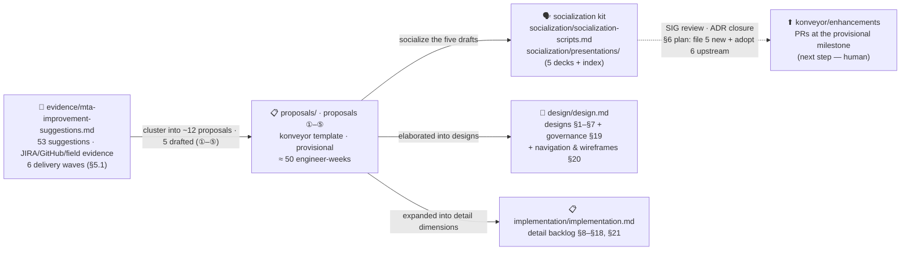

# MTA Improvement Program — workspace guide

Evidence-based improvement proposals for Red Hat Migration Toolkit for
Applications (MTA) 8.3 and upstream Konveyor, worked into fileable
enhancement proposals — plus the three code deliverables that back them
(a verified PatternFly 6 console mock, its React port, and a Quarkus
Hub-API implementation). Author: `@jcordes73` · November 2026.

## What this workspace is

The program flowed through five stages, and the directory structure mirrors
them. The main flow runs **evidence → proposals → socialization → upstream
filing** (stages 1, 2, 4, 5); the two stage-3 design documents are a
**result of the proposals** — they elaborate the five drafts into
filing-ready detail. Each stage is grounded in the one before it — start
anywhere, but the numbering is consistent across all layers:



## Workspace layout

```
mta-improvements/
├── evidence/        stage 1 — the evidence base (suggestions catalog)
├── proposals/       stage 2 — the five enhancement proposals ①–⑤
├── design/          stage 3 — design/design.md (§1–§7, §19–§20), elaborating the proposals
├── implementation/  stage 3 — implementation/implementation.md (detail backlog §8–§18, §21)
├── socialization/   stage 4 — SIG-meeting scripts + presentations/ (5 decks + index)
├── upstream/        stage 5 — ready-to-post upstream issue comments and issue texts
├── deliverables/    code — ui-mockup/ (PF6 HTML mock) · ui-react/ (Vite port) · hub-backend/ (Quarkus Hub)
├── demos/           captured demos (mock tour video/GIF, live-stack demo notes)
├── CHANGELOG.md     behavior-change record (one clause per change, dated)
└── AGENTS.md        working conventions for AI agents editing this workspace
```

## Files and directories

| Path | What it is |
|---|---|
| **[evidence/mta-improvement-suggestions.md](evidence/mta-improvement-suggestions.md)** | The evidence base: 53 suggestions across 19 areas, each with problem / proposed improvement / benefit / effort / references — grounded in a live MTA 8.3.3 audit and a portfolio-scale field deployment (2026-11), 23 validated Red Hat JIRA keys, and ~25 upstream GitHub issues. §5.1 sequences the work into 6 waves. *Do not split or renumber — the `#N` registry anchors every cross-reference in the workspace.* |
| **[proposals/](proposals/README.md)** | Five complete, fileable enhancement proposals in `konveyor/enhancements` template format (status `provisional`) — summary table below. |
| **[design/design.md](design/design.md)** | The program design (Part I): repository landscape (§1), process alignment (§2), Wave 0–1 designs (§3–4), Waves 2–5 notes (§5), filing plan with repo impact, effort, and filing status (§6), risks (§7) — plus **§19**, the console governance decisions backfilled from the UI mockup, and **§20**, the abstract console navigation & screen anatomy with per-screen wireframes. |
| **[implementation/implementation.md](implementation/implementation.md)** | The implementation detail backlog (Part II): data model & schemas (§8), API contracts & RBAC (§9), sequence diagrams (§10), NFRs (§11), security (§12), test plans (§13), rollout (§14), drawbacks (§15), ADR backlog (§16), KPIs (§17), readiness checklist (§18), wireframe-to-PatternFly mapping (§21). |
| **[socialization/](socialization/socialization-scripts.md)** | Spoken scripts (30-second + 5-minute SIG versions per proposal) and [Konveyor-styled slide decks](socialization/presentations/index.html) — one per proposal plus a launcher. |
| **[upstream/](upstream/route1-issue-comments.md)** | Ready-to-post upstream content: [Route 1 issue comments](upstream/route1-issue-comments.md) (13 build-on-existing issues), [Route 2 issue texts](upstream/route2-issue-texts.md) (17 Wave-0 friction items), [Route 3](upstream/route3-waves-2-5.md) (15 Waves-2–5 use-case issues + the Tier-B deferred register). |
| **[deliverables/](deliverables/README.md)** | The three code artifacts and how they relate (reference → port → contract). **Run the full stack with one command:** `cd deliverables && podman compose up --build -d`, then sign in at http://localhost:5173 (demo users, password `demo`) — full runbook in [deliverables/README.md](deliverables/README.md). |
| **[deliverables/ui-mockup/index.html](deliverables/ui-mockup/index.html)** | Navigable console mockup on the real PatternFly 6 stylesheet (v6.7.0, internet required): 11 screens from in-memory stores with live cross-surface consistency, enforced RBAC, #41 multi-tenancy, agentic run lifecycle, 8-language i18n (incl. RTL), deep links (`#scr=…&persona=…&lang=…&scheme=…`), and suggestion-annotation badges (`&anno=1`). Behavior record + defect log: [use-case-verification.md](deliverables/ui-mockup/use-case-verification.md); design-system conformance clauses: [design-system-rules.md](deliverables/ui-mockup/design-system-rules.md). |
| **[deliverables/ui-mockup/use-case-verification.md](deliverables/ui-mockup/use-case-verification.md)** | Persona journeys with reproduction steps, the suggestion-coverage matrix, the live-console parity audit (§7, 2026-11-12), and the **append-only defect log** (§4, rows 1–106 — the workspace's detailed change-evidence record). |
| **[deliverables/ui-mockup/parity-plan.md](deliverables/ui-mockup/parity-plan.md)** | The 2026-11-12 work-package plan for making the mock fully functional — **all ten packages complete and verified; the §7.1 parity audit is fully closed** (kept as the historical plan). |
| **[deliverables/ui-react/](deliverables/ui-react/MIGRATION.md)** | The React port of the mock (Vite + React 19 + PF6 react-core, RHDS tokens/icons) — **Keycloak-authenticated and backed by the live hub API** (hard dependency, no mock fallback): realm role = persona, token claims drive tenancy, per-screen porting status + landmine notes in [MIGRATION.md](deliverables/ui-react/MIGRATION.md). |
| **[deliverables/hub-backend/](deliverables/hub-backend/README.md)** | Quarkus 3.40 + PostgreSQL implementation of the Tackle Hub API contract v2.1: inventory/controls + console-extension resources, `resource:verb` scope RBAC with six role bundles, #41 tenancy clamp, Keycloak auth in every profile (checked-in realm), seeded with the mock's full dataset; 30-test suite. Contract + run instructions: [README.md](deliverables/hub-backend/README.md); schema of record: [schema.sql](deliverables/hub-backend/schema.sql). |
| **[demos/](demos/mock/README.md)** | Animated guided tour of the mock (`mta-mock-tour.webm`/`.gif`) — regenerable via `demos/mock/make-demo.sh` from the mock's deep links. |

## The five proposals

Numbering ①–⑤ is used consistently in the proposals' cross-references, the
socialization scripts, and the slide decks:

| # | Proposal (`proposals/…`) | Covers suggestions | Primary repos | Effort | Filing status |
|---|---|---|---|---|---|
| ① | `deterministic-analyses-and-incident-identity.md` | #7, part of #1 | analyzer-lsp, tackle2-hub, kantra | ≈ 12 ew | new filing |
| ② | `triage-store-and-run-comparison.md` | #33(1–2), #1, #6, #10 | tackle2-hub | ≈ 12.5 ew | new filing (complements enhancements#279) |
| ③ | `sarif-and-cyclonedx-export.md` | #12, #18 | tackle2-hub | ≈ 5 ew | new filing — genuinely novel |
| ④ | `batch-events-and-aggregates-api.md` | #33(3–6) | tackle2-hub | ≈ 10 ew | new filing — genuinely novel |
| ⑤ | `vulnerability-and-coverage-issue-types.md` | #24, #22 | tackle2-hub, addons | ≈ 11 ew | new filing — genuinely novel |

Program total ≈ 50 engineer-weeks; recommended landing order ① → ② → ④ → ⑤,
with ③ as the parallel quick win (design doc §6.2–6.4).

## How to navigate

- **"Which suggestion covers X?"** → `evidence/mta-improvement-suggestions.md` §2
  (summary table) then the detailed suggestion; its **References** line
  links the JIRA/GitHub issues and any drafted proposal.
- **"How would X be built?"** → the
  [proposal index](proposals/README.md) for the five
  filed clusters; design doc §3–§5 for everything else (Wave 0 items are
  repo issues, not enhancements).
- **"What exists upstream already?"** → design doc §6 filing plan: five
  clusters marked ✅ are *build-on existing issue* actions
  (enhancements#279, tackle2-hub#335, operator#543,
  agentic-controller#341, enhancements#259, tackle2-ui#3694); the five
  drafted proposals are all **new filings** (§6.4).
- **"What's the schema/API contract?"** → design doc Part II (§8–§9) for
  Wave 1; each proposal's Implementation Details for its own surface.
- **"What changed recently?"** → [CHANGELOG.md](CHANGELOG.md) (dated
  behavior changes) and the defect log
  ([use-case-verification.md §4](deliverables/ui-mockup/use-case-verification.md)).

## Current state

Two tracks: the **program documents** (evidence → filing) and the
**deliverables** (mock → port → live backend).

**Program track** — evidence, proposals, design, socialization kit, and
upstream content are complete; the remaining steps are human/process:

| Status | Item | Where |
|---|---|---|
| ✅ | Evidence base — live MTA 8.3.3 audit, 53 suggestions, 6-wave sequence | [evidence §2](evidence/mta-improvement-suggestions.md#2-summary-of-suggestions) · [§5.1](evidence/mta-improvement-suggestions.md#51-suggested-implementation-sequence) |
| ✅ | Five `provisional` proposals (YAML complete) | [proposals/](proposals/README.md) |
| ✅ | Design (Part I + §19–20) and implementation backlog (Part II, §8–18, §21) | [design.md](design/design.md) · [implementation.md](implementation/implementation.md) |
| ✅ | Socialization scripts + decks; Route 1/2/3 upstream content drafted | [socialization/](socialization/socialization-scripts.md) · [upstream/](upstream/route1-issue-comments.md) |
| ⬜ | Post Route 1 comments; file Route 2 + Route 3 Tier-A issues (zero-dependency) | [upstream/](upstream/route1-issue-comments.md) |
| ⬜ | Socialize at the SIGs (fills the two TBD reviewers) | [§18.2 socialization map](implementation/implementation.md#182-socialization-map-what-socialize-concretely-means) |
| ⬜ | Close the six ADRs + proposal open questions | [§18.3 ADR backlog](implementation/implementation.md#183-decisions-to-close-before-code-adr-backlog--all-undecided) |
| ⬜ | File PRs against `konveyor/enhancements` at the `provisional` milestone; then `provisional → implementable → implemented` | [§6.4 filing status](design/design.md#64-filing-status-of-the-drafted-proposals) |
| ⬜ | Determinism harness + scale fixtures (§18.5); Waves 2–3 design depth; Wave 4–5 KEP promotion | [§18.4–18.6](implementation/implementation.md#184-design-work-not-yet-written-deepest-gap) · [Route 3 Tier B](upstream/route3-waves-2-5.md) |

**Deliverables track** — all three artifacts are built and verified against
each other:

| Status | Item | Where |
|---|---|---|
| ✅ | UI mock at full functional parity — all ten parity-plan work packages done; live-console parity audit closed (2026-11-12) | [parity-plan.md](deliverables/ui-mockup/parity-plan.md) · [§7 audit](deliverables/ui-mockup/use-case-verification.md) |
| ✅ | Full RHDS/PF6 design-system conformance (audit rows 73–106, incl. dark scheme, motion, i18n completion) | [design-system-rules.md](deliverables/ui-mockup/design-system-rules.md) |
| ✅ | Agent-run telemetry + table pagination + bulk delete + state-gated queueing (rows 105–106, 2026-11-17) | [CHANGELOG 2026-11-17](CHANGELOG.md) |
| ✅ | hub-backend: contract v2.1, Keycloak everywhere, seeded with the mock's dataset; 30 tests green | [hub-backend README](deliverables/hub-backend/README.md) |
| ✅ | ui-react: every screen live-API-backed with Keycloak auth; row-105/106 propagation complete | [MIGRATION.md](deliverables/ui-react/MIGRATION.md) |
| ✅ | One-command compose stack (PostgreSQL + Keycloak + hub + console), live-verified 2026-11-17 | [deliverables/README.md](deliverables/README.md) |
| ⬜ | Port the remaining mock surfaces to react-i18next and retire the legacy DOM walker | [MIGRATION.md "i18n strategy"](deliverables/ui-react/MIGRATION.md) |
| ⬜ | hub verbs for run lifecycle (pause/resume/cancel) — currently client-side in the port | [MIGRATION.md](deliverables/ui-react/MIGRATION.md) |

## Conventions

- Suggestion references use Red Hat JIRA keys (`MTA-xxxx`, readable at
  `redhat.atlassian.net`) and `org:reponame#issue` for GitHub.
- Upstream statuses were verified 2026-11 and are stated inline where they
  matter (New / In Progress / Dev Complete / Closed).
- The five proposal decks and scripts deliberately make the same asks as
  the YAML frontmatter reviewers — one consistent story across documents,
  scripts, and slides.
- **Behavior changes** append a defect-log row
  ([use-case-verification.md §4](deliverables/ui-mockup/use-case-verification.md),
  single line, append-only) **and** a dated clause in
  [CHANGELOG.md](CHANGELOG.md) — not README.
- **Design-system rules** for the mock (and port) live in
  [deliverables/ui-mockup/design-system-rules.md](deliverables/ui-mockup/design-system-rules.md);
  [AGENTS.md](AGENTS.md) carries the binding summary.
