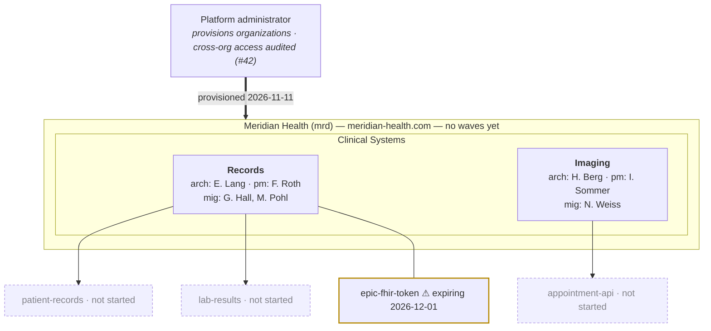

# Example organizations in the UI mock

This document describes the organizational setup of the two example companies
that ship as sample data in `index.html`. It is a descriptive reference for
reviewers and for anyone extending the mock — the authoritative source is the
`TENANCY` constant (~line 4581) plus the app, credential, stakeholder, and
wave data blocks near it.

The two orgs exist to exercise the multi-tenancy model (#41) from two very
different starting points: **Northwind Financial** is a mature, mid-migration
organization with four executed waves and a full application portfolio;
**Meridian Health** is a freshly provisioned tenant with a skeleton portfolio
and no migration program yet.

## The tenancy model

Organizations contain departments, departments contain teams. Every
application belongs to **exactly one team**, and every team is staffed with
**architects, project managers, and migrators**. Derived invariants that the
mock enforces (and the verification suites assert):

- **Stakeholders always belong to an organization** — `org` is a required
  field on every stakeholder record, stamped from the team-roster staffing at
  boot and required in the Add-stakeholder modal; person-pickers filter
  strictly by it.
- **Applications always have an owner** — boot-derived from the team roster
  (first architect, else PM, else migrator) and enforced on every
  create/edit; a stakeholder owning applications cannot be deleted without
  reassignment.
- **Credentials are team-owned** — the same ownership invariant as
  applications; visibility follows the tenancy clamp.
- **Email domains follow the organization** — Northwind people sit at
  `northwind-financial.com`, Meridian people at `meridian-health.com`
  (hand-added org-less people fall back to `example.com`).

Scoping: `state.org/dept/team` is the active scope; `scopedApps()` /
`scopedCreds()` are the only list sources renderers read.

## Organization at a glance

### Northwind Financial (`nwf`)

*The flagship tenant: a financial-services organization mid-migration —
2 departments, 4 teams, 12 applications, and migration waves 1–4.*

```mermaid
flowchart TD
    padmin["Platform administrator<br/><i>provisions organizations · cross-org access audited (#42)</i>"]
    padmin -.->|provisions| NWF

    subgraph NWF["Northwind Financial (nwf) — northwind-financial.com — Waves 1–4"]
        direction TB
        subgraph RETAIL["Retail Banking"]
            direction TB
            claims["<b>Claims</b><br/>arch: M. Keller, R. Fuchs · pm: P. Schmidt<br/>mig: J. Cordes, T. Novak"]
            payteam["<b>Payments</b><br/>arch: A. Weber · pm: L. Fischer<br/>mig: D. Braun, K. Ott"]
            custdig["<b>Customer digital</b><br/>arch: V. Brandt · pm: O. Ritter<br/>mig: U. Lehmann"]
        end
        subgraph WEALTH["Wealth Management"]
            portfolio["<b>Portfolio</b><br/>arch: R. Schulz, B. Jäger · pm: K. Vogel<br/>mig: S. Krüger"]
        end
    end

    claims --> papi["payments-api · W3"]
    claims --> invo["invoicing · W3 · running"]
    claims --> cbatch["claims-batch · W3"]
    claims --> lsync["ledger-sync · W3 · running"]
    claims --> nrouter["notification-router · W3"]
    claims --> cweb["claims-web · W4 · quota"]
    papi -.->|"consumed by (#23)"| cweb

    payteam --> bworker["billing-worker · not started"]:::ns
    custdig --> cportal["cust-portal · W4"]
    custdig --> capi["customer-api · not started"]:::ns
    custdig --> dportal["docs-portal · not started"]:::ns
    portfolio --> poleng["policy-engine · W4"]
    portfolio --> risksc["risk-scoring · W4 · quota"]

    claims --- gitpat["gitlab-pat"]
    claims --- svnkey["svn-read-key ⚠ expiring"]:::warn
    claims --- nexus["nexus-mvn ⚠ unverified"]:::warn
    portfolio --- ghp["github-wealth-pat"]

    classDef ns stroke-dasharray:4 3,opacity:.75
    classDef warn stroke:#b58900,stroke-width:2px
```

### Meridian Health (`mrd`)

*The fresh tenant: provisioned by the Platform administrator on 2026-11-11 —
1 department, 2 teams, 3 unanalyzed applications, no waves yet.*

*(W3)/(W4) = assigned to Northwind's migration wave 3/4 · dashed nodes = not yet
analyzed · amber-outlined nodes = credentials needing attention · every app is
owned by its team's first architect (#41 invariant); the dotted `consumed by`
edge is the #23 cross-wave dependency that drives inter-wave planning.*

The same structure as the mock enforces it: applications and credentials
clamp to the team, teams clamp to the department, departments to the
organization — and the Platform administrator sits outside the tree,
provisioning organizations like Meridian into existence.

## Northwind Financial (`nwf`)

*The flagship tenant: a financial-services organization mid-migration, with
2 departments, 4 teams, 17 staffed people, 12 applications, 4 business
services, 4 team-owned credentials, and migration waves 1–4.*

Email domain: `northwind-financial.com`

### Departments and teams

| Department | Team | Architects | Project managers | Migrators |
|---|---|---|---|---|
| Retail Banking | Claims | M. Keller, R. Fuchs | P. Schmidt | J. Cordes, T. Novak |
| Retail Banking | Payments | A. Weber | L. Fischer | D. Braun, K. Ott |
| Retail Banking | Customer digital | V. Brandt | O. Ritter | U. Lehmann |
| Wealth Management | Portfolio | R. Schulz, B. Jäger | K. Vogel | S. Krüger |

Note that **J. Cordes** (migrator, Claims) doubles as the sample's
"current user" persona in several screens and sits in both stakeholder
groups below.

### Applications (12, all in Retail Banking + Wealth Management teams)

| Application | Team | Archetype | State | Risk | Wave |
|---|---|---|---|---|---|
| payments-api | Claims | Quarkus | succeeded | High (inherited) | 3 |
| invoicing | Claims | EAP7 | running (61%) | unassessed | 3 |
| claims-web | Claims | Ant | quota-gated | Medium | 4 |
| claims-batch | Claims | EAP7 | succeeded | Medium (inherited) | 3 |
| ledger-sync | Claims | EAP7 | running (24%) | unassessed | 3 |
| notification-router | Claims | Quarkus | succeeded | Low | 3 |
| billing-worker | Payments | Spring | not started | — | — |
| cust-portal | Customer digital | EAP7 | succeeded | High | 4 |
| customer-api | Customer digital | Spring | not started | — | — |
| docs-portal | Customer digital | Ant (legacy) | not started | — | — |
| policy-engine | Portfolio | Quarkus | succeeded | Low | 4 |
| risk-scoring | Portfolio | Spring | quota-gated | Medium (inherited) | 4 |

### Business services

| Service | Description | Owner |
|---|---|---|
| Claims | Claims processing and policy administration | M. Keller |
| Customer | Customer self-service and onboarding | P. Schmidt |
| Pricing | Premium and rate calculations | L. Fischer |
| Billing | Invoicing, dunning and payment runs | J. Cordes |

### Credentials (team-owned)

| Credential | Kind | Team | Status |
|---|---|---|---|
| gitlab-pat | source · PAT (https) | Claims | verified, expires 2027-09-12 |
| svn-read-key | source · SSH key | Claims | verified, **expiring in 6 days** |
| nexus-mvn | maven · user/password | Claims | **unverified**, never used |
| github-wealth-pat | source · PAT (https) | Portfolio | verified, expires 2027-01-30 |

### Migration program

Migration **waves 1–4 all belong to Northwind**; Meridian has no waves yet.
Waves 1 and 2 completed before the sample window (no sampled applications);
waves 3 and 4 carry the active portfolio:

| Wave | Window | Sampled apps |
|---|---|---|
| 1 | 2026-09-01 → 2026-09-15 | none (completed pre-window) |
| 2 | 2026-09-22 → 2026-10-03 | none (completed pre-window) |
| 3 | 2026-10-13 → 2026-10-24 | payments-api, invoicing, claims-batch, ledger-sync, notification-router |
| 4 | 2026-11-03 → 2026-11-21 | claims-web, cust-portal, policy-engine, risk-scoring |

There is one cross-wave dependency (#23): **payments-api** is *consumed by*
**claims-web** — the dependency-graph edge that drives inter-wave planning.

### Stakeholder groups

| Group | Purpose | Members | Waves |
|---|---|---|---|
| Wave planners | own the wave gates and assignment decisions (#46) | M. Keller, J. Cordes | Waves 1–3 |
| Application owners | sign off reviews for their business services (#45) | P. Schmidt, J. Cordes | Wave 2 |

One hand-added stakeholder outside the team rosters: **D. Baumann** (DBA,
Billing business service) — the sample's demonstration that stakeholders can
exist beyond roster derivation.

### Pain points

Northwind's problem is not where to start (waves 1–2 already ran) but
**throughput and hygiene while scaling the migration**:

- **Analysis-quota contention is the #1 bottleneck** (#38). Two apps are
  blocked on the same `concurrent-analyses (8/8)` limit — `claims-web`
  (queued; its 41-day-old results stay visible but re-analysis is gated) and
  `risk-scoring` ("one raise unblocks both"). The queue names the quota and
  the raise path (a change request).
- **Stale analyses on already-"done" apps**: `claims-web` (41d), `cust-portal`
  (9d), `claims-batch` (5d), `payments-api` (2d) are marked stale — decisions
  rest on results drifting out of date, and the quota problem feeds this.
- **Incident hotspots with high effort**: `payments-api` (214 incidents,
  1180 pts, **High risk inherited** from its archetype) and `cust-portal`
  (137 incidents, 890 pts, High own risk) dominate the effort budget.
- **Review-signoff backlog**: three apps are assessed (v3) but `review
  pending` (`payments-api`, `claims-web`, `cust-portal`) — the
  Application-owners sign-off (#45) is the lagging stage; only the two Quarkus
  apps are fully approved.
- **Unassessed in-flight work**: `invoicing` (61% running) and `ledger-sync`
  (24% running) have no assessment yet — provisional totals only.
- **Legacy-tech concentration in the hard apps**: the incident-heavy apps are
  EAP7/Ant with Subversion repos and **binary deployments** (`claims-batch`,
  `cust-portal`) — no source rebuild path — while the painless ones are
  Quarkus/OpenShift.
- **Credential risks with real blast radius**: `svn-read-key` **expires in
  6 days** and its 2 dependents are precisely the two running apps;
  `gitlab-pat` serves **7 applications** (single point of failure);
  `nexus-mvn` is unverified and never used.
- **Tracker-sync fragility** (#37): `claims-web`'s ORM-hint ticket (MIG-425)
  has a **failed sync after 3 attempts** (410 Gone — ticket moved projects,
  needs re-link); `risk-scoring`'s Log4j remediation has no ticket at all.
- **Cross-wave coupling**: `payments-api` (W3) is *consumed by* `claims-web`
  (W4) — the #23 dependency constrains sequencing: W3 can't truly close while
  W4 depends on it.
- **A parked tail**: `billing-worker`, `customer-api`, `docs-portal` (legacy
  Ant) are not started and assigned to **no wave** — unscoped work.

## Meridian Health (`mrd`)

*The fresh tenant: provisioned by the Platform administrator on 2026-11-11
("1 department, 2 teams, 3 applications imported"), with no migration
program yet — the org a platform admin onboards, and the sample for org
isolation checks.*

Email domain: `meridian-health.com`

### Departments and teams

| Department | Team | Architects | Project managers | Migrators |
|---|---|---|---|---|
| Clinical Systems | Records | E. Lang | F. Roth | G. Hall, M. Pohl |
| Clinical Systems | Imaging | H. Berg | I. Sommer | N. Weiss |

### Applications (3, all not yet analyzed)

| Application | Team | Archetype | Business service |
|---|---|---|---|
| patient-records | Records | Spring | Records |
| lab-results | Records | Spring | Records |
| appointment-api | Imaging | Quarkus | Imaging |

### Credentials

| Credential | Kind | Team | Status |
|---|---|---|---|
| epic-fhir-token | source · OAuth2 | Records | verified, **expiring 2026-12-01**, 1 application |

### Migration program

None — no waves, no analysis runs, no incidents. Meridian's three
applications are all `not started`; the tenant demonstrates the empty-state
surfaces (no waves → no gate clause, spend collapse, etc.) and serves as the
isolation counterpart in tenancy tests (e.g. the #36 fix where Northwind's
admin briefly saw Meridian's tenant-provisioning bell event).

### Pain points

Meridian's pain is the mirror image of Northwind's: nothing is moving yet,
and the scaffold is fragile:

- **Entire portfolio unanalyzed**: all 3 apps are not started — no analyses,
  no incidents, no effort estimates, so no basis for planning.
- **No program structure**: no waves exist — no gate cadence, no
  assignments; the org is pre-"Wave 1".
- **A credential time bomb on the flagship app**: `epic-fhir-token`
  (OAuth2 to Epic, used by `patient-records`) **expires 2026-12-01** —
  roughly two weeks out; letting it lapse stalls the org's most important
  integration before analysis even begins.
- **Healthcare-grade integration debt ahead**: all three apps are
  FHIR/Epic-adjacent Spring/Quarkus services — the risk profile is unknown
  until first analysis runs, and the org has no migrated-app experience yet
  to calibrate against.

The two orgs deliberately exercise different console surfaces: Northwind
stresses **queue health, quota gates, wave gates, credential blast radius,
and review workflow**; Meridian stresses **empty states, provisioning, and
first-run onboarding**.

## How MTA mitigates these pain points

`#N` cites [`../evidence/mta-improvement-suggestions.md`](../../evidence/mta-improvement-suggestions.md);
"upstream" marks capability MTA already ships.

### Northwind Financial — throughput & hygiene

| Pain point | How MTA mitigates it |
|---|---|
| **Quota contention** | **#38** task-queue resilience (reaping, quota visibility, retry) — the queue names *which* quota blocks *which* task and the raise path; **#30** observability turns queue health into metrics/alerts instead of a hidden wait |
| **Stale analyses** | **#7** deterministic analyses (same inputs → same results, so re-runs are trustworthy and cheap to act on), **#1** run comparison (diff old vs. new before trusting a refresh), **#33** API bulk/events to schedule re-analysis programmatically |
| **Incident hotspots & effort** | **#4** portfolio effort rollup (provisional totals even for in-flight apps), **#13** documented estimation methodology, **#32** combined risk reporting with provenance (own vs. inherited — why `payments-api` is High), **#6** false-positive feedback loop to shrink the 214-incident noise, **#24/#22** vulnerability & dependency findings as first-class issue types |
| **Review backlog** | **#45** archetype lifecycle (risk provenance + group dashboard so sign-off is evidence-based), **#33** bulk triage via API, **#26** Hub↔IDE triage sync so owners act where they work |
| **Legacy/binary apps** | Upstream binary analysis, plus **#23** automatic dependency resolution and **#21** import-time addons; **#12** SARIF/SBOM export to govern them |
| **Credential blast radius** | **#15** credential health: verification action, expiry warnings, last-used as audit, **used-by blast radius before rotation** (the `gitlab-pat` → 7 apps fan-out is exactly this), **#42** immutable credential-access audit |
| **Tracker sync fragility** | **#37** Jira Cloud compatibility: sync outcomes surfaced, guarded retry lifecycle (the 410-Gone re-link flow), degraded-state surfacing; **#40** tracker SPI so they're not locked to one tracker |
| **Cross-wave coupling** | **#25** wave planner (dependency-, risk-, effort-aware suggestions) would have placed `claims-web` with knowledge of the `payments-api` dependency; **#46** wave execution tracking makes gates/dependencies/actuals visible mid-flight; **#47** verification & wave-gate evidence |
| **Parked tail (no wave)** | **#25** planner proposes waves for unassigned apps; **#44** wizard-driven onboarding to add them with per-step validation; the agentic factory (**#16/#39/#49**, exposed via **#19** MCP) analyzes the long tail at machine pace with guardrails |

### Meridian Health — onboarding

| Pain point | How MTA mitigates it |
|---|---|
| **Unanalyzed portfolio** | **#44** wizard-driven onboarding walks the add-apps flow with validation; the agentic factory + **#19** MCP server let the 3-person staff bootstrap analyses without deep MTA expertise; **#21/#22** import-time dependency & vulnerability analysis means the first analysis already carries TPA findings |
| **No program structure** | **#25** wave planner generates a risk/effort/dependency-aware first wave plan from zero — they don't need wave-planning experience to get one |
| **Credential time bomb** | **#15** expiry warnings + test-on-save + last-used: the console flags `epic-fhir-token`'s 2026-12-01 expiry *before* it breaks `patient-records`; **#42** audit trail on every credential access |
| **Unknown risk profile** | Upstream assessment questionnaire + **#45** archetype membership rules (Quarkus apps inherit the cloud-ready archetype's provenance), **#10** Solution Server confidence metrics, **#12** SBOM export — compliance-grade evidence from day one, which matters in healthcare |

**Cross-cutting:** **#36** role-adaptive UI gives each persona the right
surface (Meridian's small team lives in migrator/pm views; Northwind's admin
gets queue health), and **#43**'s guided empty states turn Meridian's blank
screens into onboarding rather than dead ends.

The pattern: Northwind's pains map to **operational-resilience and workflow
suggestions** (#38, #37, #15, #46, #45), Meridian's to **onboarding and
planning suggestions** (#44, #25, #43) — consistent with why the mock samples
both orgs.

## Personas operating on the two orgs

Console personas are a separate axis from the people taxonomy (functions
like Architect/DBA classify people but grant no access — #36):

| Persona | Scope |
|---|---|
| Architect | chooses a responsibility level (application › team › department › organization) that clamps the scope; the sampled architect's app responsibility is pinned to `payments-api` |
| Project manager | locked to their home team's scope |
| Program manager | whole organization/department, plus the cross-team coordination view in Migration waves |
| Migrator | locked to their team's scope |
| Administrator | organization admin — org-locked like every other persona |
| Platform administrator | operates **above** tenancy: provisions organizations (that's how Meridian entered the sample); every cross-org access is audit-logged (#42) |
