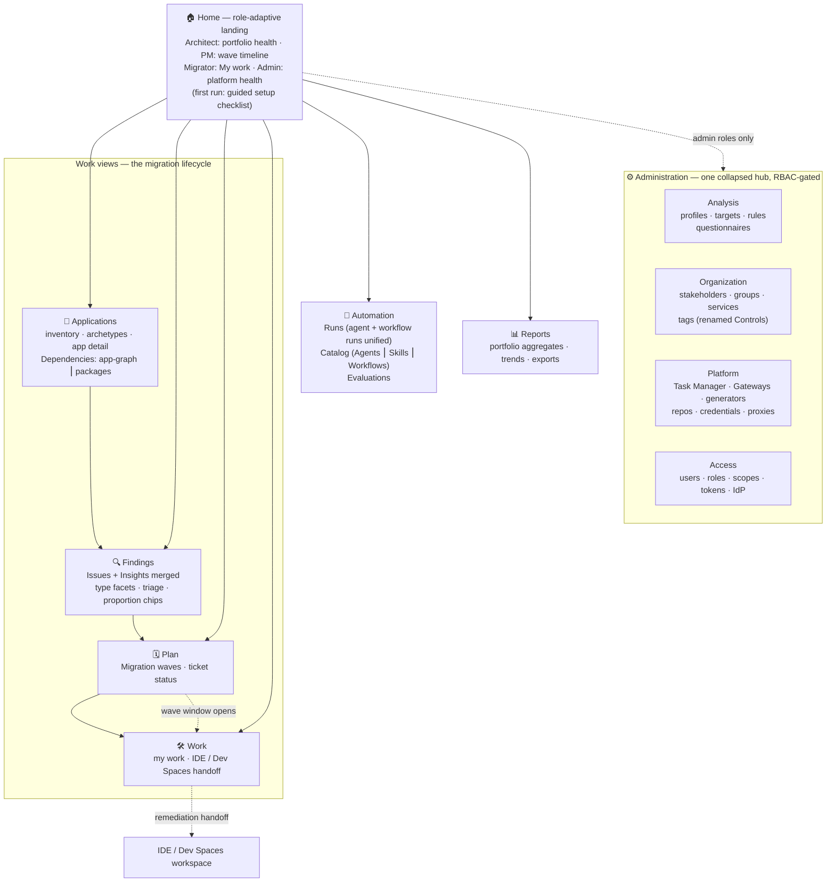
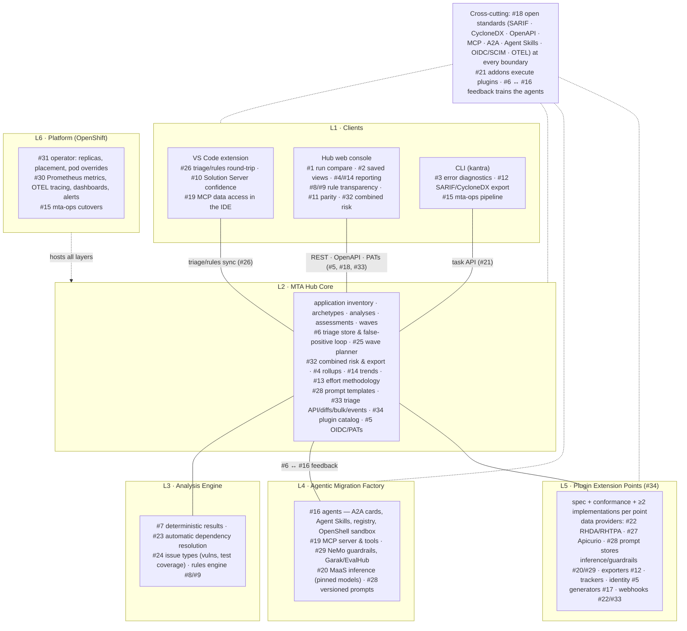

# Migration Toolkit for Applications (MTA) — Improvement Suggestions

**Author:** Jan Cordes
**Date:** 2026-11-09
**Status:** Draft
**Audience:** Red Hat MTA Product & Engineering teams
**MTA version evaluated:** MTA 8.3 (GA September 2026), including 8.3.x CLI updates
**Updated:** 2026-11-16 — removed the per-suggestion **Status (mock-validated,
2026-11-12/13)** bullets (28) and twelve **"Observed in (MTA) 8.3.3 (sandbox
instance)"** evidence bullets (including Suggestion 16's live-environment
observation bullets); the audit findings they recorded remain reflected in the
design and implementation documents and in
[use-case-verification.md](../deliverables/ui-mockup/use-case-verification.md).
2026-11-15 — new Suggestion 52 (light/dark color scheme per the Red Hat theming
model; previously implemented in the mock as design-conformance chrome, now catalogued) and
Suggestion 53 (collapsible navigation sidebar with a per-user preference; the masthead ☰
toggle, catalogued after the row-102 collapse fix).
2026-11-12 — mock-validation pass: 27 suggestions now carry a **Status
(mock-validated)** line from the interactive PatternFly 6 UI mock; #36, #41, and #42 gained
implementation-update paragraphs recording how the mock work refined the original proposals.

---

## Executive Summary

We use MTA 8.3 end-to-end — platform administration, portfolio assessment and
analysis (100+ Java EE applications on commercial application servers), migration
planning to EAP 8/Quarkus and OpenShift, and remediation execution via the Hub
and the VS Code extension. Based on this hands-on experience across all roles,
we propose **53 improvement suggestions**, grouped into seven themes:

**1. Trustworthy analysis results (the foundation).** Effort numbers must be
plannable: deterministic results for identical inputs (#7), rule transparency
(#8) with a rule coverage matrix (#9), "completed with errors" diagnostics in
the UI (#3), Solution Server confidence metrics surfaced in the Hub (#10), a
false-positive feedback loop that turns reviewer corrections into rule fixes
(#6), and dependency
resolution that no longer depends on the application building (#23). Trust in
the estimates is the precondition for every investment decision built on them.

**2. Portfolio-level planning.** Effort rollups by archetype/domain/wave (#4),
analysis run comparison (#1), trend reporting (#14), a portfolio view that
combines migration effort with security risk (#22, #24), a wave planner
that suggests data-driven wave compositions from dependencies, effort, risk,
and vulnerability exposure (#25), and a risk picture that merges assessment
questionnaire risk and analysis code risk in one exportable view (#32) —
closed out by the v0.5 lifecycle suggestions: an archetype lifecycle that
makes membership rules, risk provenance, and a group dashboard first-class
(#45), wave execution tracking with progress, gates, and planned-vs-actual
(#46), and verification suites executed in the sandbox so the migration loop
closes on evidence (#47).

**3. Reporting and integration with the existing toolchain.** Standards-based
export — SARIF for incidents, CycloneDX for dependencies (#12) — plus
parity between the Hub and static reports (#11), documented effort methodology
(#13), issue types for vulnerabilities and test coverage debt (#24), exportable
combined risk reporting (#32), Hub API extensions so automation can drive
the full migration workflow: triage, analysis diffs, bulk operations, and
event/webhook subscriptions (#33), with that API promoted to a supported,
versioned contract (#48), issue-tracker compatibility for the Jira Cloud API
breakage (#37), and a pluggable tracker SPI that treats non-Jira trackers as
first-class (#40).

**4. Red Hat ecosystem integration.** First-class, supported connections to
Red Hat Dependency Analytics and Trusted Profile Analyzer (#22), RHOAI
Models-as-a-Service as the governed inference layer for MTA's AI features (#20),
the MCP Catalog/Gateway for AI tool governance (#19), Apicurio Registry for
API/schema contract awareness, contract-level guardrails, and shared agentic
artifact storage (#27), governed, organizationally adaptable prompt
templates for MTA's AI features (#28), runtime guardrails plus adversarial
evaluation for the agentic features (#29), a production-ready agentic harness
for enterprise repository realities (#39), and workflow authoring that
composes registered agents into versioned, organization-owned migration
workflows (#49).

**5. Open standards instead of proprietary formats.** SARIF, SBOM, OpenAPI,
Konveyor rule-schema compatibility, OIDC/SCIM (#18); for the Agentic Migration
Factory: A2A Agent Cards, Agent Skills (SKILL.md), MCP, and OpenShell as the
enforcement runtime (#16) — replacing the proprietary Git-branch handoffs, which
also pollute application source repositories with MTA-only artifacts (#16.7).

**6. Extensibility and daily usability.** Documented custom import-time tasks
(#21), saved filtered views (#2), mta-ops safety checks (#15), Keycloak/SSO
hardening (#5), organization-level generator customization (#17), a deeper
Hub↔IDE integration so triage decisions, false positives, and locally run
analyses flow between the developer's IDE and the Hub (#26), a unified,
specification-first plugin architecture that turns every integration boundary
into a versioned, conformance-tested contract (#34), an automated UI
quality gate for accessibility and interaction regressions (#35), an
in-console help system with per-view docs links and guided empty states (#43),
wizard-driven onboarding for the eight highest-friction flows (#44), a
multi-lingual console UI with an externalized string catalog and full RTL
support (#51), and a light/dark color scheme following the Red Hat theming
model — persisted, deep-linkable, with the toggle icon naming the active
scheme (#52), a collapsible navigation sidebar with a persistent per-user
preference (#53) — and
role-adaptive UI workspaces so each persona — architect, migrator, project
manager, administrator — reaches value in one click (#36).

**7. Operability at portfolio scale.** Comprehensive observability for a
platform that operations teams must run: documented Prometheus metrics and
business KPIs (#30), end-to-end OpenTelemetry tracing of Hub tasks, shipped
Grafana dashboards and alert rules, and per-tenant usage attribution (#30) —
so MTA can be operated and measured like any other OpenShift component. And
the same for deployment: declarative, structured CR settings for replicas,
placement (affinity/anti-affinity, node selectors, tolerations), and
pod-level overrides (#31), instead of unsupported hand-edits to
operator-managed resources — plus the scale findings a portfolio surfaces:
task-queue resilience for reaping, quota, and retry (#38), team-scoped
multi-tenancy with visibility isolation (#41), and immutable audit logging
for sensitive mutations and credential access (#42).

**Our top four asks:** deterministic analysis results (#7), standards-based
machine-readable export (#12), actionable "completed with errors" diagnostics
(#3), and mta-ops safety checks for cutovers (#15).

Details, JIRA references, current workarounds, and positive feedback follow in
the sections below; §6 analyzes implementation dependencies (vendor and
technology lock-in), and §7 shows how all suggestions fit together as one
architecture.

---

## 1. Purpose and Context

- **Environment(s) analyzed:** Java EE applications running on commercial application servers (e.g., WebLogic/WebSphere) — _[please adjust to your actual server landscape]_
- **Application portfolio size:** 100+ applications
- **Target platforms:** JBoss EAP 8 / Quarkus (replatforming), OpenShift (containerization)
- **MTA interfaces used:** MTA Hub/web console, VS Code extension (including Developer Lightspeed)
- **How MTA fits into the overall process:** We work with MTA end-to-end — administering the platform, running portfolio-level assessment and analysis, planning migration waves, and executing the resulting code changes. The improvement suggestions below therefore reflect the perspectives of the platform administrator, the architect, and the migrator alike.

Suggestions are grounded in the MTA 8.0–8.3 release notes and currently
published known issues (JIRA references included where applicable).

---

## 2. Summary of Suggestions

| # | Suggestion | Area | Impact |
|---|-----------|------|--------|
| 1 | Analysis run comparison (diff view) | Hub / Web UI| High |
| 2 | Saved, shareable filtered views | Hub / Web UI| Med |
| 3 | Clearer "completed with errors" diagnostics | Hub / Web UI| High |
| 4 | Portfolio-level effort rollup | Hub / Web UI| High |
| 5 | Authentication/Keycloak UX hardening | Hub / Web UI| High |
| 6 | False-positive feedback loop | Rules & Analysis| High |
| 7 | Deterministic analysis results | Rules & Analysis| High |
| 8 | Rule result transparency | Rules & Analysis| Med |
| 9 | Rule coverage matrix | Rules & Analysis| Med |
| 10 | Solution Server confidence metrics in the Hub | Rules & Analysis| High |
| 11 | UI vs. static report parity | Reporting| High |
| 12 | Standards-based machine-readable export (SARIF, SBOM) | Reporting| High |
| 13 | Effort estimation methodology documentation | Reporting| Med |
| 14 | Trend/burn-down reporting | Reporting| Med |
| 15 | mta-ops pipeline ergonomics & safety checks | Container Migration| High |
| 16 | Agentic Migration Factory: feedback, guardrails & open interoperability | Agentic AI| High |
| 17 | Organization-level generator customization | Asset Generation| Med |
| 18 | Open standards across MTA surfaces | Cross-cutting| Med |
| 19 | First-class MCP server/tool support | Cross-cutting| High |
| 20 | MaaS as the governed inference layer for MTA's AI features | Cross-cutting| Med |
| 21 | Document custom import-time tasks (addons) — e.g., dependency/vulnerability analysis | Extensibility| Med |
| 22 | Integration with Red Hat Dependency Analytics and Trusted Profile Analyzer | Integrations| High |
| 23 | Automatic application dependency resolution | Analysis engine| High |
| 24 | Issue types for vulnerabilities and test coverage debt | Reporting| High |
| 25 | Migration wave planner (dependency-, risk- and effort-aware suggestions) | Migration planning| High |
| 26 | Deepen the Hub↔IDE integration (triage sync, rules round-trip, SSO) | Hub↔IDE integration| High |
| 27 | Integration with Apicurio Registry | Integrations| Med |
| 28 | Governed prompt templates for MTA's AI features (RHOAI/Apicurio) | Cross-cutting| Med |
| 29 | Runtime guardrails & adversarial evaluation for MTA's agentic features | Cross-cutting| High |
| 30 | Comprehensive observability: metrics, tracing, dashboards, alerts | Observability| High |
| 31 | Declarative deployment customization (replicas, placement, overrides) | Operator / Deployment| High |
| 32 | Exportable, combined risk reporting (assessment + analysis) | Reporting| High |
| 33 | Hub API extensions for migration automation (triage, diffs, bulk, events) | Hub API / Automation| High |
| 34 | Unified, specification-first plugin architecture | Extensibility| High |
| 35 | Automated UI quality gate (a11y, navigation, regression) | Cross-cutting| Med |
| 36 | Role-adaptive UI — persona-based workspaces | Hub / Web UI| Med |
| 37 | Issue-tracker compatibility (Jira Cloud API breakage) | Integrations| High |
| 38 | Hub task-queue resilience (reaping, quota, retry) | Hub / Task management| High |
| 39 | Agentic harness production-readiness (scoping, branches, transport) | Agentic AI| High |
| 40 | Pluggable issue-tracker integrations (tracker SPI beyond JIRA) | Integrations| High |
| 41 | Multi-tenancy — visibility isolation & team-scoped resources | Hub / Multi-tenancy| High |
| 42 | Hub audit logging (immutable mutation & credential-access record) | Hub / Audit logging| High |
| 43 | In-console help system (help menu, docs links, guided empty states) | Hub / Web UI| Med |
| 44 | Wizard-driven onboarding (8 high-friction flows, per-step validation) | Hub / Web UI| High |
| 45 | Archetype lifecycle (membership rules, risk provenance, group dashboard) | Hub / Archetypes| High |
| 46 | Wave execution tracking (progress, gates, timeline, actuals) | Migration planning| High |
| 47 | Verification & integration testing (test charter, sandbox-executed suites, wave-gate evidence) | Migration planning| High |
| 48 | Hub API as a first-class automation contract (parity gate, versioning, machine-first semantics) | Hub API / Automation| High |
| 49 | Workflow authoring for the agentic factory (compose, version, and share migration workflows from registered agents) | Agentic AI| High |
| 50 | Persistent run-event log (agent-stage event timeline — tool invocations, model calls with token counts, sandbox denials, checkpoints, retries — that survives the ephemeral workspace) | Agentic AI | High |
| 51 | Multi-lingual console UI (externalized string catalog, language switcher, full RTL) | Hub / Web UI| Med |
| 52 | Light/dark color scheme (RHDS theming model — PF6 dark scheme, persisted, deep-linkable) | Hub / Web UI| Med |
| 53 | Collapsible navigation sidebar (masthead toggle, per-user preference) | Hub / Web UI| Low |

---

## 3. Detailed Suggestions

### 3.1 Hub / Web UI

#### Suggestion 1: Analysis run comparison (diff view)

- **Area:** Hub/Web UI
- **Problem / Pain point:** Each analysis of an application replaces the previous results. There is no way to see what changed between two runs — new incidents, resolved incidents, effort delta — without exporting to spreadsheets and diffing manually. This makes it hard to demonstrate migration progress to stakeholders or verify the effect of a remediation effort.
- **Proposed improvement:** A diff/compare view that lets the user select two analyses of the same application (or a whole project) and shows: new issues, resolved issues, unchanged issues, and the effort delta. Could be surfaced as a "Progress" tab per application and a portfolio-level rollup.
- **Expected benefit:** Tangible progress tracking; supports reporting to management; reduces manual spreadsheet work.
- **Estimated effort:** M
- **Workarounds used today:** Downloading static reports per analysis run and comparing them manually; migration progress tracked externally in spreadsheets.
- **References:** proposal drafted: [triage-store-and-run-comparison.md](../proposals/triage-store-and-run-comparison.md) (diff endpoint; depends on the incident-identity keystone in [deterministic-analyses-and-incident-identity.md](../proposals/deterministic-analyses-and-incident-identity.md))

#### Suggestion 2: Saved, shareable filtered views

- **Area:** Hub/Web UI
- **Problem / Pain point:** Filters in the Issues and Applications views are ephemeral. Recurring triage queries (e.g., "all mandatory, effort ≥ 5, target EAP 8") must be re-entered by every team member every session, and there is no shared definition of "our triage view".
- **Proposed improvement:** Allow saving the current filter set as a named view, scoped to the user, the project, or the organization. Saved views appear in a sidebar and can be shared across team members. Optionally link a saved view to an archetype.
- **Expected benefit:** Consistent triage across the team; less repetitive UI work; onboarding support for new team members.
- **Estimated effort:** S
- **Workarounds used today:** Triage filter conventions are documented in the team wiki and re-entered manually by each member per session.
- **References:** related: MTA-7482 / konveyor/tackle2-ui#3523 (New — server-side application/archetype filter chips on Runs pages — the filter-infrastructure precedent)

#### Suggestion 3: Clearer "completed with errors" diagnostics

- **Area:** Hub/Web UI
- **Problem / Pain point:** Analysis and tech-discovery tasks fail or "complete with errors" without surfacing the root cause in the UI. One currently documented case: analysis completes with errors for projects without a Maven/Gradle build file at the root directory (MTA-6140), silently missing tags and issues. Users must locate and read pod/container logs to diagnose.
- **Proposed improvement:** When a task completes with errors, show in the UI: the failing stage, the actual error message, the affected files/applications, and — where possible — an actionable hint (e.g., "no Maven/Gradle build file found at project root; analysis of transitive dependencies was skipped"). Additionally, handle non-Maven/Gradle project layouts gracefully rather than erroring.
- **Expected benefit:** Self-service diagnostics; fewer support cases; higher trust in "completed" results.
- **Estimated effort:** M
- **Workarounds used today:** Ensuring a build file exists at the project root (per documented workaround for MTA-6140).
- **Observed in a field deployment (2026-11):** the
  diagnostics gap has a harder edge in the field — task pods that die before
  reporting leave **failed task records with `error: null`**, a shared-cache
  permission failure (`mkdir /cache/m2: permission denied` — task pods run as
  random UIDs, so the cache directory must be world-writable) produces a
  tell-tale language-discovery-succeeds/tech-discovery-fails split, and the
  task scheduler can wedge the entire queue on dead pods (Suggestion 38) —
  the portfolio's analyses then sit queued with no UI-visible cause.

- **References:** MTA-6140, MTA-5069 (discovery task errors)

#### Suggestion 4: Portfolio-level effort rollup

- **Area:** Hub/Web UI
- **Problem / Pain point:** Effort (story points) is reported per application. There is no aggregated view by archetype, business domain, tag, or migration wave, although archetypes in 8.x are exactly the construct for grouping applications with shared characteristics.
- **Proposed improvement:** A portfolio dashboard aggregating total effort and issue counts grouped by archetype, target, business domain (tag category), and migration wave, with drill-down to applications. Include mandatory vs. optional vs. potential split.
- **Expected benefit:** Better planning and prioritization of migration waves; a direct answer to "how much work is left for domain X?".
- **Estimated effort:** M
- **Workarounds used today:** Exporting per-application effort figures and aggregating them manually in spreadsheets.
- **References:** proposal drafted: [batch-events-and-aggregates-api.md](../proposals/batch-events-and-aggregates-api.md) (the `/report/effort?groupBy=…` server-side rollup this dashboard needs, with UI-parity acceptance test)

#### Suggestion 5: Authentication/Keycloak UX hardening

- **Area:** Hub/Web UI
- **Problem / Pain point:** Enterprise SSO setup has rough edges documented as known issues in 8.2: a Keycloak administrator cannot manage MTA users without manually adding a list of scopes (MTA-7235), and after configuring an external identity provider MTA does not automatically redirect to the IdP login page (MTA-7236, requiring a hand-edit of the Tackle custom resource).
- **Proposed improvement:** Make user management work out of the box for Keycloak-admin-provisioned users, and support a first-class, UI- or CR-level option to designate an external IdP as primary with automatic redirect. Validate IdP configuration at setup time and surface misconfigurations clearly.
- **Expected benefit:** Day-one SSO experience appropriate for enterprise deployments; less manual cluster resource editing.
- **Estimated effort:** S
- **Workarounds used today:** Manually adding the scopes documented in MTA-7235; setting `idp_primary: true` in the Tackle CR.
- **Observed in a field deployment (2026-11):** the
  Keycloak deployment path adds two hardening items: the realm import
  declares `firstName`/`lastName` as **required profile attributes, stopping
  every login at a "Verify profile" form** until both are made optional via
  the Admin API, and a realm re-import resets users defined in the manifest.
  Separately, the Hub acts as its **own OIDC provider and rejects Keycloak
  JWTs** — hub tokens must be minted with Hub basic auth — which is the
  identity model any SSO design has to reconcile (the IDE plugin's OIDC
  option talks to Keycloak, the Hub-side token minting does not).

- **References:** MTA-7235, MTA-7236

### 3.2 Rules & Analysis Quality

#### Suggestion 6: False-positive feedback loop

- **Area:** Rules & Analysis Quality
- **Problem / Pain point:** When a rule fires incorrectly, the only channel is filing a JIRA issue and manually reconstructing the context (rule ID, code snippet, analysis mode). This friction means most false positives are never reported, so rule quality improves slowly. The 8.3.3 Issues view confirms there is no triage surface at all: no "false positive"/"not an issue" action on issues or incidents, no triage-state column, and no way to dismiss a finding — every consumer re-evaluates the same false positive forever (verified by automated crawl; the view also carries accessibility violations in its interactive rows, Suggestion 35).
- **Proposed improvement:** A "Report false positive" action on each incident in the Hub and the VS Code extension, auto-capturing rule ID, matched condition, source snippet, application metadata, and analysis mode (source / source+dependencies / binary), optionally bundled into a pre-filled issue template. With user consent, reports could feed the Solution Server / rules backlog.
- **Expected benefit:** Faster rule fixes; better data for Red Hat to prioritize rule improvements; measurable quality signal per rule family.
- **Estimated effort:** M
- **Workarounds used today:** Filing Red Hat JIRA/support cases with manually collected rule IDs, code excerpts, and analysis settings.
- **References:** Related past cases: MTA-4024, MTA-4982; further confirmed cases: MTA-8244 (Verified — javax→jakarta/OpenJDK 11 rules report false positives on JDK packages), MTA-5879, MTA-5792, MTA-5780, MTA-5750; open RFE: MTA-5973 ("An analysis issue triggered by an indirect dependency looks like a false positive"); upstream: konveyor/enhancements#279 (REST frontend + rule candidate staging for Kai Solution Server); proposal drafted: [triage-store-and-run-comparison.md](../proposals/triage-store-and-run-comparison.md) (the triage store this loop consumes)

#### Suggestion 7: Deterministic analysis results

- **Area:** Rules & Analysis Quality
- **Problem / Pain point:** Identical input should produce identical output, but there is a documented history of variance: differing efforts between runs of the same application with identical settings (MTA-4943, MTA-5170), differences between Windup and Konveyor rulesets (MTA-4982), and rules mismatching between MTA versions (MTA-5179). Combined with still-open coverage gaps (wildcard imports not matching rule patterns, MTA-6530; custom rules silently not firing on binary analysis, MTA-5199), this erodes confidence in the effort estimates used for planning.
- **Proposed improvement:**
  1. Guarantee determinism for a fixed MTA version, or document any intentional sources of variance.
  2. Emit a warning when a rule condition cannot be fully evaluated (e.g., wildcard imports, unsupported fields) instead of silently producing no incidents (cf. MTA-4790, which introduced this for Python — extend the principle to all providers).
  3. Add a regression test baseline: known golden analyses whose results must be byte-stable across patch releases.
- **Expected benefit:** Effort numbers become plannable and comparable across releases; trust in analysis results.
- **Estimated effort:** M
- **Workarounds used today:** Re-running analyses to average out variance.
- **References:** MTA-4943, MTA-5170, MTA-4982, MTA-5179, MTA-6530, MTA-5199, MTA-4790; related: MTA-7445 ("Different rules / issues fired when running analysis from MTA HUB and IDE plugin using synced analysis profile" — determinism across surfaces), MTA-8155 (Dev Complete — "Dependency resolution parity vs Maven/Gradle oracles"); upstream: konveyor/editor-extensions#1482 (analysis assertion failing silently since July — the argument for the #35-style gate); proposal drafted: [deterministic-analyses-and-incident-identity.md](../proposals/deterministic-analyses-and-incident-identity.md)

#### Suggestion 8: Rule result transparency

- **Area:** Rules & Analysis Quality
- **Problem / Pain point:** Incidents show affected files and effort, but not *why* the rule fired. Users cannot judge whether an incident is a hard requirement, a heuristic, or a likely false positive without reverse-engineering the rule.
- **Proposed improvement:** For every incident, show: rule ID, the matched condition in human-readable form, a link to the rule source (upstream repository), the analysis mode that produced it, and the linked message/links already present in the rule. Ideally with a stable deep-link so documentation and AI-assisted remediation (Developer Lightspeed) reference the same anchor.
- **Expected benefit:** Faster, better-grounded triage decisions; fewer false alarms taken at face value; support for audit requirements.
- **Estimated effort:** S
- **Workarounds used today:** Looking up rule YAML in the upstream Konveyor/MTA repositories manually to understand why a rule fired.
- **References:** —

#### Suggestion 9: Rule coverage matrix

- **Area:** Rules & Analysis Quality
- **Problem / Pain point:** Before starting a migration, there is no way to see how well covered a given source→target path is (e.g., WebLogic → EAP 8, Spring Boot → Quarkus, CF → OpenShift). Teams discover coverage gaps mid-migration.
- **Proposed improvement:** A published, queryable matrix (in the Hub and/or documentation) of bundled rules per source and target, including rule counts, last-update recency, and known gaps. `mta-cli rules list-sources/list-targets` (post-8.3 syntax) could emit machine-readable data to power this.
- **Expected benefit:** Realistic up-front scoping of migration projects; early identification of paths needing custom rules.
- **Estimated effort:** M
- **Workarounds used today:** Trial analyses on representative applications.
- **References:** —

#### Suggestion 10: Promote Solution Server confidence metrics into the Hub

- **Area:** Rules & Analysis Quality
- **Problem / Pain point:** MTA 8.0 introduced per-rule migration success metrics via Developer Lightspeed's Solution Server (Technology Preview): success metrics derived from real-world usage, intended to let IDEs and tools present a "confidence level" for resolving an issue. Today this signal exists only in the IDE context, while the Hub — where portfolio-level triage and planning happen — shows every incident as an equally-weighted number.
- **Proposed improvement:** Promote the Solution Server to a supported (non-Technology-Preview) component and surface its per-rule/per-incident confidence in the Hub UI and reports, so planners can discount noisy rule families and prioritize incidents with proven resolution patterns. Integrate the confidence score into the portfolio effort rollup (see Suggestion 4).
- **Expected benefit:** Data-driven effort estimates; a direct feedback loop between solved issues and future planning; stronger case for the Solution Server investment.
- **Estimated effort:** M
- **Workarounds used today:** —
- **References:** MTA 8.0 release notes (Solution Server, Technology Preview); Developer Lightspeed documentation; related: MTA-7358 (New — "Solution Server: Weight Learning by User Seniority and Role"), MTA-8246 (In Progress — solution server testing in Konflux integration tests); upstream: konveyor/enhancements#279 (REST frontend + rule candidate staging); proposal drafted: [triage-store-and-run-comparison.md](../proposals/triage-store-and-run-comparison.md) (triage state that confidence scores weight)

### 3.3 Reporting

#### Suggestion 11: UI vs. static report parity

- **Area:** Reporting
- **Problem / Pain point:** The dynamic Issues view in the Hub and the downloadable static report are separate renderings of the same data and have repeatedly diverged (e.g., static reports missing issue names/targets, MTA-3256/3257; UI-specific gaps such as the 8.1 Gradle open-source-dependency omission, MTA-6211). Teams that archive static reports for compliance or share them with stakeholders cannot rely on them matching what the Hub shows.
- **Proposed improvement:** Guarantee that the static report is a complete, faithful offline copy of the Hub's analysis view (same incidents, names, targets, insights, effort), and add an automated parity check to the release process. Where the two intentionally differ, label it in the report.
- **Expected benefit:** Static reports become trustworthy archives; no surprises when sharing with stakeholders without Hub access.
- **Estimated effort:** M
- **Workarounds used today:** Cross-checking both views manually.
- **References:** MTA-3256, MTA-3257, MTA-6211; further static-report data-loss cases: MTA-5643 ("Incident description is missing in the static report"), MTA-5730, MTA-5939; context: MTA-6988 (static reports migrated to PatternFly 6). **Upstream reality:** the static report is a *separate rendering path* — `konveyor/static-report` converts analyzer YAML into `public/output.js` via `analyzer-output-parser` (packaged into kantra), while the Hub UI renders the Hub API — so parity is enforceable with a three-way contract test (fixture analyzer output → Hub JSON → `output.js`), not by hand-syncing.

#### Suggestion 12: Standards-based machine-readable export (SARIF, SBOM)

- **Area:** Reporting
- **Problem / Pain point:** Full incident, dependency, and effort data is hard to extract in structured form from the Hub. Integrations with Jira, migration tracking tools, security dashboards, or data warehouses require scraping HTML reports or custom parsers. This becomes more pressing with the Agentic Migration Factory (Developer Preview), which would benefit from structured issue input.
- **Proposed improvement:** Rely on established open standards as the primary machine-readable output instead of a bespoke format:
  1. **SARIF** (OASIS Static Analysis Results Interchange Format) as the export format for incidents/violations, from both `mta-cli analyze` and the Hub. SARIF is natively supported by GitHub Code Scanning, Azure DevOps, most IDEs, and security tooling, so incidents would flow into existing pipelines with zero custom integration. Rule metadata (rule ID, description, help URI) maps naturally to SARIF's `reportingDescriptor`.
  2. **CycloneDX or SPDX** for the dependency inventory. The Dependencies tab already collects artifact coordinates (GAV, SHA1, vendor, path); emitting a standard SBOM lets MTA output feed vulnerability scanners and compliance processes directly.
  3. A **versioned OpenAPI 3 specification** for the Hub REST API as the stable contract for anything not covered by the above, with stable schemas downstream tools can rely on (see also Suggestion 18).
  4. Custom JSON/CSV only as a fallback supplement for data with no standard equivalent (e.g., effort/story points, assessment results).
- **Expected benefit:** Integration-ready output with no bespoke tooling; reuse of the large SARIF/SBOM ecosystem; a standard, structured input for the agentic workflows and the Solution Server feedback loop.
- **Estimated effort:** S–M (SARIF mapping of existing incident data is straightforward; SBOM generation requires dependency-metadata plumbing)
- **Workarounds used today:** Manually copying figures from HTML reports into spreadsheets; no structured export in productive use.
- **References:** proposal drafted: [sarif-and-cyclonedx-export.md](../proposals/sarif-and-cyclonedx-export.md) (items 1–2; SARIF partialFingerprints reuse the incident-identity key; item 3 is covered by Suggestion 18's contract work; JIRA/GitHub searches found nothing filed — genuinely novel)

#### Suggestion 13: Effort estimation methodology documentation

- **Area:** Reporting
- **Problem / Pain point:** Story points in reports are a relative effort measure, but the calculation method, its assumptions, and its limits are not documented in a form that planners can use. Effort figures are used for budgeting and scheduling without a stated error margin or calibration guidance.
- **Proposed improvement:** Official documentation covering: how story points are assigned per rule, the assumptions behind mandatory/optional/potential classification, known distortions (e.g., buildability effects on effort, cf. MTA-3225), and guidance on calibrating the numbers against an organization's measured velocity after the first few migrated applications.
- **Expected benefit:** Realistic plans; defensible estimates in stakeholder conversations; fewer failed expectations.
- **Estimated effort:** S
- **Workarounds used today:** —
- **References:** MTA-3225

#### Suggestion 14: Trend/burn-down reporting

- **Area:** Reporting
- **Problem / Pain point:** Each analysis is a snapshot; there is no built-in way to see the migration burn-down (total effort and issue counts over successive analyses) at application or portfolio level. Progress reporting currently means manually collecting and charting snapshots externally.
- **Proposed improvement:** Store analysis history (possibly leveraging the diff capability from Suggestion 1) and render effort/issue trend charts per application, archetype, and portfolio, exportable as images/CSV for stakeholder reporting — including **wave planned-vs-actual** once Suggestion 46 records actual start/completion per wave, so trend reporting shows execution slippage alongside effort/risk trends.
- **Expected benefit:** Management-ready progress reporting out of the box; motivation for teams through visible progress.
- **Estimated effort:** M
- **Workarounds used today:** Collecting per-run snapshot figures manually into a spreadsheet to approximate burn-down.
- **References:** —

### 3.4 Container Migration (new in MTA 8.3)

#### Suggestion 15: mta-ops pipeline ergonomics & safety checks

- **Area:** Container migration (mta-ops)
- **Problem / Pain point:** The 8.3 container migration pipeline has safety gaps documented as known issues: `kubectl apply` of exported manifests silently overwrites existing target resources (MTA-7103), and `mta-ops transform` does not accept `--overwrite`, so a re-run stops if a custom stage directory exists (MTA-7234). For a pipeline positioned as the MTC successor and used for cutover operations, silent overwrite is a high-risk behavior.
- **Proposed improvement:**
  1. Add an explicit safety layer: a dry-run/plan mode and a conflict check before applying manifests, with a clear diff of what would be overwritten.
  2. Support `--overwrite` (and generally idempotent re-runs) in `mta-ops transform`.
  3. Document a recommended stage+cutover runbook that includes these checks.
- **Expected benefit:** Safer cutovers; automation-friendly pipeline re-runs; lower risk during migration windows.
- **Estimated effort:** S
- **Workarounds used today:** Manually verifying the target namespace before deployment; deleting stage directories before re-runs.
- **References:** MTA-7103, MTA-7234

### 3.5 Agentic AI (new in MTA 8.3)

#### Suggestion 16: Agentic Migration Factory feedback & guardrails

- **Area:** Agentic Migration Factory (Developer Preview)
- **Problem / Pain point:** The agentic migration factory (Developer Preview) runs multi-agent workflows (analyze, remediate, validate, deploy) with handoffs via files on a shared Git branch. Two gaps are visible from an early-evaluation perspective: (1) what the agents changed is not summarized in a structured, reviewable form; and (2) human accept/reject decisions have no defined feedback path into the Solution Server, so the collective-learning loop described for Developer Lightspeed is not closed.
- **Proposed improvement:**
  1. A structured, exportable change report per agent run (files changed, issues addressed, validation results), reviewable in the Hub alongside the analysis issues it claims to resolve.
  2. Explicit accept/reject UI for agent proposals, feeding the Solution Server so accepted solutions improve future suggestion quality (consistent with Suggestion 10).
  3. Prominent and accurate labeling of what is Developer Preview vs. supported, both in docs and in the product UI.
  4. **Standard-based agent interoperability via A2A Agent Cards:** expose the migration factory agents (analysis, dependency, remediation, validation, deployment) as A2A servers, each publishing an Agent Card (`/.well-known/agent-card.json`, A2A v1.0.x under the Linux Foundation) describing identity, skills, endpoint, and authentication schemes. This would:
     - make the agents discoverable and consumable by standard A2A clients — enterprise agent platforms and orchestrators teams already run — instead of locking them into MTA's internal orchestration;
     - use authenticated extended Agent Cards and out-of-band credentials, matching the sandbox/RBAC/audit boundaries Red Hat already describes for the factory;
     - enable an extensibility model in which organizations register their own or third-party agents (e.g., an org-specific remediation agent) into factory pipelines via a curated Agent Card registry — the Hub being the natural home for that registry;
     - provide a standard basis for the handoff/context exchange that today happens through unstructured files on a shared Git branch.
  5. **Standard-based skill packaging via Agent Skills (SKILL.md):** package the procedural knowledge of the migration stages (and of MTA workflows generally — analyze, rules generation, remediation, validation) as [Agent Skills](https://agentskills.io) instead of proprietary handoff/context formats. Agent Skills is the open standard for describing agent skills — a folder with a `SKILL.md` (frontmatter: `name`, `description`; Markdown instructions) plus optional `scripts/`, `references/`, and `assets/`, loaded via progressive disclosure. It was donated to the Agentic AI Foundation (Linux Foundation) in October 2026 and is supported by 70+ agent platforms (ChatGPT, Cursor, GitHub Copilot, VS Code, Codex, Gemini CLI, goose, OpenCode, ...). Upstream Konveyor is already moving in this direction (Pallet-synced skills driving goose/OpenCode/Claude); making MTA's migration skills official, first-class Agent Skills would:
     - make MTA's migration know-how portable across all supported agents, not only Red Hat's tooling;
     - let organizations extend and share their own migration skills (org-specific frameworks, conventions) in the same standard format — the natural complement to the extensibility model for agents described in item 4;
     - provide a validated, documented format (skills-ref) for the stage handoff knowledge that the Migration Factory currently encodes in unstructured files.
  6. **Commit to OpenShell as the agent enforcement runtime:** the MTA 8.3 announcement states the Migration Factory's initial implementation uses the Kubernetes Agent Sandbox project, with later iterations planned to move to OpenShell — the open-source agent sandbox runtime started by NVIDIA, with Red Hat as contributor/maintainer, already shipping as a Developer Preview in Red Hat OpenShift AI 3.5. The suggestion is to make this commitment explicit and early rather than deferring it:
     - build the factory's stated "sandbox with policy, RBAC and audit boundaries" on OpenShell's kernel-enforced controls (Landlock, seccomp, namespace isolation, deny-by-default) so the boundaries are enforced by the OS, not by agent behavior — a prompt-injected agent hits a kernel wall, not a convention;
     - leverage OpenShell's per-binary network policy and SHA-256 verification so remediation agents can reach exactly the MTA MCP server (Suggestion 19) and the MaaS gateway (Suggestion 20) — and nothing else — even from spawned subprocesses;
     - keep credentials out of agent sandboxes entirely via OpenShell's network-boundary injection, consistent with the credential-isolation model in Suggestions 19 and 20;
     - surface OpenShell's structured OCSF denial events in the Hub's agent run reports (item 1), giving security teams a direct audit trail for agent-initiated migrations;
     - use OpenShell's formal verification of policy changes for the factory's per-project agent policies, so a policy widening (e.g., granting a remediation agent access to a new system) is risk-checked and human-approved before taking effect;
     - document the layered defense with OpenShift sandboxed containers (Kata micro-VMs) for environments that require hardware-enforced isolation around the sandbox.
  7. **Keep MTA working state out of the application repositories, and replace the Git-branch handoff:** the current factory design exchanges context through handoff files on a shared Git branch of the application sources. This has two problems: (a) it pollutes the application's own repository with MTA-specific artifacts (handoff files, agent working state, migration plans) that are meaningless to the development team and must be filtered out of every future diff, review, and audit; and (b) file-based Git handoffs lack lifecycle semantics (no failure/retry signaling), require polling, and are prone to conflicts. Proposal:
     - **Separate migration metadata from source changes.** The application repository should only ever receive the actual code change — remediations arrive as PRs from short-lived, disposable branches. All MTA working state (analysis results, remediation decisions, validation reports, stage context) lives outside the application repository.
     - **Durable state in the Hub / Solution Server:** stage context is persisted centrally (Hub database or Solution Server, already MCP-accessible) rather than passed between agents as files; downstream stages pull context as MCP resources. This makes agent run state queryable, RBAC-controlled, and renderable in the Hub UI (see item 1).
     - **Machine-speed handoffs via A2A task artifacts:** between stage agents, use A2A tasks/artifacts (with the task lifecycle replacing file-polling, and push notifications for long-running stages such as remediation) rather than the Git branch.
     - **Large payloads as OCI artifacts:** patches, bundles, and reports are packaged as digest-pinned OCI artifacts in the cluster registry (the same pattern the RHOAI model catalog uses), optionally cosign-signed — immutable, air-gap-friendly, and verifiable.
     - **Git retained only as a human review gate:** keep PR-based review and auditability for the changes that matter — but as a review gate over structured artifacts, not as the inter-agent message bus. If file-based handoffs remain necessary for some stages, use a separate migration-workspace repository with a versioned, validated handoff schema (JSON Schema, breaking changes versioned as with the MCP protocol) — never the application sources.
- **Expected benefit:** Reviewable, auditable agent work; a compounding quality loop; safer adoption path toward GA.
- **Estimated effort:** M
- **Workarounds used today:** Reviewing agent changes manually via Git.
- **References:** MTA 8.3 release notes (Agentic Migration Factory, Developer Preview; Agent Sandbox → OpenShell roadmap); Developer Lightspeed Solution Server; OpenShell (`github.com/red-hat-data-services/openshell`); Red Hat OpenShift AI 3.5 (OpenShell Developer Preview); Suggestion 29 (semantic guardrails and adversarial evaluation layer); Suggestion 47 (verification — the test-evidence artifact type these run reports should carry, executed on the same sandboxed machinery)

### 3.6 Asset Generation (new in MTA 8.3)

#### Suggestion 17: Organization-level generator customization

- **Area:** Asset generation / Generators
- **Problem / Pain point:** The three Helm-based generators shipped in 8.3 (OpenShift Pipelines/Tekton, OpenShift GitOps/Argo CD, Java Service) produce fixed templates. Enterprise platform teams standardize on their own CI/CD and GitOps conventions (registry hosts, RBAC patterns, namespace layout, pipeline steps); a fixed generated stack means every team must hand-adjust the output, defeating the purpose of "a repeatable destination pattern".
- **Proposed improvement:** Allow organization-level overrides and extensions of the generated assets, versioned and associated with archetypes (consistent with the existing archetype/target-profile model) — e.g., custom values overlays, additional pipeline steps, or fully custom generator templates that ship alongside the built-in ones.
- **Expected benefit:** Generated stacks that land compliant with platform standards on day one; wider adoption of the asset-generation workflow.
- **Estimated effort:** M
- **Workarounds used today:** Post-generation manual adjustment of the output.
- **References:** MTA 8.3 release notes (out-of-the-box generators)

### 3.7 Cross-cutting

#### Suggestion 18: Open standards across MTA surfaces

- **Area:** Cross-cutting (API, rules, identity, validation)
- **Problem / Pain point:** Several MTA surfaces rely on bespoke or drift-prone mechanisms where mature open standards exist: the published OpenAPI spec for the Hub API was outdated in 8.3 (MTA-5128); rule tooling has shown divergence between Windup and Konveyor rulesets (MTA-4982); user management depends on hand-configured Keycloak scopes (MTA-7235) rather than a standard provisioning protocol; and manifest application behavior differs from standard Kubernetes validation semantics, producing silent overwrites (MTA-7103). Each instance creates custom integration or operations work that a standard would avoid.
- **Proposed improvement:**
  1. **OpenAPI:** keep the Hub's OpenAPI 3 specification accurate and versioned as part of the release process; make it the contract behind Suggestion 12's exports.
  2. **Rule schema:** commit to strict compatibility with the upstream Konveyor YAML rule schema — community rules work unchanged, and `mta-cli rules test`/validation behave identically for Windup-sourced and Konveyor-sourced rulesets.
  3. **Identity:** support standard enterprise provisioning (OIDC claims mapping; SCIM where feasible) so user/group management works with mainstream IdPs without manual scope surgery (reinforces Suggestion 5).
  4. **Validation semantics:** build the preflight/apply safety checks on standard Kubernetes validation and dry-run semantics (e.g., server-side dry-run, schema validation conventions) and document them (reinforces Suggestion 15).
  5. **Agent interoperability:** for the Agentic Migration Factory, adopt the A2A protocol's Agent Card (Linux Foundation, v1.0.x) for agent discovery, capability declaration, and authentication — see Suggestion 16 — and MCP for tool/context access (see Suggestion 19), rather than bespoke agent-to-agent handoff mechanisms. Package reusable migration knowledge as standard Agent Skills (`SKILL.md`, also AAIF) instead of proprietary handoff/context formats.
- **Expected benefit:** Less custom glue for every adopting organization; predictable behavior across MTA components; community rules and standard tooling work out of the box; stronger ecosystem position for MTA.
- **Estimated effort:** M (item 1 is S and largely maintenance discipline; items 2–4 are incremental)
- **Workarounds used today:** Manually keeping API clients in sync; hand-editing Keycloak scopes; pre-deploy verification by hand.
- **References:** MTA-5128, MTA-4982, MTA-7235, MTA-7103; proposal drafted: [sarif-and-cyclonedx-export.md](../proposals/sarif-and-cyclonedx-export.md) — the exporters are deliberately the first concrete instantiation of this suggestion's standards-boundary rule (filed together)

#### Suggestion 19: First-class MCP server/tool support

- **Area:** Cross-cutting (AI/IDE integration, Agentic AI)
- **Problem / Pain point:** MTA's analysis data and capabilities are reachable only through the Hub UI, HTML reports, or the bespoke VS Code extension. AI coding assistants cannot drive MTA or query its results, even though enterprises increasingly work through MCP-capable tools (Claude, Cursor, Microsoft Copilot, VS Code, Gemini, ChatGPT). Meanwhile, the upstream Konveyor ecosystem has already proven the pattern — the Kai MCP solution server backs Developer Lightspeed's Solution Server, an MCP bridge in the Konveyor editor extensions exposes `run_analysis`, `get_analysis_results`, and `get_incidents_by_file`, and community MCP servers generate Konveyor/kantra rule YAML — but none of this is a first-class, supported MTA capability.
- **Proposed improvement:** Ship an official, documented, supported MCP server for MTA (per the current MCP specification, 2026-07-28, under the Linux Foundation's Agentic AI Foundation), exposing tools such as:
  1. **Analysis:** run an analysis (CLI/hub), fetch results, query incidents by file/rule/target.
  2. **Portfolio data:** applications, dependencies, insights, effort — complementing the SARIF/SBOM exports from Suggestion 12 for AI-consumable access.
  3. **Solution Server:** retrieve solved examples and confidence metrics (Suggestion 10) as MCP tools, making Developer Lightspeed's collective memory usable from any MCP client, not only the Red Hat VS Code extension.
  4. **Rules:** generate and validate custom rule YAML via MCP (following the proven community pattern), tied into the rule validation added in 8.2.
  5. **Agentic Migration Factory:** have the factory agents consume and expose MCP tools, complementing the A2A Agent Card interoperability proposed in Suggestion 16 (A2A for agent-to-agent interop, MCP for tool/context access).
  6. **Full data parity in the IDE — including Insights:** today the VS Code extension surfaces only effort-bearing issues/hints; analysis Insights (zero-effort, informational findings such as tolerated deprecated-API usage or technology usage locations) are visible only in the Hub UI, the static report, and the YAML output. And the asymmetry runs both ways: the extension's Hub connection syncs profiles and rules, but not results — locally run extension analyses never reach the Hub inventory. An MCP-based data access layer should close both gaps: insights (and later the extended issue types from Suggestion 24) become queryable in any MCP-capable IDE tool, and optionally, local extension analyses can be published back to the Hub so the architect's portfolio view and the developer's IDE view converge on the same data. The broader Hub↔IDE integration (triage sync, rules round-trip, SSO) is covered in Suggestion 26.
  Security should follow the current spec's enterprise posture (OAuth 2.1/OIDC, Enterprise Managed Authorization), consistent with Suggestion 5.
- **Expected benefit:** MTA becomes consumable from the AI tools developers already use, without bespoke integrations; multiplies the reach of Developer Lightspeed and the Solution Server; low implementation risk since proven upstream components exist; positions MTA in the dominant agentic-tooling standard alongside the A2A effort.
- **Estimated effort:** M (significant portions exist upstream and need hardening, packaging, and support commitments)
- **Workarounds used today:** —
- **Observed in a field deployment (2026-11):** the
  auth reality an MCP server must design for was confirmed: the Hub is its
  **own OIDC provider and rejects Keycloak JWTs** — programmatic Hub access
  mints tokens via Hub basic auth (`POST /auth/tokens`) — so "reuse the
  SSO identity chain" needs an explicit token-exchange or delegation step
  (the pattern the OpenShift MCP server implements), not just shared
  Keycloak configuration.

- **References:** Konveyor Kai MCP solution server (`kai_mcp_solution_server`); Konveyor editor-extensions MCP bridge (tools: `run_analysis`, `get_analysis_results`, `get_incidents_by_file`); related: konveyor/enhancements#259 (open enhancement: "Analyzer MCP Server"), agentic-controller#256 / MTA-8051 (Spike: MCP servers as a first-class attachment on Agent), MTA-6891 (New — document Analyzer MCP server); MCP specification and Agentic AI Foundation (Linux Foundation)

**Integration with the Red Hat OpenShift AI MCP ecosystem:** The MTA MCP server should not ship in isolation — Red Hat already operates an MCP platform stack around OpenShift AI that it can plug into:

1. **AI Hub MCP Catalog / MCP Lifecycle Operator (RHOAI 3.x):** package the MTA MCP server for the AI Hub MCP Catalog (Red Hat support tier) so cluster administrators can deploy it via an `MCPServer` custom resource alongside the MTA hub — the same pattern Red Hat's own `rhoai-mcp` server uses. This turns MTA's AI integration into a first-class, on-cluster, lifecycle-managed capability instead of a separately downloaded binary.
2. **Shared identity chain:** reuse the MTA hub's Keycloak/OIDC infrastructure for token exchange (the pattern the MCP server for Red Hat OpenShift already implements), so agent traffic arrives at MTA with a delegated user identity and MTA's existing roles (administrator/architect/migrator) govern authorization. No parallel identity model; reinforces Suggestion 5.
3. **Governance via the MCP Gateway (Red Hat Connectivity Link, GA since 1.5):** register MTA tools in the enterprise MCP Gateway for tenant isolation, progressive tool discovery, and NeMo guardrails — e.g., read-only tools (query incidents, dependencies, insights) broadly available, write tools (trigger analyses, accept solutions, generate assets) restricted per role/tenant and screened against prompt-injection and data-exfiltration policies.
4. **Composable agent workflows on Llama Stack:** with MTA tools registered in the catalog, RHOAI/Llama Stack agents can compose MTA tools with the OpenShift MCP server's cluster tools — e.g., "analyze this application with MTA, remediate the incidents using Solution Server examples, generate deployment assets, apply and verify on the target cluster." This provides an open, standards-based composition path that complements (and can gradually absorb) the proprietary handoff mechanism of the Agentic Migration Factory (Suggestion 16).
5. **Operational parity:** adopt the same operational conventions as the OpenShift MCP server — OpenTelemetry traces/metrics into OpenShift monitoring, read-only-by-default toolsets with explicit opt-in for write operations, and audit-trail user-agent marking for agent-initiated actions.

### 3.8 Cross-cutting (AI inference)

#### Suggestion 20: Models-as-a-Service (MaaS) as the governed inference layer for MTA's AI features

- **Area:** Cross-cutting (AI inference, Developer Lightspeed, Agentic Migration Factory)
- **Problem / Pain point:** MTA's AI features — Developer Lightspeed (RAG-based code remediation, agent mode), the Solution Server, and the Agentic Migration Factory — are substantial LLM consumers, but their model access is configured per user and per tool (e.g., `provider-settings.yaml`, individually managed API keys), typically pointing directly at external providers. For enterprises this is ungoverned: no central quotas or rate limits, no cost attribution per team or migration project, API-key sprawl, unclear data-path compliance, and no path at all for disconnected/air-gapped environments. Red Hat OpenShift AI's Models-as-a-Service (GA since RHOAI 3.4) exists precisely to solve this — Red Hat's own flagship MaaS use case is "running a private AI code assistant for developers" — but MTA does not integrate with it.
- **Proposed improvement:**
  1. **Native MaaS connectivity:** support the MaaS gateway as a first-class LLM provider for Developer Lightspeed and the Solution Server (OpenAI-compatible `/v1/chat/completions`, plus the multi-provider API passthrough for Anthropic/OpenAI-native features), with official documentation for the provider-settings equivalent of "point at your MaaS gateway".
  2. **Metered agentic workflows:** run Agentic Migration Factory agent workloads under MaaS subscriptions, so migration agent runs consume token quotas with priority tiers, and migration projects get cost attribution via the MaaS usage export (CSV showback) — "what did migrating domain X cost in inference?" becomes answerable.
  3. **Model catalog synergy:** publish/label Red Hat-validated models from the RHOAI model catalog for migration workloads (the catalog already benchmarks models as coding assistants), and allow pinning model versions so that remediation patterns learned by the Solution Server remain reproducible across model updates.
  4. **Credential isolation:** the migration factory agents and the MTA MCP server (Suggestion 19) obtain inference access via MaaS API keys or external OIDC — no static provider keys embedded in agent sandboxes, consistent with the factory's stated RBAC/audit boundaries.
  5. **Disconnected environments:** with locally served models (vLLM/llm-d) behind the MaaS gateway, Developer Lightspeed and the agentic workflows become usable in air-gapped clusters — a common enterprise migration constraint.
  6. **Configurable showback rates and multi-currency display:** the monetary amount assigned to token usage must be admin-configurable per gateway (a rate per 1M tokens — models are
  priced differently, and premium/standard tiers diverge), not hardcoded in the UI; showback amounts render in the viewer's currency — derived from the locale's country with USD as the
  default and an explicit override for the cases a locale cannot express (a German user in Switzerland needs CHF, not EUR). The mock validates the interaction model: per-gateway rate
  inputs on the Administration → Automation card with the derived cost shown live (tokens × rate), and a Currency selector (Auto = language's primary country / fixed code) that re-walks
  the whole console (defect rows 60–62).
- **Expected benefit:** Governed, metered, auditable LLM consumption for all of MTA's AI features; no key sprawl; per-migration-project inference cost attribution; a complete OpenShift-native AI stack (MTA MCP tools via the MCP Catalog/Gateway + MaaS inference + Llama Stack orchestration); air-gap usability.
- **Estimated effort:** S–M (the platform capabilities all exist; this is primarily configuration surface, documentation, and wiring in the agent workflows)
- **Workarounds used today:** Individually procured API keys for external LLM providers, configured per developer; no central governance of model access.
- **References:** RHOAI "Govern LLM access with Models-as-a-Service" documentation (GA in 3.4); RHOAI model catalog with Red Hat-validated models; MTA 8.0 release notes (Developer Lightspeed, Solution Server)

### 3.9 Extensibility

  Automation card (initial rates chosen to reproduce the shipped costs exactly; run records keep their billed history — a rate change is forward pricing, not invoice rewriting), and every
  monetary amount renders in the currency of an explicit Currency override (Auto = the selected language's primary country, USD default) with per-locale formatting — EUR "79,49 €", JPY
  "¥12,874", TRY "₺2.980,80" — persisted and deep-linkable (`&cur=…`). See defect rows 60–62 in [use-case-verification.md](../deliverables/ui-mockup/use-case-verification.md).

#### Suggestion 21: Document how custom tasks can run on application import (e.g., dependency and vulnerability analysis)

- **Area:** Extensibility / Documentation / Hub task framework
- **Problem / Pain point:** When an application is imported, MTA automatically runs built-in tasks (language discovery, technology discovery) via its task manager. Teams, however, want to hook additional tasks into that same import flow — most commonly dependency/SBOM analysis and vulnerability scanning, but also license compliance or organization-specific checks — so that security posture is visible alongside migration effort from the first moment an application enters the inventory. The underlying extension mechanism actually exists internally: the Konveyor task framework uses `Addon` custom resources (`tackle.konveyor.io/v1alpha1`) that declare the task kinds they implement (e.g., `analysis`, `tech-discovery`, `application-import`), with task dependencies handled by the task manager. But this is undocumented for customers and behaves as an internal implementation detail — there is no supported way to add, say, a vulnerability-scanning task that runs automatically on import and writes its findings back into the inventory.
- **Proposed improvement:**
  1. **Officially document the Addon/Task extension mechanism:** how to implement an addon that provides a custom task kind, declare it via the `Addon` CR, have it run on application import (automatically or by configuration), pass task data, and report results — including which parts of the API are supported for customers vs. internal.
  2. **Provide worked examples for the two most-requested tasks:** a dependency/SBOM task (producing CycloneDX output, consistent with Suggestion 12) and a vulnerability-scanning task (e.g., OSV/Trivy-style), both writing findings back into the application inventory. The first-party implementation of both exists in the Red Hat portfolio — see Suggestion 22 (RHDA/RHTPA integration).
  3. **Integrate custom task results into the product surface:** findings from custom import tasks should be visible in the Hub (as tags, insights, or a dedicated section), included in reports, and covered by the machine-readable exports (Suggestion 12) — not relegated to addon logs.
  4. **Bundle or reference ready-made addons** for common cases (dependency/vulnerability analysis) so teams get value without writing code, with the documentation covering how to adapt them.
- **Expected benefit:** Security and compliance posture is visible from import time, next to migration effort; MTA becomes the portfolio inventory of record; reduced custom scripting outside the tool; a supported extension point encourages ecosystem contributions (consistent with the standards-based extensibility argued in Suggestion 18).
- **Estimated effort:** S for documentation of the existing mechanism (M if API stabilization and result-integration surfaces are included)
- **Workarounds used today:** Running dependency and vulnerability scans outside MTA in CI and correlating the results manually with the application inventory.
- **References:** Konveyor task framework / `Addon` CRD (`tackle.konveyor.io/v1alpha1`, task kinds: `application-import`, `analysis`, `tech-discovery`, `language-discovery`); MTA task management UI (since 7.1)

### 3.10 Integrations

#### Suggestion 22: Integration with Red Hat Dependency Analytics (RHDA) and Trusted Profile Analyzer (RHTPA)

- **Area:** Integrations (security/supply-chain) / Reporting
- **Problem / Pain point:** MTA already builds a complete dependency inventory per application (artifact coordinates, versions, SHA1s, vendor, path — the Dependencies tab), but treats it as static metadata: no vulnerability, license, or remediation context. Teams therefore run dependency/vulnerability analysis in separate tools, disconnected from the migration portfolio view. Red Hat's own stack covers exactly this gap — **Red Hat Dependency Analytics** (RHDA, 1.0 since July 2026: IDE/CI software composition analysis, CycloneDX SBOM generation, Exhort API, Tekton/Jenkins tasks) and **Red Hat Trusted Profile Analyzer** (RHTPA, the enterprise distribution of trustify: SBOM/CVE/OSV/CSAF/VEX system of record on OpenShift, REST API v3, remediation recommendations with VEX status) — yet there is no supported integration between MTA and either product. Notably, the predecessor Tackle project already had a dependency-analytics addon, so the concept existed before MTA 7.
- **Proposed improvement:**
  1. **Import-time dependency/vulnerability analysis via RHDA/Exhort** (first-party implementation of Suggestion 21's worked examples): an import-time task that runs software composition analysis on the application's manifests/dependencies via the Exhort API and writes findings (CVEs, licenses, severity) back into the application inventory as insights/tags — visible in the Hub next to migration effort.
  2. **Automatic SBOM registration in RHTPA:** with the CycloneDX export from Suggestion 12, publish each application's SBOM to a connected RHTPA instance (mapping MTA business services/archetypes to RHTPA SBOM groups), so every application gets a continuously-updated vulnerability profile as new CVEs/advisories are ingested — no re-analysis of the application required.
  3. **VEX-aware remediation in the Hub:** surface RHTPA's remediation recommendations (e.g., Red Hat-rebuilt package versions, "VulnerableCodeNotPresent" justifications) in the Dependencies view, and let accepted remediations feed Developer Lightspeed/the Solution Server as solved examples (Suggestion 10).
  4. **Portfolio risk rollup:** combine migration effort (Suggestions 4/14) with vulnerability risk from RHTPA in the same portfolio report — e.g., migration waves ranked by both migration effort and critical-CVE exposure, using RHTPA's vendor-remediation-report/CSV exports consistent with Suggestion 12's export story.
  5. **Private/air-gapped deployments:** leverage the July 2026 capability to run the RHDA backend against a private RHTPA instance on OpenShift, so the whole analysis loop works without internet egress — consistent with MTA's disconnected-environment story.
  6. **Keep the lenses separate:** vulnerability remediation effort and migration effort must remain clearly distinguished in reports (a Log4j fix is not a migration story point), with optional combined views for prioritization.
  7. **Event-driven updates via repository webhooks:** rather than relying on scheduled re-analyses, connect dependency-source events to the SBOM/vulnerability loop:
     - **Artifactory** provides native webhooks (artifact `deployed`, `deleted`, `cached`, Docker `pushed`/`promoted`, Xray scans, etc.); **Nexus Repository** provides asset/component webhooks (`CREATED`/`UPDATED`/`DELETED`) — but only in the Pro tier, with Community Edition fallbacks being scheduled REST polling or CI-deploy-time notifications.
     - The trigger only becomes useful when intersected with the applications' actual dependency graphs (Suggestion 23): repositories accumulate thousands of irrelevant third-party versions daily. The recommended pattern is therefore: repository webhooks feed the RHTPA instance, RHTPA correlates new artifacts/advisories against the registered SBOMs, and MTA is notified (via the Hub API or the MCP server, Suggestion 19) only when a dependency that a registered application actually uses changes.
     - This yields the continuous, event-driven loop: new relevant dependency version → SBOM update → CVE correlation → visible in the Hub inventory — without re-running application analyses.
- **Expected benefit:** Security posture visible from import time alongside migration effort (completing Suggestion 21 with first-party content instead of only documentation); one governance loop across migration and supply-chain risk using Red Hat's own products; continuous vulnerability monitoring without re-running analyses; air-gap-capable by design.
- **Estimated effort:** M (the building blocks — Exhort API, RHTPA REST API, SBOM generation — all exist; this is integration, result-surfacing, and portfolio-rollup work)
- **Workarounds used today:** Using RHDA only in individual developers' IDEs; no portfolio-level vulnerability view exists.
- **References:** RHDA 1.0 (CycloneDX SBOM generation, Exhort API, Tekton/Jenkins tasks); "RHDA works with your private Trusted Profile Analyzer instance" (Red Hat Developer, July 2026); RHTPA 3.x release notes (API v3, CVSS v4, SBOM groups, vendor remediation reports); trustify contribution to OpenSSF GUAC; legacy Tackle dependency-analytics addon; JFrog Artifactory webhooks (native); Sonatype Nexus Repository webhooks (Pro tier only); proposal drafted: [vulnerability-and-coverage-issue-types.md](../proposals/vulnerability-and-coverage-issue-types.md) (items 1–5 as sourcing paths and consumers; item 7's event loop lands with the batch/events webhook receiver side)

### 3.11 Analysis engine

#### Suggestion 23: Automatic application dependency resolution

- **Area:** Analysis engine / CLI & Hub analysis
- **Problem / Pain point:** In `source+dependencies` (`full`) mode, MTA's dependency picture depends on the application actually building: resolution relies on Maven (or the language provider's build tool) succeeding against the configured repositories. Consequences, all observable today:
  - Effort and results differ depending on whether an application can be built (MTA-3225) — unbuildable legacy applications, precisely the common migration case, get systematically different (and less complete) numbers than buildable ones.
  - Analyses of applications backed by internal repositories (Nexus/Artifactory) complete with errors (MTA-5156), and expected issues go missing with custom Maven settings (MTA-4994).
  - In disconnected environments, "the analysis output usually results in fewer incidents because a dependency analysis does not run accurately without access to Maven."
  - Dependency resolution fails outright for some non-Java providers (MTA-4791, Python).
  - The Maven search index used for binary classification is "frequently unavailable," with the documented fallback producing unreliable internal/external classification.
- **Proposed improvement:**
  1. **Resolve dependency graphs from manifests, not from builds:** parse the build manifests (pom.xml, Gradle, package.json, go.mod, requirements.txt/pyproject.toml, ...) and resolve the transitive dependency graph directly against configured artifact repositories — without requiring a successful application build. A build, if available, should only *enrich* the result (e.g., with classpath proof), never be a precondition for a complete dependency picture.
  2. **First-class repository configuration:** per-project configuration of internal artifact repositories (Nexus, Artifactory, plain Maven remotes) and package registries (npm, PyPI mirrors, Go proxies), integrated with the existing credentials management (including the default-credentials feature from 8.0) and proxy support.
  3. **Deterministic effort parity:** guarantee that a buildable and a non-buildable application with identical manifests produce identical dependency-derived incidents and effort (resolving MTA-3225 as a design principle, not just a bug fix).
  4. **Disconnected operation:** build on the pre-generated bundled Maven index from 8.0 (currently used for binary analysis) so resolution works air-gapped against internal repositories — removing today's trade-off between accuracy and connectivity.
  5. **Complete SBOMs as a byproduct:** the resolved graph should feed the SBOM export (Suggestion 12) and the RHTPA integration (Suggestion 22) — a complete, build-independent SBOM per application, even for applications that no longer compile.
  6. **Graceful partial resolution:** when parts of the graph cannot be resolved (missing artifacts, unreachable repositories), mark those subtrees explicitly in results instead of silently degrading, and continue with what resolved.
- **Expected benefit:** Consistent, trustworthy effort numbers across the whole portfolio regardless of buildability — critical for legacy assessments; complete SBOMs for security integration; analysis no longer gated by environment quirks (repositories, proxies, connectivity); fewer "completed with errors" outcomes.
- **Estimated effort:** M–L (per-provider manifest parsing and resolution infrastructure; the 8.0 Maven-index work shows the direction)
- **Workarounds used today:** Fixing broken builds solely to make applications analyzable; accepting incomplete results for applications that cannot be built.
- **References:** MTA-3225, MTA-5156, MTA-4994, MTA-4791; related: MTA-8155 (Dev Complete — dependency-resolution parity vs Maven/Gradle oracles), MTA-8184 (New — GAV syntax and dependency normalization for dependency-based archetype matching); upstream: konveyor/tackle2-hub#1141 (closed RFE: supply custom CA certificates to trust internal Maven repositories), analyzer-lsp#1196/#1192 (insecure-repo/CA handling); MTA 8.0 release notes (pre-generated bundled Maven index); MTA CLI documentation (disconnected-environment analysis limitations)

### 3.12 Issue types & quality reporting

#### Suggestion 24: Report issue types for vulnerabilities and missing unit/integration test coverage

- **Area:** Reporting / Analysis engine / Issue model
- **Problem / Pain point:** MTA's issue model has a single dimension: migration incidents produced by rules, classified as mandatory/optional/potential with story-point effort. Two issue types that decisively determine remediation risk and cost are invisible:
  1. **Vulnerabilities** in dependencies and code (see Suggestion 22) — a security issue is not a migration story point, but today it has no first-class place in reports at all.
  2. **Test debt:** remediating an incident in code without unit/integration test coverage is far riskier and slower than in well-tested code — yet MTA cannot say which affected files are covered. Teams plan test-writing work in separate tools, and portfolio reports cannot answer "how much of the code this migration wave touches has zero coverage?"
- **Proposed improvement:**
  1. **First-class issue taxonomy:** extend the issue/insight model with explicit issue types — migration incident (existing), vulnerability (CVSS-severity model, sourced per Suggestion 22), and test debt — each with its own effort/severity semantics, never merged into one number.
  2. **Coverage ingestion:** accept standard coverage formats at analysis or import time (JaCoCo XML, Cobertura, Go cover — e.g., as a custom import task per Suggestion 21) and correlate coverage data with incident locations, marking each affected file/line as covered/uncovered per unit and integration tests.
  3. **Remediation-risk reporting:** per application and portfolio, report and chart the "affected but uncovered" metric (incidents in code without test coverage), alongside a separate test-debt effort estimate — enabling risk-based migration-wave planning instead of effort-only planning.
  4. **Test scaffolding suggestions:** for uncovered affected code, optionally propose test scaffolding — a natural task for Developer Lightspeed/the agentic workflows (Suggestion 16), with generated tests reviewed via the normal PR flow.
  5. **Dashboard integration:** breakdown of issues by type in the Dashboard/Issues views and in the machine-readable exports (Suggestion 12), with filters such as "all mandatory incidents in files without integration-test coverage."
- **Expected benefit:** Realistic remediation planning (risk-adjusted, not effort-only); quantified and visible test debt tied to the actual migration scope; security and quality posture in the same portfolio view as migration progress; a concrete bridge between MTA results and quality-gate tooling.
- **Estimated effort:** M (taxonomy and reporting are incremental; coverage ingestion depends on the custom-task mechanism of Suggestion 21)
- **Workarounds used today:** Reviewing JaCoCo coverage reports in separate tooling and manually correlating them with MTA-affected files.
- **References:** Suggestion 21 (custom import tasks), Suggestion 22 (vulnerability data via RHDA/RHTPA), Suggestion 12 (exports); JaCoCo/Cobertura/Go coverage formats; proposal drafted: [vulnerability-and-coverage-issue-types.md](../proposals/vulnerability-and-coverage-issue-types.md) (the type taxonomy, effort exclusion, coverage ingestion, and affected-but-uncovered metric — grounded in the 8.3.3 observation below); related: MTA-5973 (indirect-dependency FP RFE)

### 3.13 Migration planning

#### Suggestion 25: Migration wave planner with data-driven wave suggestions

- **Area:** Migration planning / Hub (Migration view)
- **Problem / Pain point:** Migration waves in the Hub are composed manually. For a portfolio of 100+ applications, planners must balance — by hand and largely from memory — the application dependency graph, remediation risk, effort, complexity, business priorities, and team capacity. The data for these decisions exists in MTA (the inventory supports inter-application dependencies, assessments capture risk and complexity, analyses quantify effort), but nothing helps compose waves from it. Consequences: waves ordered such that dependent applications arrive in the wrong sequence, risk-heavy applications deferred indefinitely, and plans that are hard to defend to stakeholders because no explicit trade-offs were made.
- **Proposed improvement:** A wave planner component that suggests wave compositions from the data MTA already holds:
  1. **Inputs:** the application dependency graph (inventory), effort and issue counts per application, assessment risk/complexity, archetype and business service, migration targets — plus, once available, vulnerability exposure (Suggestions 22/24) and coverage debt (Suggestion 24).
  2. **Constraints and optimization goals:** dependencies must migrate before (or with) their dependents; wave size and team capacity limits; target-platform readiness. Support alternative optimization strategies — risk-first (critical vulnerabilities and high risk first), quick-wins-first (low effort, high business value), dependency-driven (unlock blocked clusters early) — so planners can compare strategies rather than receive a single black-box answer.
  3. **Advisory, human-in-the-loop:** suggestions are proposals, not decisions; planners drag applications between waves, and the planner continuously re-validates (e.g., flagging a dependency-order violation when an application is moved).
  4. **What-if simulation:** moving an application between waves shows the impact — violated dependency ordering, changed wave effort/risk profile, affected dependents — before the plan is committed.
  5. **Traceable rationale:** each suggestion explains why ("Application X placed in wave 3: depends on Y (wave 2); effort 45 SP; critical CVE exposure; archetype EAP 6 → EAP 8"), making plans defensible to stakeholders.
- **Expected benefit:** Better-ordered waves with fewer integration surprises; explicit, defensible planning trade-offs; less manual planning effort at portfolio scale; turns MTA's existing data (dependencies, effort, risk, vulnerabilities) into planning value rather than leaving it as reporting output.
- **Estimated effort:** M–L (the dependency graph, effort, and assessment data exist; the planner is a new component, but a constraint-checking/suggestion MVP is a realistic first step)
- **Workarounds used today:** _[describe]_
- **References:** MTA migration waves (UI, since 7.0); application inventory dependencies (CSV import); Suggestions 4, 22, 23, 24 as data sources; Suggestion 46 (the execution half — this planner's compositions get progress, gates, and planned-vs-actual feedback from it); related: konveyor/tackle2-ui#3694 (open use case: "plan migration waves from declared application dependencies" — this suggestion, already filed upstream); dependency-based grouping data: MTA-8044/MTA-8045 (Dependency-Based Archetype Criteria), MTA-8261 (merge archetype membership by deps)

### 3.14 Hub↔IDE integration

#### Suggestion 26: Deepen the integration between MTA Hub and the VS Code extension

- **Area:** Hub↔IDE integration / VS Code extension
- **Problem / Pain point:** The Hub connection of the VS Code extension is one-directional and configuration-only: profiles and rules flow down to `.konveyor/profiles`, and the Solution Server provides resolution examples — but results, decisions, and knowledge created in the IDE never flow back. Triage actions ("Mark as Complete", "Delete") die locally; false positives observed by developers have no channel; migrators who discover rule gaps cannot contribute rules; and locally run analyses are invisible in the Hub's analysis history. For a workflow in which developers do the actual remediation, the tool where the work happens is disconnected from the tool where planning and reporting happen.
- **Proposed improvement:**
  1. **Two-way triage status sync:** triage decisions made in the IDE (resolved, not applicable, deferred) sync back to the Hub, so the architect's portfolio view and the analysis-diff view (Suggestion 1) reflect reality — distinguishing "resolved" from "not yet looked at."
  2. **False-positive reporting from the IDE:** a right-click action on an incident reports it as a false positive into the same pipeline as Hub-side reports (Suggestion 6), optionally feeding the Solution Server as a negative example.
  3. **Custom-rules round-trip:** author/adjust a rule in the IDE, validate it (the validation engine shipped in the 8.2 web console), and publish it to a Hub ruleset subject to architect approval — closing the loop that today only flows rules downward.
  4. **Local analyses in the Hub analysis history:** optionally publish locally run analyses to the Hub as first-class analyses (see Suggestion 19, item 6), so trend reporting (Suggestion 14) and run comparison (Suggestion 1) include IDE-driven runs.
  5. **Application auto-registration:** where the extension today *requires* a matching Hub application, offer the reverse: register a not-yet-inventoried application from the IDE with auto-filled coordinates, smoothing onboarding of long-tail applications.
  6. **Wave and assignment context:** show the application's migration wave and any issues assigned to the developer in the IDE, connecting daily work to the plan (Suggestion 25).
  7. **SSO for the extension:** replace username/password Hub authentication with the same OIDC/Keycloak identity chain as the Hub (Suggestion 5) and the planned MCP server (Suggestion 19) — no separate local credentials.
  8. **OpenShift Dev Spaces integration beyond the plugin (platform-level, plugin-optional):** Dev Spaces workspaces are Kubernetes-native (`DevWorkspace` CRs reconciled by the Dev Workspace Operator), start from devfile URLs via factory links (`https://<devspaces-fqdn>#<devfile-url>`), and authenticate through an OIDC gateway — three hooks that let the Hub integrate *without* any IDE extension:
     - **"Open in Dev Spaces" from the Hub:** Hub-generated devfiles per application (project clone, migration-relevant tooling, `mta-cli` with the application's Hub-side analysis profile) delivered as a factory link from the application detail, an incident, or a workflow run — turning "here are 40 incidents" into "here is the workspace where you fix them."
     - **Agent-run verification workspaces:** MTA's `AgentRun`/`AgentWorkflowRun` CRs already execute in sandboxed workspaces (`sandboxName`) and commit to a target branch; the MTA operator could instead provision a labeled `DevWorkspace` per run (or attach to one), so a developer reviews the agent's changes in a full IDE against the run's context — answering the outcome-artifact gap (Suggestion 16) with a human review gate that Dev Spaces is purpose-built for (the "Try in Web IDE" PR-review pattern, applied to agent output).
     - **Migration devfile stacks:** ship curated devfile templates ("EAP 7→8 migration", "Spring Boot→Quarkus") in a devfile registry/`DevWorkspaceTemplate` CRs, with Hub tasks (analyze with profile X, transform, verify) as devfile commands — workspace-as-code mirrors the Hub's config-as-code direction (#33).
     - **Shared identity:** Hub PATs minted from the same Keycloak realm Dev Spaces already authenticates against; Hub deep links open pre-authenticated, and the extension's SSO item above applies equally inside Dev Spaces' VS Code.
     - **Event-driven workspaces:** with Suggestion 33's webhooks, "analysis completed" → provision a triage workspace for the assigned migrator; a wave entering its window → bulk-provision workspaces for that wave's owners.
  9. **Lightweight source handoff — clickable repository links (no IDE, no extension):** the application record already holds the repository URL and branch, but the UI renders them as text. Render them as links: the repo root, and a `/tree/<branch>` deep link when the branch is known — reliable once tackle2-hub#1177's `git ls-remote` branch resolution lands. Extend the same treatment to run results: today "any commits the agent made are on the target branch … the branch may not exist" is unclickable text (the bug class of MTA-7957/7958/7959); once Suggestion 16's outcome artifacts record commit SHAs, render them as forge links. Link generation must not assume `github.com` (the forge-parity gap — GitLab/Bitbucket/Gitea are excluded from the commit feed today). This is the zero-infrastructure tier below item 8: any browser reaches it, making it the default handoff for environments without the extension or Dev Spaces.

**Ideal navigation (blueprint).** The 8.3.3 sidebar maps API resources (17 Migration views + 14 Administration views plus a Migration/Administration *mode switch* that hides one half from the other). The blueprint reorganizes the same functionality around the migration lifecycle and personas, cutting ~31 top-level views to ~8 work views + one Administration hub:

- **Home** — role-adaptive landing (architect: portfolio health; PM: wave timeline; migrator: "my work"; admin: platform health with queue/agent-run status). First-run: guided setup checklist instead of empty states.
- **Applications** — inventory, archetypes, and application-level results (the per-app detail already hosts analysis, assessment, tags); inter-application dependencies and software-package dependencies as two tabs of one Dependencies view (resolving the naming clash, S11).
- **Findings** — Issues and Insights merged into one view with type facets (incident/insight/vulnerability), triage states (#6), proportion chips (#32); the "Single application" tab retired (#32).
- **Plan** — Migration waves (#25) with progress, plus ticket-tracker status.
- **Work** — "My work" for migrators (assigned incidents, triage queue, next wave) and the remediation handoff (open in IDE/Dev Spaces, #26).
- **Automation** — the agentic factory consolidated: one **Runs** view (agent runs and workflow runs are the same lifecycle; today two views duplicate toolbars), one **Catalog** (Agents, Skills, Workflows as tabs of a single registry — today three fragmentary views forming a de facto registry with no detail level), evaluation results (#29).
- **Reports** — portfolio aggregates (#4, #14, #32), exportable (#12).
- **Administration** — one hub with sections: *Analysis* (profiles, custom targets, custom rules, questionnaires), *Organization* (stakeholders, groups, job functions, business services, tags — the renamed Controls), *Platform* (Task Manager/queue health, Gateways, generators, source platforms, repositories, credentials, proxy, issue management), *Access* (users, roles, scopes, tokens, IdP). Named consolidation instance from the repository-pages workup: today's **Git, SVN, and Maven are three separate Administration pages, each rendering essentially one hardcoded switch** (`git.insecure.enabled`, `svn.insecure.enabled`, `mvn.insecure.enabled` + a repository input — verified in `client/src/app/pages/repositories/`); under the settings manifest (Route 2 issue 14, #33 item 11) they collapse into a single manifest-driven **Repository access** entry in *Platform* — the pages have nothing else to say.

Navigation mechanics: visibility derived from the existing `resource:verb` scopes (#36 item 2); a global search/command palette (jump to any application, issue, run — none exists today); role-filtered notification feed; the Migration/Administration mode switch retired in favor of one nav with a collapsed Administration section; every view reachable ≤2 clicks from Home, every entity ≤2 clicks from its aggregate.

Today's 31 views (17 Migration + 14 Administration behind a mode switch) collapse to **6 work views + Reports + one Administration hub**; visibility per role comes from the existing `resource:verb` scopes, and the global search/command palette (not shown) is the cross-cutting jump layer that makes the consolidation safe.
- **Expected benefit:** The IDE becomes a full participant in the migration workflow rather than a config consumer; portfolio reporting reflects developer reality; rule knowledge flows from the people who hit the gaps; one identity chain across all MTA surfaces.
- **Estimated effort:** M (individual items are small to medium; items 1 and 4 build on the results-sync mechanism of Suggestion 19; item 8 is platform-level and does not require the extension)
- **Workarounds used today:** _[describe]_
- **Observed in a field deployment (2026-11):** the integration's
  fragility is concrete.
  `mta-java` waits a **hardcoded 3 minutes** (`JDTLS_READY_TIMEOUT_MS`, no
  retry) for the Java Language Server to reach Standard mode — a
  large multi-module Maven repository exceeds the window on a cold start,
  and the
  MTA view then reports "No analysis providers are registered" (recovered
  only by a manual window reload). Profile sync matches the workspace
  remote against Hub records by URL and **fails silently**
  ("No Hub applications match repository URL") across scheme/host
  variations, supports a **single workspace folder only**, and fails
  ambiguously at repository root ("Multiple Hub applications found …").
  The Hub connection itself cannot be pre-seeded from settings (VS Code
  secret storage; undocumented env-var overrides exist: `HUB_URL`,
  `HUB_USERNAME`, `HUB_PASSWORD`, …).

- **References:** Suggestion 19 (item 6: data parity in the IDE), Suggestion 6 (false-positive loop), Suggestion 5 (SSO), Suggestions 1, 14, 25; VS Code extension documentation (Hub profile sync, Solution Server); Dev Spaces architecture (DevWorkspace CRs via Dev Workspace Operator, factory URLs `https://<fqdn>#<devfile_url>`, OIDC gateway, DevWorkspaceTemplate CRs — Dev Spaces 3.2x documentation, verified 2026-11); related: MTA-7445 (Hub vs. IDE analysis divergence with synced profile — the parity motivation)

### 3.15 Integrations (API/schema contracts)

#### Suggestion 27: Integration with Apicurio Registry

- **Area:** Integrations (API/schema contracts) / Analysis / Migration planning
- **Problem / Pain point:** Modern applications are coupled not only through libraries but through API and schema contracts — OpenAPI/AsyncAPI definitions, Avro/Protobuf/JSON schemas — typically governed in Apicurio Registry (Red Hat build of Apicurio Registry 3.x, part of Red Hat Application Foundations). MTA's analysis and planning are blind to this contract layer: the inventory knows which JARs an application uses, but not which registered API/schema artifacts it consumes or produces, whether its migration touches a governed contract, or whether remediation would break registered consumers. Meanwhile, Apicurio Registry has evolved capabilities that are a natural fit for MTA: compatibility rules with semantic checking (Avro, Protobuf, JSON Schema, OpenAPI, XSD — `BACKWARD`/`FORWARD`/`FULL`, transitive), artifact reference integrity rules, usage telemetry that tracks which SerDes clients consume which artifacts (explicitly for consumer/deprecation impact analysis), and — new in 3.x — first-class `MCP_SERVER`, `MCP_TOOL`, and `AGENT_CARD` artifact types with references between agents, MCP servers, and tools.
- **Proposed improvement:**
  1. **Contract-aware inventory enrichment:** query a connected Apicurio Registry to link applications with the API/schema artifacts they consume or publish — either detected in code/dependencies (registry client usage, `$ref`s, deserialization of registered types) or via Apicurio's usage telemetry (which clients consume which artifacts at runtime). This gives the inventory *contract-level inter-application dependencies*, sharper than JAR-level ones.
  2. **Better wave planning through contract dependencies:** feed contract dependencies into the wave planner (Suggestion 25) — an application whose migration would change a registered contract shared with other applications carries integration risk that jar-level dependency data cannot see.
  3. **Contract guardrails for remediation:** when the Agentic Migration Factory or a developer changes code affecting a registered contract, validate the impact against Apicurio's `COMPATIBILITY` rules (e.g., is the modified producer still backward-compatible with registered consumers?) before merge — a *semantic* guardrail layer complementing OpenShell (execution) and NeMo (content) in Suggestion 16.
  4. **Registry-aware analysis rules and insights:** bundled rules detecting schema-registry client usage (Confluent, Apicurio, AWS Glue serializers/deserializers) as insights/tags, with migration-path rules (e.g., Confluent client → Apicurio Kafka SerDes when moving toward Red Hat Application Foundations) — classic MTA rule territory, currently unoccupied.
  5. **A shared agentic registry:** Apicurio already stores `MCP_SERVER`, `MCP_TOOL`, and `AGENT_CARD` artifacts. Position it as the storage layer for the agent interoperability model of Suggestion 16 (MTA Hub as the curated catalog on top), including MTA's own MCP server definitions (Suggestion 19) — one registry for schemas, API contracts, and agentic artifacts.
  6. **Publish governed migration outputs:** optionally register generated API definitions or contract-affecting artifacts produced during migration into Apicurio, so they inherit versioning and compatibility governance from day one.
- **Expected benefit:** Migration decisions that account for the API/schema contract layer — the coupling that actually breaks integrations at runtime; consumer-verified impact analysis via Apicurio usage telemetry; semantic guardrails for agent-driven remediation; alignment with Red Hat Application Foundations and the agentic artifact types Red Hat is already standardizing in Apicurio.
- **Estimated effort:** M (Apicurio's REST API, compatibility rules, and telemetry exist; this is integration, inventory enrichment, and rule work)
- **Workarounds used today:** _[describe]_
- **References:** Red Hat build of Apicurio Registry 3.3/3.4 documentation (artifact types incl. `MCP_SERVER`/`MCP_TOOL`/`AGENT_CARD`; `COMPATIBILITY`/`INTEGRITY` rules; usage telemetry for SerDes clients and deprecation impact); Suggestion 16 (guardrails), 19 (MCP), 25 (wave planner); Red Hat Application Foundations

### 3.16 Cross-cutting (AI content governance)

#### Suggestion 28: Governed prompt templates for MTA's AI features

- **Area:** Cross-cutting (AI content governance) / Developer Lightspeed / Agentic Migration Factory
- **Problem / Pain point:** MTA's AI features are driven by prompts that encode real migration knowledge — Developer Lightspeed's remediation prompts, the Migration Factory agents' system prompts, solved-example formatting — but these are hardcoded into MTA releases and invisible to platform teams. Enterprises cannot review, customize, version, or roll back the instructions that determine how their code is changed by AI. This is the content-side equivalent of the model-access governance gap that Models-as-a-Service solves (Suggestion 20): ungoverned prompts, no reproducibility across releases, no organization-specific adaptation. Red Hat's platform is already building the governance layer for exactly this — RHOAI 3.5 ships shared Prompt Templates (Technology Preview) in Gen AI Studio, and Apicurio Registry 3.x supports `PROMPT_TEMPLATE` artifacts (Prompty-aligned, versioned, variable-validated, with backward-compatibility rules and instant rollback) that are exposed as MCP prompts for agent discovery.
- **Proposed improvement:**
  1. **Externalize MTA's AI prompts as first-class, versioned artifacts:** remediation prompts (Developer Lightspeed), agent system prompts (Migration Factory), and solved-example formatting become named, semantically-versioned templates — no longer frozen into MTA releases.
  2. **Consume and publish via Apicurio `PROMPT_TEMPLATE` / RHOAI shared prompt templates:** organizations store their customized migration prompt templates in the registry (which already provides validation, compatibility rules, A/B testing, and rollback) and MTA consumes them — including via MCP, since Apicurio exposes prompt templates as MCP prompts, fitting the MTA MCP server model of Suggestion 19.
  3. **Migration knowledge as curated prompt-template packs:** ship prompt-template sets per migration path (like rule packs) — e.g., EAP 6→8 remediation guidance, Quarkus pom conventions, Jakarta EE patterns — updatable independently of MTA releases and linked to archetypes/target profiles, so prompt guidance evolves at the same cadence as the rules.
  4. **Organization-level customization:** platform teams adapt prompts to internal coding standards, frameworks, and conventions — the prompt-side counterpart to generator customization (Suggestion 17).
  5. **Reproducibility:** record the prompt-template versions used per migration/agent run (alongside pinned model versions per Suggestion 20), so Solution Server patterns remain reproducible and agent runs are auditable ("which prompt version produced this change?").
- **Expected benefit:** Governed, auditable, organizationally adaptable AI behavior; migration prompt knowledge that evolves independently of MTA releases; reuse of the Prompty/Apicurio/MCP ecosystem rather than a bespoke prompt store; consistent with the platform's own direction (shared prompt templates in Gen AI Studio).
- **Estimated effort:** M (externalizing and parameterizing prompts is the main work; the registry, schema, and MCP exposure exist upstream)
- **Workarounds used today:** —
- **References:** Apicurio Registry 3.x `PROMPT_TEMPLATE` artifact type (Prompty-aligned; backward-compatibility rules; MCP prompt exposure); RHAI/RHOAI 3.5 (shared Prompt Templates, Technology Preview, Gen AI Studio); Suggestions 19, 20, 16, 17; Microsoft Prompty specification

### 3.17 Cross-cutting (AI safety)

#### Suggestion 29: Runtime guardrails and adversarial evaluation for MTA's agentic features

- **Area:** Cross-cutting (AI safety) / Developer Lightspeed / Agentic Migration Factory
- **Problem / Pain point:** Suggestion 16 covers *execution-level* enforcement (OpenShell: what processes may touch) and human oversight (accept/reject). What is missing is the semantic and behavioral safety layer for MTA's LLM touchpoints — and MTA has an unusually concrete threat model: **migration agents ingest untrusted input by design**. Legacy application source code can contain attacker-planted comments, strings, or poisoned dependencies whose content rides into the LLM context (indirect prompt injection). An agent holding repository write access plus MCP tools (analysis, remediation, asset generation, apply) is precisely the target for: instruction hijacking via ingested code, exfiltration of hub credentials or source code, and malicious code smuggled into generated remediations. Red Hat's AI stack already provides the missing layers — NeMo Guardrails (semantic guardrails at five pipeline stages, with execution rails wrapping every tool call; default guardrail service across Red Hat AI, deployable via the TrustyAI Operator), Garak and MiDojo for adversarial testing (MiDojo interposes fake tools between agent and real tools, injecting payloads per the OWASP Agentic Security taxonomy, with dual security+utility scoring), asago for policy-to-production orchestration, and EvalHub (GA) for evaluation of agents, tools, and guardrails.
- **Proposed improvement:**
  1. **NeMo Guardrails on every LLM touchpoint:** input, retrieval, dialog, and — critically — **execution rails** wrapping each MCP/tool call of Developer Lightspeed and the Migration Factory agents with pre- and post-invocation validation; deployable via the `NemoGuardrails` custom resource with proxy-style integration that requires no changes to agent code.
  2. **A defined indirect prompt-injection threat model:** document and treat legacy source code ingested during analysis/remediation as untrusted input; define what an agent may do with instructions found in code (nothing) and test this explicitly.
  3. **Adversarial red-teaming as CI regression:** run Garak probes and MiDojo-style interception tests (fake tools splicing payloads into analysis results, dependency metadata, and fetched source) against the migration agents on every release — with dual scoring: the agent must both resist the attack *and* still complete the migration task.
  4. **EvalHub integration:** publish evaluation collections for migration agents (building on the existing "Coding" collections), generate an EvalCard per agent run, and include evaluation results in the Hub's agent run reports (Suggestion 16, item 1) — making agent trustworthiness inspectable, not asserted.
  5. **asago-style governance orchestration:** support mapping an organization's AI policy into risks, test scenarios, and guardrail configurations for MTA's agents; ship reference guardrail configs for the built-in agents that customers can tighten.
  6. **Guardrails at the MCP layer:** as Red Hat AI adds guardrails for MCP servers (roadmap), ensure the MTA MCP server (Suggestion 19) is a first-class citizen — tool-level policies at the gateway complementing the role/tenant isolation already proposed there.
- **Expected benefit:** Defense in depth for agentic migrations: kernel (OpenShell, #16) + semantic (NeMo) + protocol (MCP Gateway, #19) + adversarial testing (Garak/MiDojo/EvalHub) + governance (asago); a credible answer to "why should I let an AI agent write to my production repositories?"; alignment with the AI safety stack Red Hat is standardizing across its portfolio.
- **Estimated effort:** M (the guardrail services, red-teaming frameworks, and evaluation platform all exist in Red Hat AI; this is integration, threat modeling, and shipping reference configurations)
- **Workarounds used today:** —
- **References:** Red Hat AI 3.5 (NeMo Guardrails as default guardrail service; EvalHub GA; TrustyAI Operator `NemoGuardrails` CR); MCP Gateway GA with NeMo integration (Red Hat Connectivity Link 1.5); Garak; MiDojo (indirect prompt injection red-teaming, OWASP Agentic Security Initiative taxonomy); asago (AI Safety and Governance Orchestration); Suggestion 16 (execution-level guardrails), Suggestion 19 (MCP server/gateway)

### 3.18 Observability

#### Suggestion 30: Comprehensive observability — metrics, tracing, dashboards, and alerts

- **Area:** Observability / Operator / Hub / CLI
- **Problem / Pain point:** MTA's observability story has stalled at the infrastructure layer. OpenShift Monitoring integration exists since 6.2 (ServiceMonitors scraping the deployed components), but it exposes only technical metrics (JVM, HTTP, database), has no documented metric catalog or shipped dashboards, and has reliability gaps — MTA-4774 documents monitoring targets down related to Keycloak. Tracing is limited to the CLI's `--jaeger-endpoint` flag with no end-to-end correlation of a Hub task across its addon/provider spans. The numbers that actually matter to a migration program — task queue depth, analysis duration and failure rates, applications onboarded, total effort, wave progress — are visible only as UI states, not as metrics. For a platform that operations teams must run at portfolio scale, health and progress are both invisible to standard tooling.
- **Proposed improvement:**
  1. **Fix and document the Prometheus/OpenMetrics integration:** repair the broken monitoring targets (MTA-4774), publish a metric reference for all components (hub, Keycloak, providers, addons), and keep it versioned like the API contract (Suggestion 18).
  2. **Business and operational metrics:** expose as Prometheus metrics — task queue depth and wait time, analysis/discovery duration and success/failure/error counts (per type, feeding Suggestion 3's diagnostics), plus **per-application analysis coverage and staleness** (last-analysis age distribution, never-analyzed / stale counts — the portfolio dimension Suggestion 33 item 8 exposes in the API and the inventory renders), applications onboarded, total recorded effort, issues by type (Suggestion 24), addon task outcomes (Suggestion 21), MCP server tool-call counts and latencies (Suggestion 19), and **component cache effectiveness** — the Maven view's local artifact repository reports a bare "used of capacity" readout with no signal whether the cache works at all (kantra#808: the cache volume was mounted at `/root/.m2` while containers run non-root — ineffective, and invisible from the view); report hit rate and last effective use per cache. The Task Manager itself still cannot answer "is the queue healthy?" on upstream main (verified 2026-11): no queue-health header, no aging indicator, no backlog aggregate — the queue-depth/wait-time metrics this item defines remain their precondition.
  3. **OpenTelemetry end to end:** standardize on OTEL (extending the CLI's Jaeger-only flag) so a Hub task can be traced across task manager → addon → language/analyzer provider → report generation, with trace links surfaced in the Hub's Task Manager view.
  4. **Shipped dashboards and alerts:** provide reference Grafana dashboards (platform health + migration progress) and runbook-ready alert rules (task failure spikes, queue backlog, monitoring-target down) in the operator.
  5. **AI/agent observability:** expose token usage and duration per Developer Lightspeed resolution and per agent run (via MLflow agentic tracing, consistent with Red Hat AI), feeding MaaS showback (Suggestion 20), the agent run reports (Suggestion 16), and the guardrail audit trail (Suggestion 29).
  6. **Per-user/tenant usage metrics:** align with the observability direction of Red Hat AI 3.5 (per-user token showback, non-admin dashboards) so platform teams can attribute activity across teams.
- **Expected benefit:** Operations teams can run MTA like any other OpenShift platform component — with alerts, dashboards, and documented SLOs; migration programs get progress metrics in the same tooling as everything else; failures become detectable before users report them (complementing Suggestion 3); AI feature usage becomes attributable and auditable.
- **Estimated effort:** M (metrics/tracing infrastructure is largely standard; the work is business-metric instrumentation, documentation, and dashboards)
- **Workarounds used today:** _[describe]_
- **References:** MTA 6.2 release notes (OpenShift Monitoring integration); MTA-4774 (monitoring targets down); MTA CLI guide (`--jaeger-endpoint`); related issues: konveyor/tackle2-hub#335 (closed: "Expose Prometheus metrics" — a partial upstream baseline exists), agentic-controller#192 / MTA-8100 / MTA-8049 (agent usage accounting, activity telemetry, runaway-run containment — the agentic metrics workstream, in flight); Red Hat AI 3.5 observability direction (per-user token showback, MLflow agentic tracing); Suggestions 3, 10, 16, 19, 20, 24, 29

### 3.19 Deployment customization at scale

#### Suggestion 31: Declarative deployment customization in the Tackle CR — replicas, placement, and pod-level overrides

- **Area:** Operator / Deployment at scale
- **Problem / Pain point:** For large-scale, production-grade deployments, a platform engineer needs standard Kubernetes control over the MTA components: resource requests/limits for *every* component, replica counts for high availability, and placement control (node selectors, affinity/anti-affinity, tolerations, topology spread constraints) to co-locate or separate MTA workloads appropriately. The Tackle CR exposes only a narrow slice of this: a flat, snake-cased list of volume sizes/storage classes, feature flags, and container resources for a handful of components (analyzer, UI, Java provider). There are no CR fields for replicas (hub, UI run single-replica), no affinity/taint/toleration settings, no topology spread constraints, no pod-level overrides (security context, proxy environment, image pull secrets per component), and no PDB/HPA support. Because the CRD uses `x-kubernetes-preserve-unknown-fields: true` with flat variables, the OpenShift console cannot even render a user-friendly form. A platform engineer who wants, say, the Hub database pinned to infra nodes with anti-affinity against the analyzer workload pool, or a second Hub replica, has no supported declarative path — the only "workaround" is manually editing operator-managed Deployment objects, which the operator can revert on the next reconcile, and which is unsupported. Upstream Konveyor has acknowledged this gap in the "[RFE] Structured Tackle CR" issue (konveyor/operator#543), which proposes exactly the structured per-component spec that is missing.
- **Proposed improvement:**
  1. **Structured, per-component CR spec:** restructure the Tackle CRD into per-component sections (hub, ui, providers, database, solution server, addons), each supporting `replicas`, `resources`, and placement — aligning with upstream konveyor/operator#543 and making the OpenShift console form generable.
  2. **Standard placement controls per component:** `nodeSelector`, `affinity`/`antiAffinity`, `tolerations`, and `topologySpreadConstraints` passed through from the CR to the generated Deployments/StatefulSets — enabling, e.g., Hub components on dedicated infra nodes while analyzer pods scale on compute nodes.
  3. **Replicas and availability:** supported multi-replica settings for stateless components (hub, UI, solution server) plus PodDisruptionBudgets, so rolling cluster maintenance does not take MTA offline mid-cutover (complementing Suggestion 15's safety focus and Suggestion 30's operational metrics).
  4. **Pod-level overrides:** supported pass-through for security contexts, environment variables (e.g., corporate proxy settings), image pull policies/secrets, and annotations — the knobs platform teams routinely require by policy.
  5. **GitOps-friendly declaration:** ensure the full deployment configuration is expressible in the CR alone (no out-of-band edits), so MTA fits the standard Argo CD/OTa-managed deployment model used for everything else on the cluster; validate and document the complete CR schema (linking to Suggestion 18's contract discipline).
- **Expected benefit:** MTA becomes deployable like any other enterprise OpenShift service: HA where needed, correctly placed, policy-compliant, and fully declarative under GitOps; platform teams stop fighting the operator with unsupported hand-edits; console-based configuration becomes usable.
- **Estimated effort:** M (schema restructuring and template pass-through in the operator; upstream RFE #543 already sketches the shape)
- **Workarounds used today:** _[describe]_
- **Observed in a field deployment (2026-11):** proxy configuration is
  the sharpest edge of the CR gap: the `Tackle` and `Konveyor Gateway` CRs have **no proxy fields**;
  the operator propagates its own `HTTP_PROXY`-family environment to the
  `mta-hub` container only (not `kai-api`, not `agentic-controller`, not
  task pods); a mis-scoped `NO_PROXY` breaks operator leader election
  (traffic to the Kubernetes API routed into the proxy); and OLM reverts
  `oc set env` drift, so the Subscription's `spec.config.env` is the only
  durable place — none of this is documented. The Hub additionally keeps a
  separate, internal (unsupported) `/hub/proxies` API for its own git
  operations, whose `excluded` semantics (exact host match) differ from
  `NO_PROXY`.

- **References:** konveyor/operator RFE #543 ("Structured Tackle CR", open, Feb 2026); MTA 8.x installation docs (Custom resource settings tables — flat settings only, no replicas/placement); Suggestions 15, 18, 30

### 3.20 Reporting (assessment risk)

#### Suggestion 32: Exportable, combined risk reporting — assessment risks meet analysis risks

- **Area:** Reporting / Assessment / Analysis
- **Problem / Pain point:** MTA identifies risk in two separate worlds that never meet. The assessment side computes per-application risk levels (red/yellow/green/unknown) from questionnaires; the Reports view's "Identified risks" table lists every contributing answer with its questionnaire, section, question, answer, and mitigation. The analysis side computes code-level risk: mandatory/optional/potential incidents with story points, dependencies, and technologies. Three concrete gaps: (1) the Hub REST API exposes assessments (`/assessments`, `/applications/{id}/assessments`, with embedded selected answers, per-answer risk, rationale, and mitigation), but — unlike analyses, which have dedicated server-side report endpoints (`/analyses/report/rules`, `/analyses/report/applications/{id}/insights`) — there is **no aggregated assessment-report endpoint**: the UI aggregates assessment objects into the identified-risks table client-side, so every external consumer must re-implement that flattening. (2) There is **no export** of the identified-risks table in any format (CSV/JSON/YAML) — the one report an architect most needs for steering committees and Jira tickets is copy-paste territory. (3) Assessment risk and analysis risk are never combined: an application can be "green" in its assessment yet carry 500 mandatory incidents, and no view or API surface reveals the discrepancy.
- **Proposed improvement:**
  1. **Server-side aggregated assessment report endpoint:** add `/assessments/report`-style endpoints (parity with the analysis report endpoints) that return the flattened identified-risks view — application, risk level, questionnaire, section, question, answer, rationale, mitigation — with server-side filtering and pagination.
  2. **Export formats:** CSV/JSON/YAML download of the identified-risks report (both from the UI and the API), including per-application risk levels and mitigations — making assessment results first-class citizens of the toolchain (complementing Suggestion 12, which covers analysis output).
  3. **A combined application risk view:** one per-application and portfolio-level view (and API surface) merging assessment risk level, analysis story points and mandatory/optional/potential incident counts, dependency counts, and — per Suggestion 24 — vulnerability and test-coverage findings; highlight divergences (low assessment risk, high analysis effort) explicitly.
  4. **Risk in rollups and planning:** feed the combined risk picture into portfolio effort rollups (Suggestion 4), trend reporting (Suggestion 14), and the wave planner (Suggestion 25), whose risk dimension then covers both organizational and code-level risk.
  5. **Better presentation of the "Identified risks" categories** (observed in 8.3.3): the current flat sortable table repeats the questionnaire name in every row (truncated to "Questionnai…"), shows risk only as a color icon in a truncated column, and links "100+ applications" as undifferentiated text — so the single most decision-relevant signal, *how systemic a finding is*, is invisible. Improvements: **group rows by questionnaire section** (collapsible, replacing the repeated-column layout); add a **per-section stacked risk bar** (red/yellow/green distribution per category — instant "which areas of the assessment hurt most"); replace the application-count link with a **proportion chip** and make "applications affected" sortable (systemic vs. isolated findings); show each answer's **mitigation and rationale** in the expanded row (the API already carries both); never encode risk in color alone (accessibility); and replace the five side-by-side donuts with a **single stacked distribution bar** — five donuts waste prime space and collapse to four zeros whenever the portfolio skews (as here: 100+ red, four 0s). The same proportion-chip principle applies to the Issues view's "Affected applications" column: a count link alone hides the blast radius (1 of 100+ applications — under 1% — the interesting fact); the affected-applications drill-down should additionally carry per-application context (tags, risk, migration wave, last analysis) and, for vulnerability issues, the **per-application dependency version** — different applications on different versions of the affected package need different fix paths. With these improvements in place, the Issues view's **"Single application" tab can be retired**: its question ("which issues does *this* application have?") is answered by a group-by-application pivot on the unified issues view and, more naturally, by the application inventory's own detail view — two parallel tab surfaces duplicate toolbars, filters, and maintenance (and doubled accessibility surface) without adding a distinct question.
  6. **Risk provenance display (inherited / own / unassessed):** an archetype assessment cascades its risk to every member — observed live: a single archetype assessment made **all 100+ member applications display `assessed=true, risk=red`**, and the Reports donut went solid with zero signal. Every risk display (application rows, the donut, the combined view) must distinguish **inherited from archetype assessment X** vs **own assessment** vs **unassessed**, with a drill-down from an inherited value to the group assessment that produced it — restoring the per-application signal that inheritance today silently erases (the archetype-lifecycle work in Suggestion 45 builds its group dashboard on this).
- **Expected benefit:** Assessment results leave the UI and enter the enterprise toolchain; the portfolio risk picture is complete instead of split; discrepancies between questionnaire optimism and code reality become visible; the wave planner gets a risk signal that actually reflects both dimensions.
- **Estimated effort:** S–M (the data model already carries everything needed — selected answers, per-answer risk, mitigation, computed risk level; this is aggregation endpoints, export, and one combined view)
- **Workarounds used today:** _[describe]_
- **Observed in a field deployment (2026-11):** a
  semantic trap for automation: an archetype's `risk` field derives **only
  from assessments of questionnaires marked `required: true`** — a
  completed but non-required questionnaire leaves the group unassessed.
  The REST assessment flow otherwise works end-to-end (archetype
  assessment populated from a questionnaire, answers set via full-object
  PUT, thresholds computed across all member applications).

- **References:** Hub API `/assessments` endpoints and Assessment model (embedded sections/questions/answers with risk, rationale, mitigation); tackle2-ui Reports implementation (client-side aggregation; "the Hub API does not provide a flattened risk endpoint"); analysis report endpoints (`/analyses/report/*`); Suggestions 4, 12, 14, 24, 25

### 3.21 API completeness

#### Suggestion 33: Hub API extensions for migration automation — triage, diffs, bulk operations, and events

- **Area:** Hub API / Automation
- **Problem / Pain point:** The Hub REST API (~143 paths) covers CRUD for the full inventory (applications, archetypes, tags, business services, stakeholders, waves, platforms), task management for addons, analysis reports, CSV imports, batch tagging/tickets, custom rulesets, and auth (PATs, service accounts). But walking the API against the *actual migration workflow* reveals systematic gaps: (1) **Analysis results are read-only** — `/analyses/incidents` and `/analyses/insights` are GET-only; there is no API to record triage decisions (false positive, not-an-issue, resolved, deferred) on an insight or incident, so triage lives only in UI-local state and cannot sync to the IDE or tooling (the precondition for Suggestions 6 and 26). (2) **No analysis-diff endpoint** — no way to compare two analyses of an application via API; run-over-run comparison (Suggestion 1) must be built by every consumer. (3) **Bulk operations exist only for tags and tickets** (`/batch/tags`, `/batch/tickets`) — no batch analysis start, no bulk wave/archetype assignment, no bulk application operations for the onboarding of 100+ applications. (4) **No outbound events/webhooks** — automation must poll task state; there is no subscription mechanism for "analysis completed", "task failed", "application updated" events, which any CI/CD or GitOps integration needs. (5) **No aggregated statistics endpoints** — portfolio effort rollups and summaries are computed client-side (Suggestions 4, 32). (6) **No rule validation endpoint** — the 8.2 web console's validation engine is not exposed via API, blocking rule round-trips from IDEs (Suggestion 26). (7) **No wave-planning support** — migration waves are plain CRUD; no planning/suggestion surface (Suggestion 25). (8) **No reverse-relation queries and no collection conventions** — the API is belongs-to-only (no `/tags/{id}/applications`; tag usage is not queryable), and collections return unbounded arrays with no pagination/sort/filter metadata, so the UI cannot ask "which applications carry this tag / use this profile / belong to this archetype" and degrades at scale. Meanwhile the API is *gaining* agentic surfaces (`/adoptionplans`, manifest endpoints) — the extension points exist, but the workflow-automation layer lags.
- **Proposed improvement:**
  1. **Triage API:** writable triage state on insights/incidents (status, comment, actor, timestamp), exposed to the UI, IDE extension, and report filters — the server-side foundation for the triage sync and false-positive loop.
  2. **Analysis-diff endpoint:** `GET /applications/{id}/analysis/diff?from=<id>&to=<id>` returning new/resolved/changed issues between two runs.
  3. **Generalized batch API:** extend the batch pattern beyond tags/tickets to analyses (start on N applications), wave assignment, archetype assignment, and application create/update.
  4. **Event/webhook subscriptions:** outbound webhooks (or SSE) for task lifecycle and entity-change events, authenticated with the existing PAT/service-account machinery — making Hub-driven CI/CD possible without polling.
  5. **Aggregate statistics endpoints:** server-side portfolio summaries (effort by business service/domain/wave/archetype, issue counts by category), consumed by UI and external dashboards alike.
  6. **Rule validation endpoint:** expose the rule-validation engine via API (`POST /rulesets/validate`) for IDE and pipeline integration.
  7. **Document the API as a versioned contract** (Suggestion 18) with these extensions — including the emerging agentic surfaces — so external tooling can rely on it.
  7. **Per-user UI settings API:** `GET/PUT /user-settings` — a per-identity preference map (Keycloak subject-scoped; a user reads and writes only their own) carrying the console's UI-state
  surfaces that today live in browser localStorage: onboarding **tour completion per role**, selected **language**, and the **currency override**. Without it these preferences die with the browser
  profile and cannot follow the user across workstations — and by #48 item 3's parity rule a UI surface ships without its REST resource. The mock carries the surface in its embedded Hub API
  excerpt (`/user-settings`, beta tier) and stands in with localStorage until the API exists (defect row 64).
  8. **Per-application analysis state, coverage, and staleness in list endpoints:** the applications list/detail should carry the application's operational analysis state as first-class, filterable/sortable fields — current task state (queued / running / failed, including **quota-blocked**, per Suggestion 38), last-analysis timestamp and age, and coverage state (never analyzed / stale beyond a configurable threshold). This is what turns the application inventory from a CRUD table into the portfolio's operational surface: the architect's first questions — "where is the portfolio hurting and what's stale?" ("effectively 1 of 100+ analyzed" was the audit's headline finding, yet coverage is not a filterable dimension) — become saved-view defaults (Suggestion 2) and landing-page content (Suggestion 36 item 1) instead of manual row-by-row inspection.
  9. **Reverse-relation (has-many) endpoints and uniform collection conventions:** parameterized reverse queries — `GET /tags/{id}/applications`, `/archetypes/{id}/applications`, `/analysis-profiles/{id}/applications`, `/gateways/{id}/consumers`, `/business-services/{id}/applications`, `/roles/{id}/consumers` (users and tokens holding the role — so role edits and deletes can warn with the affected consumers named, folded from the Roles workup) — so the "which applications carry this tag / use this profile / ran against this gateway" questions become API calls instead of client-side scans of unbounded arrays; plus uniform pagination/sort/filter conventions (page or cursor params, total counts) on all collection endpoints. The flagship safety instance is identities: `GET /identities/{id}/consumers` (applications, trackers, proxies) — the Credentials view cannot show which resources use a credential, so deleting one in use silently breaks analyses and agent runs downstream (filed as the usage-visibility half of Route 2 issue 15). This is the API half of scale behavior and navigation: the 2,000+-application inventory degrades today (upstream tackle2-ui#1763, closed — slow-connection loading at scale), and every reverse-navigation affordance in the UI (Suggestion 36 item 7's "jump to cohort") is blocked by the belongs-to-only shape.
  10. **Wave execution fields:** actual start/completion timestamps and gate state (definition-of-done conditions and their status, per Suggestion 46) on the wave resource, plus per-wave progress rollups (ticket states via the tracker sync, member task state per item 8) — so wave execution is API-visible and #14's trend reporting can consume planned-vs-actual.
  11. **Settings as a documented, versioned surface:** `/settings` today is a bag of global admin key-values with no schema; give each setting a machine-readable manifest (key, description, type, default, since-version, hot-apply vs restart semantics), save-time validation, export/import as a versionable JSON document (config-as-code for runtime settings — the runtime complement to Suggestion 31's deployment CR), and a UI↔API↔docs parity contract test (the General Configuration view's asks, filed as Route 2 issue 14; change audit per Suggestion 42). The same versionable-document treatment applies to custom questionnaires: YAML import exists, but there is no export/promotion of an authored questionnaire between environments (folded from the Questionnaires workup).
- **Expected benefit:** Migration automation becomes a first-class use case: CI pipelines, IDE extensions, and custom tooling can drive the full workflow (analyze → triage → plan → remediate) through the API instead of scraping the UI or polling; the other suggestions in this document (1, 4, 6, 22, 25, 26, 32) get the server-side foundation they implicitly require.
- **Estimated effort:** M (each item is incremental on an existing, well-structured API; triage and events are the largest)
- **Workarounds used today:** _[describe]_
- **Observed in a field deployment (2026-11):** the
  REST automation this suggestion proposes was exercised end-to-end, and
  the ergonomic gaps are concrete: **no upsert anywhere** (duplicate
  identity POSTs return `409 Conflict`, forcing name-based lookups), every
  update is a **full-object PUT** (lost-update risk on concurrent edits),
  feature parity holes between the UI and the API (the questionnaire REST
  schema rejects `includeFor`/`applyTags`/`autoAnswerFor` that UI YAML
  upload accepts; top-level `POST /assessments` is not routed while only
  sub-resource routes exist; archetype stakeholder inheritance needs a
  manual PUT), the dependency importer **creates duplicate edges on
  re-import and resolves application names by `LIKE` match** (a prefix of
  another application's name can bind to the wrong row), and wave dates
  accept RFC3339 only (date-only strings fail with a confusing parse
  error).

- **References:** Hub OpenAPI spec (`tackle2-hub/docs/openapi3.json`, 143 paths; `/analyses/insights` GET-only; `/batch/tags`, `/batch/tickets` as the only batch endpoints; no webhook/event resources); related: MTA-7482 / konveyor/tackle2-ui#3523 (New — "Runs pages: server-side application/archetype filter chips" — a first server-side filter move), MTA-8247 (New — "Add tasks:GET to the MTA scopes in Keycloak" — task API RBAC gap); Suggestions 1, 4, 6, 18, 22, 25, 26, 32; proposal drafted: [triage-store-and-run-comparison.md](../proposals/triage-store-and-run-comparison.md) (items 1–2; items 3–6 covered by [batch-events-and-aggregates-api.md](../proposals/batch-events-and-aggregates-api.md), with item 7 documented in-PR per the Hub's OpenAPI discipline; items 8–11 are UI-consumption extensions of the list/relation/wave/settings surface — foldable into ④'s PR series or fileable as repo issues)

### 3.22 Extensibility (plugin architecture)

#### Suggestion 34: A unified, specification-first plugin architecture

- **Area:** Extensibility / Plugin architecture / API
- **Problem / Pain point:** MTA already has three extension mechanisms — but they are disconnected and informal: **addons** (the `Addon` CRD, executing tasks and reporting via the Task API), **language/analysis providers** (separate containers speaking an internal gRPC interface, e.g., the Java provider), and **generators** (the `/generators` API for asset generation). None is specified as a versioned public contract; there is no common lifecycle (discovery, install, upgrade, permissions, removal), no catalog, and no conformance story. The provider abstractions proposed in §6 Tier 2 (vulnerability data, inference gateway, guardrails, schema registry, prompt store) have no architectural home — each would otherwise become a bespoke, hand-built integration (as today's RHDA/Apicurio/MaaS touchpoints would be). This perpetuates technology lock-in: an integration boundary that is not a specified public contract is just an internal detail others cannot safely build against.
- **Proposed improvement:**
  1. **Consolidate the three existing mechanisms** under one plugin model with a unified Kubernetes-native lifecycle (package as OCI artifacts, install/upgrade via CRD, resource limits, uninstall), reusing the Addon CRD and Task API where they fit.
  2. **Define an extension-point taxonomy with versioned public contracts:** analysis providers (formalize the existing gRPC interface), task addons (document per Suggestion 21), data providers (vulnerability data, schema registry, prompt store), inference gateway, guardrail provider, exporters/importers (SARIF/CycloneDX/assessment export), issue trackers, and generators. Each contract: OpenAPI/gRPC spec, semver, deprecation policy (per Suggestion 18).
  3. **Capability manifests and a plugin catalog in the Hub:** plugins declare capabilities, required permissions, and configuration schema — reusing the emerging standards rather than inventing one (A2A Agent Cards, Agent Skills/SKILL.md, Apicurio `MCP_SERVER`/`MCP_TOOL`/`AGENT_CARD` artifact types for agentic plugins).
  4. **Permission scoping:** plugins declare needed access (identity roles, buckets, PAT scopes) and receive least-privilege credentials — the same scoping model as Suggestion 19's MCP tools and Suggestion 5's PATs.
  5. **The two-implementation rule as a release criterion (§6):** every extension point ships with a conformance suite and at least two reference implementations — Red Hat premium integrations (NeMo guardrails, Apicurio, MaaS, Exhort) become plugins competing on equal footing with OSS alternatives, not privileged internals.
  6. **Ecosystem distribution:** a plugin catalog (Hub UI + CLI), with third-party plugins installable from OCI registries — the mechanism through which community rule packs (Suggestion 6), exporters (Suggestion 12), and data providers (Suggestions 22, 27, 28) reach users without core releases.
- **Expected benefit:** Every integration boundary in MTA becomes a specified, versioned, conformance-tested contract — the structural answer to technology lock-in; new integrations (Red Hat's and third parties') arrive as plugins instead of core changes; the Tier 2 abstractions and Suggestions 12, 17, 21, 22, 27, 28, 29 get one coherent home instead of seven bespoke mechanisms; MTA becomes the reference implementation of an open extension ecosystem rather than a closed core with adapters.
- **Estimated effort:** L (consolidation, contract specification, lifecycle management, catalog; incremental delivery possible starting with formalizing addons and providers)
- **Workarounds used today:** _[describe]_
- **References:** `Addon` CRD (`tackle.konveyor.io/v1alpha1`) and Task API; language providers as separate containers (internal gRPC); `/generators` API; A2A Agent Cards, Agent Skills (AAIF), Apicurio agentic artifact types; Suggestions 5, 6, 12, 17, 18, 19, 21, 22, 27, 28, 29; §6 (Tier 2 abstractions, two-implementation rule)

### 3.23 Cross-cutting (UI quality)

#### Suggestion 35: Automated UI quality gate — accessibility, navigation, and interaction regression

- **Area:** Cross-cutting (UI quality) / Web console
- **Problem / Pain point:** UI quality — especially accessibility — is currently not automatically verified. An automated headless-browser crawl (Playwright + axe-core) of the 8.3.3 web console found **accessibility violations on every one of the 31 views** (17 sidebar views plus 14 Administration sub-views), including: **critical** `button-name` violations (icon-only toolbar buttons without accessible text) on Application inventory, Migration waves, Agent runs, Task Manager, Users, Tokens, Roles, and Scopes; `empty-table-header` on nearly every table; unlabeled/duplicate landmarks on all views; `aria-valid-attr-value` on Issues, Insights, and Controls; `svg-img-alt` (5 unlabelled chart SVGs) on Reports; `heading-order` on Reports and Custom migration targets; and `scrollable-region-focusable` on Custom migration targets. Beyond accessibility compliance (WCAG 2.2 AA / EN 301 549 — a legal requirement for enterprise customers under the European Accessibility Act), the crawl surfaced interaction gaps that an automated interaction test suite would have caught as regressions: the Task Manager's only filterable column is ID (no status/kind filtering in the default toolbar — painful at 494 tasks), no bulk actions are offered for task management, and the Tokens view paginates **13,500 token rows across 1,350 pages** with no bulk revoke/cleanup beyond the "show expired" toggle — unmanageable at that scale.
- **Proposed improvement:**
  1. **Accessibility as a CI release gate:** run axe-core (or equivalent) against every console view on each build; fail the build on new critical/serious violations; publish a WCAG 2.2 AA / EN 301 549 conformance statement. Note: MTA is already on PatternFly 6, the current major (no PatternFly 7 exists as of November 2026) — and recent PF6 minors ship capabilities that directly serve this suggestion, notably the WCAG-AAA **high-contrast mode** (6.4/6.5), **resizable table columns** (6.4), and **responsive toolbars** (6.7); adopting them is minor-version currency, not a migration.
  2. **Automated navigation regression suite:** a Playwright/Cypress suite that logs in, walks the complete navigation map (the 17+ views), and asserts page state — protecting every release against broken views and dead links.
  3. **Console-error and network assertions:** zero unexpected console errors and zero failed API calls as an invariant per view (the current codebase already achieves this — keep it gated).
  4. **Visual regression baselines:** per-view screenshot baselines diffed on every build, so layout breakages surface before release rather than in customer environments.
  5. **Interaction tests for core workflows:** application onboarding → analysis → triage → wave assignment executed end-to-end in the browser on every release, including the agentic views (agent run creation, workflow run monitoring).
  6. **Interaction findings as UX feedback:** e.g., add status/kind filtering and bulk actions to the Task Manager (status/kind/application filtering and a sortable priority column have since landed upstream — verified 2026-11; bulk actions and the queue-health affordances have not) — the kind of gap an interaction suite flags systematically rather than by customer complaint.
- **Expected benefit:** Accessibility compliance becomes continuous instead of audit-driven; UI regressions are caught before release; the console's excellent technical foundation (zero runtime errors) is protected by a gate rather than by hope. Notably, the observed violations are **PatternFly usage errors, not design-system gaps** — the console is built on PatternFly 6 with genuine Red Hat brand fonts — so every fix is a matter of applying Red Hat's own component contracts (e.g., `aria-label` on plain icon buttons), not redesign.
- **Estimated effort:** S–M (the tooling is standard: axe-core, Playwright, per-view baselines; the work is suite authoring and CI wiring)
- **Workarounds used today:** _[describe]_
- **References:** axe-core / WCAG 2.2 / EN 301 549; European Accessibility Act; automated crawl of the 8.3.3 console (17 views, Playwright + axe-core — violations per view documented); related: MTA-6821 (New — "[DOC] Configuring and using the VS Code Extension — Accessibility and Persona Verification"); Suggestions 18 (contract discipline applied to the UI), 33

### 3.24 Role-based UX

#### Suggestion 36: Role-adaptive UI — persona-based workspaces instead of one flat navigation

- **Area:** Hub / Web UI / UX
- **Problem / Pain point:** MTA defines five roles (admin, architect, migrator, project-manager, addon) and enforces them at the API with fine-grained `resource:verb` scopes — but the web console presents the **same flat navigation to every role**. An architect looking for a portfolio picture, a migrator looking for their next task, and an administrator looking for queue health all land in the same Application inventory table and must assemble their own workflow from 17 sidebar views plus a hidden Administration area. Nothing in the UI answers the first question each persona actually has: the architect's "where is the portfolio hurting?", the migrator's "what is assigned to me?", the project manager's "are the waves on track?", the administrator's "is the platform healthy?". A notification bell showing 237 undifferentiated items illustrates the problem: events exist, but they are not role-filtered into actionable feeds.

  **The root cause, observed consistently across every audited 8.3.3 view:** the UI is largely *a rendering of the Hub REST API* — collections become tables with the API's own fields as columns, and API limitations become UX limitations. The evidence pattern: detail views that render the raw resource (Task Manager shows a YAML dump; workflow-run failure reasons appear as pasted JSON); lists sorted by database ID by default (Task Manager and User management open on "ID ↓"); **name-only filtering everywhere** (Tasks, Agent runs, Workflow runs, Analysis Profiles, Controls, Gateways — because the API only supports name query params); **entities without detail views** (Agents, Skills, Workflows, Analysis Profiles — there is nowhere to render the one-resource-with-relations view the API doesn't serve); counts without denominators ("Found in: 1 application", "100+ applications" — the API returns arrays, not proportions); **no reverse navigation** (which apps carry this tag? which profiles use this target? which runs used this gateway? — the API is belongs-to-only, so the UI never asks has-many questions); empty states that quote API conditions ("No jira configuration available") instead of offering next actions; and a navigation sidebar that is essentially the API resource map, not any persona's workflow. The counterexamples prove this is a choice, not a constraint: the Workflow "Run" dialog (documented parameters, inline gateway semantics, application scoping) and the task detail's raw YAML/JSON toggle (transparency where it belongs — behind a purpose-built summary, not instead of one) show the team can build use-case-focused UI on the same API.
- **Proposed improvement:**
  0. **Design from questions, not resources — make it the IA's acceptance test.** For every view, name the persona and the question it answers ("where is the portfolio hurting?", "what is assigned to me?", "is the queue healthy?", "what did this agent change?"). Views that answer no question become API browsers under "Administration." Concretely: (a) **aggregate-first landing views** — every domain opens on its aggregation (portfolio rollup #4, queue-health header #30, combined risk #32) with entity tables as drill-downs, never the default; (b) **render decisions, not data** — a failed task is an alert with cause + action ("cache permission denied → check PVC; retry"), an agent run is verdict + diff + cost, with raw YAML/JSON behind "technical details"; (c) **translate API states into lifecycle language** — "Postponed" becomes "waiting for capacity (dependency rule)", "QuotaBlocked" names the quota; (d) **close the joins in the API** (Suggestion 33) — usage counts, reverse lookups, server-side aggregates — because the UI cannot out-UX a relational gap; (e) **every empty state and dead end offers the next action** (guided onboarding, "analyze now", "connect Jira").
  1. **Role-aware landing pages:** per default role, a workspace that answers that role's first question — Architect: portfolio dashboard (effort rollup #4, combined risk #32, analysis coverage, trends #14); Migrator: "my work" (assigned incidents across applications, triage status, next wave); Project manager: wave timeline and progress; Administrator: platform health (queue depth/backlog age #30, failed tasks with diagnostics #3, QuotaBlocked hints #31).
  2. **RBAC-driven navigation:** derive menu visibility from the same scopes the API enforces (a migrator does not need Generators, Source platforms, or Tokens in the sidebar; an administrator does not need Issues front and center) — no new permission model, just UI consumption of the existing one. The admin half of the same coin (folded from the Roles workup): **role composition needs a resource-grouped scope picker** — the Roles view's form assigns scopes as a flat dual-list of raw `resource:verb` strings with no grouping, descriptions, or warnings, while the same view's table already renders scopes grouped by resource; the form should reuse that grouping, explain the verbs, and flag admin-level scopes — the over-granting failure mode is one mis-shuffle away. The picker's data source is the Scopes view's registry — today a bare name/resource/verb table with no descriptions and no consumer visibility (folded from the Scopes workup); the never-populated header tooltips across the user-management views are the demand side of that missing registry: UI affordances wired and waiting for descriptions nobody serves.
  3. **Personalizable and saved views (#2) with role-typical defaults:** e.g., the architect's default application filter shows "analysis not started"; the migrator's shows "assigned to me."
  4. **Guided setup instead of dead-end empty states:** "No jira configuration available" becomes a one-click setup path; empty inventory links to CSV import/repository onboarding — every empty state offers the next action.
  5. **Role-filtered notification feed:** the bell's items become per-role actionable events (analysis completed → architect; incident assigned → migrator; task failed → administrator), building on the events/webhooks of Suggestion 33.
  6. **Persona-consistent table behavior:** bulk actions, column configuration, and saved filters behave identically across all inventory-style views (#35's interaction findings generalized) — and the application inventory specifically renders Suggestion 33 item 8's per-application state: row-level analysis status including quota-blocked (Suggestion 38), coverage/staleness filters with the architect's "analysis not started" default (Suggestion 2), so the table answers "where is the portfolio hurting and what's stale?" without opening a single detail view.
  7. **Row density, context preview, and cohort navigation at scale:** the inventory must stay usable at thousands of rows — server-side pagination with virtualization and user-configurable column sets (riding Suggestion 33 item 9's collection conventions; upstream tackle2-ui#1763, closed, documented the slow-connection degradation). An expanded-row / hover context card answers "which wave is this in? who owns it? which archetype?" inline (wave assignment, business service, stakeholders, archetype, last-analysis summary — all data the Hub already holds) instead of requiring navigation per row. And once Suggestion 33 item 9's reverse-relation endpoints exist, every entity view gains **jump-to-cohort** actions — "show all applications with this tag / in this archetype / using this profile" opens the inventory pre-filtered (capturable as a Suggestion 2 saved view) — turning the belongs-to-only dead ends the audit documented into round-trip navigation.
- **Expected benefit:** Each persona reaches value in one click instead of assembling a workflow; adoption improves particularly for the occasional users (project managers, architects) who never build the mental map of 31 views; the RBAC investment at the API finally becomes visible in the product.
- **Estimated effort:** M (landing-page components, scope-driven menu, notification filtering; no backend permission changes required)
- **Workarounds used today:** _[describe]_
- **References:** MTA roles (admin, architect, migrator, project-manager, addon — observed in the 8.3.3 instance); related: konveyor/tackle2-ui#3048 (closed — "Implement navigation grouping for migration perspective": grouping exists, persona-adaptivity does not), MTA-7152 (New — "[BUG] Navigation shows Migration menu instead of Administration after token deletion + refresh"), MTA-6821 (persona verification doc); Suggestions 2, 3, 4, 14, 25, 30, 31, 32, 33, 35

##### Concrete plugin candidates (illustrative)

| Extension point | Built-in / reference implementation | Red Hat premium (as plugin) | Third-party / community |
|---|---|---|---|
| Analysis provider | Java provider (formalized gRPC) | — | C#/.NET, Go, Python, Node.js/TypeScript, PHP, COBOL providers |
| Task addon | Repository discovery, dependency resolution (#23), report archiver | RHDA/Exhort vulnerability scan, RHTPA SBOM generation (#22) | Sonatype IQ, Black Duck, Snyk scans; GitLab/GitHub discovery |
| Vulnerability data provider | OSV (open) | Exhort API (RHDA), RHTPA/trustify (#22, #24) | Sonatype OSS Index, Black Duck |
| Schema registry adapter | — (feature absent) | Apicurio Registry (#27) | Confluent Schema Registry, AWS Glue |
| Prompt template store | Filesystem/Git packs (#28) | Apicurio `PROMPT_TEMPLATE`, RHOAI Gen AI Studio | — |
| Inference gateway | Generic OpenAI-compatible endpoint | RHOAI MaaS (#20) | Azure OpenAI, AWS Bedrock, local vLLM/ollama |
| Guardrail provider | Plain-code rails | NeMo Guardrails (#29) | Community rails implementations |
| Evaluation provider | Garak (OSS) | EvalHub, MiDojo-style interception (#29) | — |
| Exporter / importer | SARIF, CycloneDX, assessment CSV/JSON (#12, #32) | — | Splunk/Datadog event exporters, ServiceNow import |
| Issue tracker | Jira (built-in) | — | GitHub Issues, Azure Boards, ServiceNow |
| Generator | Kustomize transforms, KubeYaml | — | Quarkus pom generator, OpenAPI codegen, org-internal archetypes (#17) |
| Test generation | — (tackle-test-generator archived 2026-01; its interface question #83 unanswered) | — | Rule/target-aware test generators against MTA's migration knowledge (#47) |
| Rule pack | Bundled MTA rulesets | Supported per-path packs (EAP, WebLogic→EAP, Spring Boot→Quarkus) | Community packs (#6); note: distribution is plugin-shaped, the format needs an open spec (§6) |
| Agentic plugin | MTA MCP server (#19) | Agent Sandbox/OpenShell runtime (#16) | Third-party MCP tools, agents with Agent Cards/Skills (#16) |
| Identity provider | Hub built-in OIDC | — | LDAP, Okta, Entra ID (already `LdapProvider`/`IdentityProvider` CRs — an existing precedent for plugin-shaped extension) |

The pattern the table reveals: MTA's existing IdentityProvider/trackers/generators
surfaces already follow the plugin shape informally — Suggestion 34 formalizes
what works and extends it to the integration boundaries where lock-in risk is
concentrated.

---

**Update (2026-11-12 — implemented and refined in the interactive UI mock):** The mock implements item 2 as a **verb-based `resource:verb` scope model** with three
enforcement layers: navigation (per-persona view lists), deep links (a disallowed screen redirects
Home with a warning toast naming the persona), and in-page verbs (gated controls disable with the
missing scope on hover, re-applied after every render). The full verb matrix — every
`resource:verb` pair against all six personas — is documented in §2.0 of
[use-case-verification.md](../deliverables/ui-mockup/use-case-verification.md). The persona set grew to six, and
the work surfaced a **role-model finding this suggestion did not originally contain**: a *project
manager belongs to a team* (scoped, read-only), while a *program manager spans teams* at
department/organization scope and needs the cross-team coordination surface (rendered per wave, in the wave it concerns) — splitting them
made the tenancy model enforceable (see the Suggestion 41 update). A second role-model finding
from the same pass: **the architect persona is not one free-roaming role — it comes in four
responsibility levels** (application · team · department · organization): an architect is
*responsible for a scope*, and the level clamps the tenancy scope so every application row, wave
lane, and aggregate follows — the application architect sees one application and its wave lane
only; the team architect is locked like the Project manager; the department/organization
architect has the finer scopes locked but teams/departments selectable within (UC-X18, §2.0.3 of
[use-case-verification.md](../deliverables/ui-mockup/use-case-verification.md)). Evidence: the 92-check RBAC
suite (UC-X15, UC-X18).

### 3.25 Production readiness (new in v0.5 — field evidence)

_A second evidence source beyond the 8.3.3 sandbox audit: a portfolio-scale
field deployment — validated end to end in 2026-11. Three suggestions below
cover the gaps this deployment surfaced that the sandbox audit could not; their evidence also strengthens Suggestions 3, 5, 16,
19, 26, 31, 32, and 33 (inline in each). Suggestion 40 (§3.26) extends the
first of these from a Jira fix into a pluggable tracker architecture._

#### Suggestion 37: Issue-tracker compatibility — keep ticket sync working against live Jira Cloud

- **Area:** Integrations / Issue tracking
- **Problem / Pain point:** The Hub's embedded Jira client still uses REST API
  v2 endpoints, and Atlassian has **removed `/rest/api/2/search`** (developer
  changelog CHANGE-2046) — the exact endpoint the Hub's ticket status
  refresh calls. Against a live Jira Cloud site, ticket creation and the
  connection test still work, but **status synchronization silently stops**:
  the Hub polls a removed endpoint. The only working deployment pattern is
  an in-cluster nginx rewriter that translates the removed path to the
  `/rest/api/3/search/jql` replacement (which also requires an injected
  `fields=status` parameter the old call never sent). This class of failure
  will recur as Atlassian continues the v2 sunset — and the Hub gives no
  signal beyond a stalled status.
- **Proposed improvement:**
  1. Upgrade or replace the embedded Jira client so ticket status refresh
     uses the supported `/rest/api/3/search/jql` endpoint (with the required
     `fields` parameter) — or an Atlassian-supported compatibility path.
  2. Add contract tests for the tracker integrations against live Jira
     Cloud (and Jira Server/DC), run in CI, so endpoint deprecations are
     caught before release — not in a customer's ticket flow.
  3. Surface tracker sync failures in the UI: a tracker that tests
     `connected` (the `/myself` probe still passes) but fails its sync
     calls should show a degraded state with the underlying error, not
     silently stale ticket statuses.
  4. Document the supported tracker surface (kinds, identity kinds — the
     identity kind must be spelled exactly `basic-auth`; the tracker POST
     requires a `name` field — and the background connectivity tester's
     10 s/60 s cycles) so integrators don't rediscover these by trial.
- **Expected benefit:** Ticket status sync works against live Jira Cloud out
  of the box; deprecations surface in CI and in the UI instead of in a
  broken migration-wave workflow.
- **Estimated effort:** S–M (client upgrade + contract tests; the UI signal
  reuses the tracker's existing status fields)
- **Workarounds used today:** An in-cluster nginx rewriter in front of Jira
  Cloud, rewriting the removed search path to the v3 replacement and
  injecting `fields=status`; ticket creation, connection test, and project
  browsing pass through unchanged.
- **References:** Atlassian developer changelog CHANGE-2046 (removal of
  `/rest/api/2/search`); Suggestion 33 (tracker surface is part of the Hub
  API); related: Suggestion 25 (tickets are the wave-planning execution
  path)
- **Observed in the field deployment:** the full ticket lifecycle was
  verified end-to-end against a live Jira Cloud site **through the
  rewriter** — a ticket created by the Hub, then
  transitioned to Done in Jira, with the Hub picking up the new status
  within its 30-second refresh cycle. Without the rewriter, status sync
  fails against the removed v2 endpoint while every other tracker function
  appears healthy.

#### Suggestion 38: Hub task-queue resilience — reap dead pods, fix quota accounting and retry semantics

- **Area:** Hub / Task management
- **Problem / Pain point:** Three compounding task-scheduler defects can
  wedge the queue **permanently**, observed live:
  1. **The pod-quota accounting counts dead pods.** The scheduler enforces
     a task-pod limit counted over *existing* pods — including pods in
     `Error` or `Completed` state. The Hub reaps pods of *succeeded* tasks
     but never removes pods of *failed* tasks, so every failed task
     permanently consumes one quota slot.
  2. **The wedge is silent and total.** With the quota exhausted, the
     scheduler logs `quota=10/10 requested=100+ scheduled=0` and no task —
     including explicitly triggered analyses — is ever scheduled again;
     tasks pile up in `Ready`/`Postponed`/`QuotaBlocked`. The queued task
     *records* show `error: null` (the pods died before reporting), so the
     UI gives no hint of the cause.
  3. **A failed task cannot be retried.** `PUT /tasks/:id/submit` returns
     204 but leaves the state untouched; the only recovery is creating a
     fresh task with the same `kind`/`application`/`data` — requiring
     API-level reconstruction of the task shape (and an empty-body submit,
     or the UI's taskgroup submit without the object, fails silently or
     with `400 EOF`).
  The deployed workaround is an hourly CronJob that deletes task pods in
  terminal states so the quota can never stay exhausted.
- **Proposed improvement:**
  1. Reap task pods in terminal states (or exclude them from quota
     accounting) — the scheduler should never wedge on its own garbage.
2. Make the quota state visible: a task-queue metric
     (`quota`, `scheduled`, `requested` — feeding Suggestion 30) and a UI
     signal when the queue is quota-blocked, with the blocking pods
     identified — reflected **per application** in the inventory rows
     (Suggestion 33 item 8), so an application whose analysis is stuck
     behind the wedge shows queued/quota-blocked instead of a healthy
     "completed".
  3. Fix retry semantics: allow re-queuing a failed task (or provide a
     documented clone/retry endpoint); make submit endpoints validate the
     body and return meaningful errors instead of silent 204s/`400 EOF`.
  4. Record the *scheduler-level* failure on queued tasks that cannot be
     scheduled (quota exhausted) rather than leaving `error: null`.
- **Expected benefit:** Analyses cannot be permanently blocked by earlier
  failures; failed tasks are retriable from UI and API; the wedge class —
  which in the field deployment blocked every analysis in the portfolio — disappears.
- **Estimated effort:** S–M (reaping + accounting are localized scheduler
  changes; retry semantics are a small API contract addition)
- **Workarounds used today:** An hourly CronJob deleting `Error`-state task
  pods; manual task reconstruction via the REST API for retries.
- **References:** Suggestion 3 (failure diagnostics — `error: null` records
  are its evidence base), Suggestion 30 (the quota metric), Suggestion 33
  (submit/retry API contract)
- **Observed in the field deployment:** the wedge was reproduced and
  the fix verified — after deleting the dead pods the scheduler immediately
  scheduled fresh pods for all queued tasks; the hourly-cleanup CronJob
  (deployed alongside MTA) prevented recurrence. The same deployment also hit the
  sibling failure `mkdir /cache/m2: permission denied` (the shared Maven
  cache must be world-writable because task pods run as random UIDs — a
  plain mkdir by an inspector pod is not enough), with a tell-tale
  language-discovery-succeeds/tech-discovery-fails split.

#### Suggestion 39: Agentic harness production-readiness — scoping, branch fidelity, and transport for enterprise repositories

- **Area:** Agentic AI / Migration factory
- **Problem / Pain point:** The agentic harness works against
  single-application repositories, but enterprise portfolio realities break
  it in ways the UI does not surface:
  1. **The harness clones the repository's default branch**, ignoring the
     application record's branch metadata — a run planned against the
     recorded `7.4.x` sources actually analyzed the default `8.1.x` tree,
     and the results only make sense once you know this.
  2. **No repository scoping.** The harness clones the *entire* repository
     of the application's Hub record and clears the `HUB_*` environment
     before the agent starts — on a monorepo holding a 100+-application
     portfolio, every run drags in the whole estate; scoping is only
     achievable by convention (workflow parameters, instruction text, or
     an image-side wrapper reading the Hub record).
  3. **HTTPS basic auth only.** The harness clones and pushes in-process
     with a git library whose only auth method is HTTP basic auth —
     `ssh://` repository URLs fail at the clone step, SSH-key identities
     are ignored by runs, and application records with SSH URLs break
     silently at run time.
  4. **CRD/REST binding drift.** The `AgentWorkflowRun` CRD supports
     `fileMounts` (the clean way to deliver Maven settings), but the
     deployed Hub's REST binding predates the field and rejects it —
     forcing the `MAVEN_SETTINGS_XML` environment-variable workaround.
  5. **Stale-workflow runs silently ignore parameters.** Rebuilding the
     agent image does not update the workflow CR; runs launched against a
     stale CR run without the new parameters, with no validation or
     warning.
  6. **Runs cannot be created as plain Kubernetes resources** when Hub
     authentication is on: the Hub must mint the scoped API token and
     inject `HUB_BASE_URL` server-side — a directly applied CR fails with
     `401` at the first Hub call. Correct, but undocumented; a cluster
     operator applying the CR (as with every other resource in the stack)
     gets a confusing failure.
- **Proposed improvement:**
  1. Honor the application record's branch and repository-path metadata in
     the clone (or surface a loud warning when the run's tree differs from
     the record).
  2. Make repository-path scoping first-class: the Hub record's path
     parameter drives the clone scope, so monorepos are the supported
     case, not a workaround.
  3. Support SSH (or validate at record time that the URL scheme is
     harness-compatible) so the failure happens at import, not mid-run.
  4. Keep the Hub REST binding in sync with the CRD (or version them) so
     CRD features like `fileMounts` are usable through the supported API.
  5. Detect stale workflow references (resource-generation or checksum
     check) and reject or warn on runs against outdated CRs.
  6. Document the run-creation contract (Hub-minted tokens, required
     `APP_ID`/`TARGET_BRANCH` env, `params` as `{name, value}` pairs) in
     the product docs.
- **Expected benefit:** Agentic migrations behave predictably against
  enterprise realities — monorepos, branch-pinned applications, SSH-only
  git infrastructure — instead of failing silently or analyzing the wrong
  tree.
- **Estimated effort:** M (each item is bounded; items 1–3 are the
  high-value core)
- **Workarounds used today:** Image-side wrapper scripts that re-scope
  clones from the Hub record; `MAVEN_SETTINGS_XML` environment variables;
  HTTPS-only repository records; re-applying workflow CRs before every
  launch.
- **References:** Suggestion 16 (run records and persistence — this is the
  harness side of the same story), Suggestion 26 (the IDE rides the same
  Hub connection model), konveyor/agentic-controller#341 (persistence RFE),
  konveyor/agentic-controller#240 (harness HTTP-basic-only git auth — open),
  tackle2-hub#1177 (upstream: resolve default branch/branch list from the
  URL at add time — the record-time half of items 1 and 3)
- **Observed in the field deployment:** all six items verified live —
  the default-branch clone mismatch (run planned against the recorded
  branch's layout but analyzed the default branch), the 100+-application
  monorepo clone, the SSH-at-clone-step failure mode, the
  `json: unknown field "fileMounts"` rejection, the stale-CR parameter loss
  (a `test_kind` launch that silently ran the wrong lane), and the `401`
  failure of CR-created runs under Hub authentication.

---

### 3.26 Integrations / Extensibility (new in v0.5)

_A follow-on to the Jira compatibility finding above: rather than patching a
built-in Jira client, make the tracker boundary pluggable — the same
architecture direction as Suggestion 34, applied to the integration surface
with the widest enterprise variance._

#### Suggestion 40: Pluggable issue-tracker integrations — a tracker SPI beyond JIRA, with popular trackers as first plugins

- **Area:** Integrations / Extensibility
- **Problem / Pain point:** The Hub's issue-tracker surface is **built-in and
  Jira-centric**: the tracker kinds (`jira-cloud`, `jira-server`) and their
  API clients are compiled into the Hub, the ticket model (project, issue
  type, status mapping) assumes Jira vocabulary, and the identity model
  currently offers exactly one tracker-compatible identity kind
  (`basic-auth`). Adding any other tracker means a Hub code change and a
  release — there is no extension point. Meanwhile, MTA's wave-planning
  value proposition (Suggestion 25) ends at the tracker: migration-wave
  tickets land in whatever system the organization runs, and that system is
  frequently **not** Jira. Suggestion 37 demonstrates the cost of the
  built-in approach from the other side: one vendor's API deprecation broke
  status sync for everyone, and the fix is gated on a Hub release — a
  plugin would have allowed an updated adapter to ship independently.
  MTA's existing `IdentityProvider` CRs and the tracker/generator surfaces
  already follow the plugin shape informally (Suggestion 34's observation);
  trackers are simply the boundary where the shape was never applied.
- **Proposed improvement:**
  1. Define a **tracker plugin SPI** as part of the plugin architecture
     (Suggestion 34): a plugin implements ticket creation, status
     refresh, and state mapping (tracker state ⇄ Hub ticket status), and
     declares a **capability manifest** (issue types, custom fields,
     identity kinds it consumes, batch limits) so the UI can render
     tracker-appropriate forms instead of Jira-shaped ones.
  2. Ship the existing Jira support **as the first plugin** — the
     Suggestion-37 client fix becomes the SPI's proof of concept, and the
     contract tests from that suggestion become the SPI's conformance
     suite (Suggestion 34's "≥2 implementations per point" is satisfied
     as soon as a second tracker lands).
  3. Add trackers in **popularity order**, so the highest-demand
     integrations arrive first. Candidate ranking (developer-tool adoption
     for technical teams, with enterprise work-management and ITSM as
     distinct tiers):
     1. **Atlassian Jira** (Cloud + Server/Data Center) — the market
        leader and today's built-in; becomes the reference plugin.
     2. **GitHub Issues** (+ Projects) — dominant where the migrated
        code already lives; a natural fit for the agentic workflows'
        git-centric model.
     3. **Azure DevOps Boards** (Work Items) — the standard in
        Microsoft-stack enterprises, a core MTA audience.
     4. **GitLab Issues** — strong in self-managed and EU deployments;
        shares identity patterns with the existing git integration.
     5. **Linear** — fast-growing with product/engineering teams.
     6. **JetBrains YouTrack** — established in JetBrains-centric shops.
     7. **Work-management tier:** Asana, Monday.com, ClickUp — common as
        the *program-level* system in hybrid setups (strategy in the work
        tool, delivery tickets elsewhere), so field mapping matters more
        than API depth.
     8. **Self-hosted OSS tier:** OpenProject, Redmine, Taiga, Bugzilla,
        MantisBT — small individual share but a long tail that a plugin
        SDK lets the community serve without Hub releases.
     9. **Enterprise ITSM tier:** ServiceNow (and peers such as BMC
        Helix) — in governed enterprises the "ticket" is a change or
        incident record, not a dev issue; the SPI's state mapping and
        capability manifest are what make this tier reachable at all.
  4. Extend the identity model alongside: the SPI's manifest declares the
     identity kinds each plugin consumes (bearer token, OAuth2, SSH-key
     equivalent, mTLS), so trackers that cannot use `basic-auth` are not
     locked out by the Hub's current single-kind assumption.
- **Expected benefit:** Wave-planning execution (Suggestion 25) works with
  the tracker the customer already runs, not the one MTA embedded;
  tracker-adapter fixes and additions ship at plugin cadence instead of
  Hub-release cadence; vendor API deprecations (Suggestion 37's failure
  class) stop being product-wide outages; the community can add long-tail
  trackers without touching the Hub.
- **Estimated effort:** M–L (SPI + manifest are the core; porting Jira to
  the SPI is mostly reorganization; each additional tracker is a bounded
  adapter against a stable contract)
- **Workarounds used today:** None for non-Jira trackers (unsupported);
  for Jira Cloud breakage, the Suggestion-37 rewriter — itself evidence
  that a replaceable adapter layer is the right seam.
- **References:** Suggestion 34 (the plugin architecture this rides —
  trackers are one of its named extension points), Suggestion 37 (Jira
  compatibility fix = first plugin + conformance suite), Suggestion 33
  (the tracker/ticket API surface the plugins implement against),
  Suggestion 25 (wave execution depends on this boundary)
- **Observed in a field deployment (2026-11):** the
  deployment ran the full ticket lifecycle against Jira Cloud through an
  in-cluster rewriter — an arrangement that only works because tracker
  selection is a Hub *record* (host URL + identity) while the *client*
  lives in the Hub binary. Splitting those two — records stay, clients
  become plugins — is exactly the SPI's shape, and the rewriter's
  transparent interception of one removed endpoint is a miniature proof
  that the tracker boundary can carry the variation.

---

### 3.27 Platform / Multi-tenancy (new in v0.5)

_An enterprise-deployment gap with a long-stalled upstream RFE: a central
MTA instance shared by multiple teams currently has no visibility isolation.
Filing action: Route 1 comment on the existing RFE (enhancements#110) —
no new issue._

#### Suggestion 41: Multi-tenancy — visibility isolation and team-scoped resources for shared MTA instances

- **Area:** Hub / Multi-tenancy
- **Problem / Pain point:** MTA's operating model for large programs is a
  **central instance**: one Hub holds the whole application portfolio, and
  the governance value (portfolio rollup #4, combined risk #32, wave
  planning #25) comes precisely from it being shared. But the moment two
  teams share that instance, **every authenticated user sees every
  application** — inventory, analyses, task records, identities (including
  other teams' tracker credentials), and wave plans. There is no
  application-visibility ACL, no team/group scoping, and no per-tenant
  configuration or reporting. The upstream RFE
  ([konveyor/enhancements#110](https://github.com/konveyor/proposals/issues/110),
  open since 2023-03) asks exactly for this and remains **untriaged and
  labeled `stale`** — though a maintainer acknowledged in-thread that
  ACL-like permissions are "table stakes" for offering MTA as a service or
  as an internal platform. Downstream, the concept surfaces only as a
  documentation contradiction (MTA-7684, closed: multi-tenant MTA instances
  described inconsistently between docs and a KCS article) — talked about,
  never specified.
- **Proposed improvement:**
  1. **A scoping model aligned to existing structures:** teams map onto
     business services / archetypes (Suggestion 32's grouping) and Keycloak
     groups (already the identity source per Suggestion 5) — no new
     tenancy primitive, just membership rules over entities the Hub
     already has.
  2. **Application-visibility ACLs:** owner / stakeholder / contributor /
     reader roles per application (the RFE's core ask), enforced in the
     Hub API (not just the UI) and reflected in every list endpoint, the
     task queue, and the static report.
  3. **Team-scoped secrets and trackers:** identities (tracker
     credentials, git tokens) are visible to team members only —
     today any user with API access can read another team's Jira
     credentials. Connects to the identity work in Suggestion 33.
  4. **Scoped execution and reporting:** wave plans (#25), assessment
     workflows, and per-team usage attribution (#20's per-tenant showback,
     #30's metrics labeled by team) operate within the membership
     boundary; administrators retain the cross-team portfolio view.
  5. **An admin model for the partitioning:** delegation (team admins
     manage their own members), and a documented shared-instance posture
     — replacing the current implicit "one namespace per team" story whose
     downstream documentation is already contradictory (MTA-7684).
- **Expected benefit:** A single MTA instance can serve a multi-team
  modernization program without cross-team data or credential exposure —
  the difference between "MTA is our migration platform" and "MTA is one
  of many tools each team runs alone." Also the prerequisite for any
  managed/internal-platform offering (the upstream "table stakes"
  acknowledgment).
- **Estimated effort:** L (authorization model + enforcement across API,
  UI, tasks, and reporting; the data model gains membership tables, not a
  rewrite)
- **Workarounds used today:** Separate MTA installations per team (the
  operator supports installing into multiple namespaces since
  tackle2-operator#203) — at the cost of N instances to operate, no
  shared portfolio reporting, and duplicated configuration: the exact
  governance value the central instance exists to provide.
- **References:** konveyor/enhancements#110 (the RFE — our Route 1 comment
  extends it with this design), Suggestion 5 (auth hardening — the
  identity substrate), Suggestion 33 (identity/credential scoping),
  Suggestion 25 (wave planning per team), Suggestions 20/30 (per-tenant
  usage attribution), Suggestion 32 (the grouping structures teams map
  onto), Suggestion 36 (persona-aware navigation consumes the same
  membership model), MTA-7684 (downstream docs contradiction), Suggestion
  42 (the audit record credential-access accountability needs), Suggestion
  45 (the archetype lifecycle that administers the membership model and
  displays risk provenance per member); upstream:
  agentic-controller#288 (open — "excessive credential provisioning across
  agent sandboxes": the per-run credential scoping this suggestion's
  membership model enables)

---

**Update (2026-11-12 — implemented and refined in the interactive UI mock):** Working from the program owner’s tenancy definition — **organizations are
isolated** (no cross-organization visibility), each organization has **departments**, departments
have **teams**, every application belongs to **exactly one team** (a team may own many), and a team
is staffed with **architects, project managers, and migrators** — the mock implements ownership
as a **hierarchy rather than per-application ACLs**: the organization boundary swaps the entire
visible dataset (applications, waves, aggregates); team scope filters the application rows and
cascades automatically into wave membership, effort, and risk aggregates; scope is deep-linkable.
Three findings beyond the original text: (1) **the persona × tenancy intersection is part of the
model** — the Project manager *and the Migrator* are *locked to their team* (the migrator is
staffed on a team and executes within it — it keeps its execution verbs but cannot leave the
team), the Program manager spans teams at
department/organization scope with a cross-team coordination view (per-wave strips: contributing teams,
shared quota blockers, cross-team dependency verdicts), the Admin is an *organization* admin
(org-locked like every persona), and only the Platform administrator crosses organizations —
deliberately, with each pivot audit-logged and announced (see the Suggestion 42 update); the
original “administrators retain the cross-team portfolio view” assumed one admin persona,
which silently broke the isolation invariant. The architect's contribution is the four
**responsibility levels** above (Suggestion 36 update). (2) **Per-application ACLs (item 2) become the
finer-grained option on top of hierarchy ownership, not the primary mechanism** — ownership at
team granularity is what made isolation enforceable and testable with no persona exception. The
UI-layer interaction model is fully demonstrated (UC-X16, UC-X18; §2.0.1–2.0.3 of
[use-case-verification.md](../deliverables/ui-mockup/use-case-verification.md); automated evidence: 49-check
tenancy suite (now incl. the run-record/Reports scope clamp and a structural-container guard) + the
persona-split, admin-tier, and responsibility-level blocks of the 164-check RBAC suite); the API and
data-model side remains as designed in implementation/implementation.md §8/§9.

### 3.28 Platform / Audit logging (new in v0.5)

_A gap upstream has acknowledged but never specified: enhancements#266
(long-lived API keys) explicitly asks "How should API key usage be
audited/logged?" — with no audit facility to answer into. Filing action:
Route 1 comment on #266 answering that question with the general design —
no new issue._

#### Suggestion 42: Hub audit logging — an immutable record of mutations and sensitive accesses

- **Area:** Hub / Audit logging
- **Problem / Pain point:** The Hub keeps **current state only** — there is
  no record of who changed what, when, or from where. Any user with API
  access can modify applications, wave plans, analysis profiles, gateways,
  and proxies, and can **read other users' stored credentials**
  (identities — including tracker passwords and git tokens, the exposure
  Suggestion 41 scopes but does not record) without a trace. The gap
  became concrete when **service accounts** landed (tackle2-hub#1105):
  mutations now come from humans *and* non-human actors, and nothing
  distinguishes them after the fact. Upstream has acknowledged the hole —
  [konveyor/enhancements#266](https://github.com/konveyor/proposals/issues/266)
  (long-lived API keys) carries the open question *"How should API key
  usage be audited/logged?"* — but there is no audit facility to answer
  into. Downstream, the agentic governance work mentions audit *boundaries*
  (MTA-8178) without a product audit record beneath them. For governed
  enterprises this is a deployment blocker: MTA cannot be the platform of
  record for a modernization program if its own administrative history is
  unprovable.
- **Proposed improvement:**
  1. **An append-only audit log** in the Hub, recording state-changing and
     sensitive operations: mutations on applications, identities,
     trackers, wave plans, analysis profiles, business services, and
     admin resources (gateways, proxies, auth); **credential reads**
     (identity/detail fetches, so secret access is itself audited); task
     and agent-run triggers; authentication failures worth alerting on.
  2. **Actor attribution on every record:** user or service account,
     authentication method (OIDC, PAT, API key — the #266 keys are first
     beneficiaries: their creation, use, and revocation are audit
     events), source address, timestamp, action, resource, and a
     before/after reference (diff or version pointer, not full payloads).
  3. **Retention and export:** configurable retention; export to the
     enterprise SIEM (syslog/CEF or OTel logs) and queryable via the Hub
     API with the same authz model as the resource touched — team-scoped
     visibility per Suggestion 41, full view for administrators.
  4. **Distinct from #33's events:** webhooks are opt-in integration
     signals; the audit log is a server-side record of record, not a
     subscription — it rides #33's change-detection internals but has a
     different contract (completeness over convenience).
- **Expected benefit:** MTA's administrative history becomes provable —
  compliance evidence for governed deployments, forensics after incidents
  (the task-queue wedge of Suggestion 38, for instance, currently leaves
  no trace of *who* submitted what), credential-access accountability for
  shared instances, and the attribution layer multi-tenancy (#41) needs.
- **Estimated effort:** M (middleware-level capture on the write/read
  paths; append-only storage; the export surface is the largest sub-item)
- **Workarounds used today:** None in-product — external HTTP-level
  tracing or database inspection after the fact, both lossy (no actor
  attribution through the auth layer) and outside the product's support
  surface.
- **References:** konveyor/enhancements#266 (the open audit question —
  our Route 1 comment answers it with this design), tackle2-hub#1105
  (service accounts — the non-human actors needing attribution),
  Suggestion 5 (auth hardening), Suggestion 33 (events/change detection
  internals; item 11 — settings mutations are the concrete admin-resource
  case, filed as Route 2 issue 14), Suggestion 41 (tenancy — team-scoped
  audit visibility and the credential-access record), Suggestion 30
  (observability — metrics vs. audit records), Suggestion 20 (auditable
  AI consumption), MTA-8178 (downstream governance boundaries)

---

**Update (2026-11-12 — implemented and refined in the interactive UI mock):** The mock concretizes the audit record with a demonstrated schema — **time /
actor / action / target** — rendered as the cross-tenant audit trail in Administration →
Controls → Organizations. Demonstrated audited events: `tenant:provision` (organization
created through the provisioning modal) and `tenant:access` (every cross-organization pivot by the
Platform administrator, each also raising a warning toast naming the tenant — cross-org reads
are deliberate and recorded, never ambient). This binds the audit trail to the tenancy model
(Suggestion 41): the isolation invariant now has **no unlogged exception**. See §2.0.2 and
UC-X17 of [use-case-verification.md](../deliverables/ui-mockup/use-case-verification.md).

### 3.29 Hub / Web UI / UX (new in v0.5)

_The console has no help system at all — its in-product help is one
external docs link that has 404'd before. Filing action: Route 2 issue 11
(plain `tackle2-ui` feature issue — the repo has no feature template)._

#### Suggestion 43: In-console help system — help menu, per-view docs links, and guided empty states

- **Area:** Hub / Web UI / UX
- **Problem / Pain point:** The MTA console's entire in-product help is a
  **single external documentation link** — one that has already broken
  once ([tackle2-ui#945](https://github.com/konveyor/tackle2-ui/issues/945),
  a 404 that shipped and lived in the UI until manually noticed). Unlike
  the OpenShift console (masthead Help menu, contextual popovers, guided
  tours), MTA's UI has no help surface — and the 8.3.3 audit shows the
  console repeatedly raising questions it doesn't answer: empty states
  quoting raw API conditions ("No jira configuration available"); the
  Skills view badging all 24 skills **"Unverified"** with no explanation;
  the read-only Gateways view pointing at no CRD, YAML sample, or docs;
  the Workflows table dumping multi-paragraph guides as unrendered
  markdown; unexplained tier chips and columns; and "Create agent" with
  no guided onboarding. Downstream, docs feedback exists as a catch-all
  (MTA-7360) but no in-product help RFE has ever been filed. Users must
  leave the product to learn the product — and support burden follows.
- **Proposed improvement:**
  1. **A masthead help menu** (the OpenShift console pattern): product
     documentation, support/feedback, release notes, About (version/
     build).
  2. **Per-view documentation deep-links:** each sidebar view links its
     docs section, driven from a **single data source** (labels/config
     map) and contract-tested — a URL change can never silently 404
     again (#945's lesson; the #35 quality gate can own the check).
  3. **Contextual help** on the audit-identified pain points: explanatory
     popovers for badges ("Unverified"), tier chips, and concept-heavy
     columns; empty states that offer the next action plus a help link,
     not raw API conditions.
  4. **Read-only views point to the managing resource:** Gateways (and
     future cluster-managed resources) link the CRD reference and a YAML
     sample.
  5. **Guided onboarding for create flows:** field-level help and
     Agent Card/skills-based scaffolding on "Create agent"; generalize
     the Workflow Run dialog's inline parameter help — already the
     console's best example.
  6. **A first-login role welcome:** the first time a user signs in (and
     the first time an existing user enters a persona they have not
     used), greet the role with the question it exists to answer and a
     one-click start into that role's guided tour — OpenShift's
     first-login pattern applied per role, not per product. Skip
     persists per role; deep links (shared context) never prompt; a
     Help-menu item replays it. The tour itself is #43's own surface —
     the welcome is its entry point, so a newcomer's first click lands
     in guidance instead of a flat navigation.
- **Expected benefit:** Onboarding cost drops; support cases shrink;
  empty states become actionable; the console stops assuming API-shaped
  vocabulary of its users. Directly serves the migration-architect and
  administrator personas (#36) and compounds with every other UI
  suggestion — help written once covers the surfaces they change.
- **Estimated effort:** S–M (menu + data-driven links are small;
  contextual help and onboarding are incremental per-view work)
- **Workarounds used today:** External documentation and tribal
  knowledge; the Workflow Run dialog's inline help is the in-product
  exception that proves feasibility.
- **References:** Suggestion 26 (the UI audit methodology that produced
  the pain-point list), Suggestion 36 (persona-based UX consumes the same
  help surface), Suggestion 35 (the quality gate extends to broken docs
  links), Suggestion 16 (the run-creation contract this help should
  surface), Suggestion 34 (plugin onboarding pattern), Suggestion 4
  (detail views share the empty-state gaps — Route 2 issue 4),
  tackle2-ui#945 (the broken-link precedent), MTA-7360 (downstream docs
  feedback catch-all), Suggestion 44 (the wizard layer on top of this
  help surface — the active-guidance sibling)

---

### 3.30 Hub / Web UI / UX (new in v0.5)

_Wizards are Suggestion 43's active sibling: help answers "what is this?",
wizards answer "what do I do next?" — with per-step validation that
converts the audit's silent failure modes into loud ones at the right
moment. Filing action: Route 2 issue 12 (plain `tackle2-ui` feature
issue)._

#### Suggestion 44: Wizard-driven onboarding for the eight high-friction flows

- **Area:** Hub / Web UI / UX
- **Problem / Pain point:** Every major MTA flow is form-or-API-first and
  discovers its errors late — often silently. The audit and
  portfolio-scale field deployments exercised each onboarding path end to
  end and
  hit trial-and-error friction in all of them: imports accept SSH URLs
  that break at run time (#39), tracker setup succeeds on a wrong
  identity-kind spelling only after undocumented error messages (#37),
  archetype assessment silently leaves groups unassessed on the
  `required: true` trap (#32), agentic run creation requires an
  undocumented env contract with unvalidated free-text params (#39), and
  wave planning spreads across separate screens with RFC3339-only dates
  (#33). The console already contains the proof that the pattern works:
  the agentic **Workflow Run dialog** (documented parameters, inline
  gateway semantics, application scoping) — the audit's "positive
  exception."
- **Proposed improvement — the wizard inventory, by persona:**

  | # | Wizard | Replaces today's friction | Ties |
  |---|---|---|---|
  | 1 | **Platform readiness** (post-install setup checklist: proxy, auth, storage, gateway) | Undocumented proxy propagation (operator → `mta-hub` only; `NO_PROXY` mis-scope breaks leader election); OLM reverts manual env drift | #31, #5, #20 |
  | 2 | **LLM gateway setup** (host → credential → model → test) | Read-only Gateways view with no CRD pointer; no default gateway; HTTP-200 "reachability" ≠ model-level verification | #20, #43 |
  | 3 | **Application import** (URL → identity → branch/path → business service → tags → review, validating each step) | SSH URLs accepted at import, break at run time; branch metadata never validated; dependency import duplicates + `LIKE` name matching | #39, #33 |
  | 4 | **Tracker connection** (host → credential → test → project/issue-type mapping → status round-trip) | Identity kind must be spelled exactly `basic-auth`; required `name` field; against Jira Cloud, sync stalls silently on the removed v2 endpoint | #37, #40 |
  | 5 | **Archetype & assessment** (group → bind applications → stakeholders → questionnaire → live risk preview) | The `required: true` trap leaves groups unassessed silently; archetype semantics invisible | #32, #36 |
  | 6 | **First analysis** (discovered techs → suggested source/targets → suggested profile → run → results) | Label vocabulary (`konveyor.io/target=eap8+`, `+`-suffix) is tribal knowledge; tech-discovery tags already on every app are never offered as a starting point | #3, #8 |
  | 7 | **Agentic run launch** (application → workflow → branch/path pre-filled from the record → gateway → validated params → dry-run → monitor) | Undocumented env contract (`APP_ID`/`TARGET_BRANCH`), unvalidated free-text params, stale-CR traps, monorepo scoping by convention | #39, #16 |
  | 8 | **Wave planning** (candidates → dependency-order → dates with inline validation → tracker ticket creation) | Dependency correctness is manual; RFC3339-only dates fail confusingly; ticket handoff is a separate flow | #25, #40, #33 |

  Build as a small **wizard framework** (step model, per-step validation
  hooks calling the existing API, resume/skip, exit into the normal
  detail view) rather than eight bespoke screens; generalize the Run
  dialog's inline-help pattern as the component base. Items 3, 4, and 7
  are the highest-leverage three — each eliminates a field-verified
  **silent** failure mode by validating per step.
- **Expected benefit:** Cold-start becomes a guided path for all three
  personas; setup errors surface at the step that caused them instead of
  mid-run (or never); the flows where the audit found silent failures
  become loud by construction; onboarding cost and support burden drop
  together.
- **Estimated effort:** M (framework + the highest-leverage three first;
  each further wizard is incremental against the framework)
- **Workarounds used today:** Documentation, tribal knowledge, and
  scripted API sequences; the Workflow Run dialog is the in-product
  exception proving the pattern.
- **References:** Suggestion 43 (the help surface — wizards reuse its
  docs links and empty states), Suggestion 26 (the audit methodology that
  produced this inventory), Suggestions 39/37/32/33/25 (the silent
  failure modes each wizard validates away), Suggestion 35 (the quality
  gate extends to wizard flows), Suggestion 34 (Agent Card/skills-based
  scaffolding on the agent-creation flow), Suggestion 36 (persona-based
  navigation lands users at the right wizard), tackle2-ui#3704 +
  tackle2-hub#1177 (the upstream org-discovery and branch-validation
  issues — comment 10 carries the same evidence there; the import wizard
  composes with both)

---

### 3.31 Hub / Archetypes (new in v0.5)

_The archetype is MTA's grouping construct for everything governance-shaped
— assessment, risk, generators, wave planning — but the view treats it as a
label, not an administered group. Filing action: Route 3 Tier A entry A10
(use-case issue; downstream anchor MTA-8172)._

#### Suggestion 45: Archetype lifecycle — membership rules, risk provenance, and the group dashboard

- **Area:** Hub / Archetypes (grouping & governance)
- **Problem / Pain point:** The archetype view falls short in six ways,
  all confirmed in the audit and field deployment:
  1. **Membership cannot be managed in the UI.** MTA-8172 (New) states it
     directly: *catalog membership cannot be managed in the UI and is
     confused with operator ownership*. The view shows a group the user
     cannot administer.
  2. **Membership is manual and drifts.** No matching rules (by label,
     tag, platform, business service, or dependencies), no impact
     preview, no auto-update on import or re-analysis — group composition
     silently diverges from reality, and everything built on it
     (assessment cascade, #25's wave planner, #17's generators) inherits
     the drift. The dependency-based matching work is moving downstream
     (MTA-8044/8045/8261, MTA-8184's GAV normalization) with no view/API
     surface proposed.
  3. **Risk inheritance is invisible.** Observed live: a single archetype
     assessment made **all 100+ member applications display
     `assessed=true, risk=red`** — inherited risk is indistinguishable
     from an application's own assessment, and the Reports donut goes
     solid with zero signal (#32 documents the semantics; the provenance
     display is unowned).
  4. **No group dashboard.** #4 aggregates effort *by* archetype, but the
     archetype's own view composes nothing: member count, assessment
     coverage, analysis coverage, combined-risk distribution, effort
     total, wave spread — the "how is this group doing?" page a planner
     opens first does not exist.
  5. **The assessment lifecycle is invisible per archetype.** Which
     questionnaires are assigned, which carry the `required: true` flag
     (the #32 trap), stakeholder-inheritance state (#33's field-observed
     manual-PUT gap), thresholds, and change propagation ("editing this
     questionnaire makes 12 member assessments outdated") — none of it is
     rendered.
  6. **Multi-archetype membership is silent.** An application matching
     several archetypes — increasingly likely once matching rules exist —
     has no precedence, conflict display, or "which target profile wins
     for generation" indication (#17/#34's generator work needs this).
- **Proposed improvement:**
  1. **Membership management in the UI** (resolves MTA-8172): add/remove
     members on the archetype view, bulk assignment via #33 item 3's
     batch API, and a clear operator-owned vs user-owned distinction.
  2. **Membership rules as first-class:** criteria by label, tag,
     platform, business service, and dependencies (riding
     MTA-8044/8045/8261 + MTA-8184); a **dry-run impact preview**
     ("12 applications match, 3 would drop out") before applying;
     auto-apply on import and re-analysis; rule changes audited
     (Suggestion 42's record: who changed which rule when).
  3. **Risk provenance everywhere** (the #32 item 6 fold-in): every risk
     display distinguishes **inherited / own / unassessed**, with
     drill-down from an inherited value to the group assessment that
     produced it.
  4. **A group dashboard on the archetype view:** members, assessment
     coverage, analysis coverage, combined-risk distribution (#32),
     effort (#4), and wave spread (#25) — composed from #33 items 8–9's
     per-member state and reverse-relation endpoints.
  5. **An assessment-lifecycle panel:** assigned questionnaires with the
     `required` flags surfaced, stakeholder-inheritance state, thresholds,
     and change-propagation warnings ("this edit makes N member
     assessments outdated") — including the Questionnaires view's missing
     guard: it offers no usage or outdated-assessment warning before an
     edit or delete (folded from the Questionnaires workup; the
     import-error half of that view is Route 1 comment 11 on
     tackle2-ui#2749).
  6. **Multi-archetype precedence:** explicit ordering with conflict
     display, and the effective target-profile choice shown on the
     application (what #17's generators will actually use).
- **Expected benefit:** Archetypes become the administered unit they are
  designed to be: groups stay accurate automatically, risk provenance
  restores the per-application signal that inheritance erases (the
  solid-red donut blind spot disappears), planners can trust group
  composition (#25), and "how is this domain doing?" is one view instead
  of a spreadsheet.
- **Estimated effort:** M–L (the rules engine with inventory-change
  evaluation is the core; provenance display and the dashboard are
  composition of existing data)
- **Workarounds used today:** Manual membership curation; spreadsheet
  tracking of group composition; treating the all-red donut as "no signal
  available."
- **References:** MTA-8172 (membership UI), MTA-8044/8045/8261 + MTA-8184
  (dependency-based matching), Suggestion 32 (risk semantics + the
  provenance fold-in, item 6), Suggestion 25 (the planner consumes
  accurate groups), Suggestion 33 (items 3, 8, 9 — batch assignment,
  member state, reverse relations), Suggestion 36 (cohort navigation and
  persona views), Suggestions 17/34 (generators consume archetype/target
  profiles), Suggestion 42 (rule-change audit records)

---

### 3.32 Migration planning / Wave execution (new in v0.5)

_Suggestion 25 covers how waves get composed; nothing owns how they
execute. Filing action: Route 3 Tier A entry A11 (use-case issue,
cross-referencing the #3694 planning thread)._

#### Suggestion 46: Wave execution tracking — progress, gates, timeline, and actuals

- **Area:** Migration planning / Wave execution
- **Problem / Pain point:** The Migration Waves view is a **static list +
  dates** — the endpoint of #25's planning work and the start of nothing.
  Once a wave enters its window, the view answers none of the execution
  questions: no completion state, no per-member ticket or run status, no
  done/blocked signal, no timeline, no record of what actually happened.
  Concretely:
  1. **No progress tracking.** Whether "wave 3" is 20% or 90% done is
     reconstructable only by opening every member: ticket states live in
     the tracker (#37 syncs them — the view doesn't render them),
     analysis/agent-run state per member exists in the API (#33 item 8)
     but isn't surfaced here.
  2. **No definition-of-done.** "Is wave 3 finished?" is tribal
     knowledge — there is no per-wave gate ("all tickets closed, zero
     blocking incidents, no quota-blocked tasks") with an automatic
     done/blocked indicator.
  3. **No timeline.** Waves render as a table with RFC3339 dates (which
     the API *requires* — date-only entry fails with a confusing parse
     error, field-observed per #33); inter-wave dependencies and
     late/overdue states are invisible.
  4. **No capacity vs. effort check.** #4 totals effort, but capacity is
     not a concept — over-committed waves are never flagged.
  5. **No planned-vs-actual.** Actual completion dates aren't recorded or
     shown; slippage is invisible and can't feed trend reporting (#14) —
     so wave planning never learns from wave execution.
  6. **Composition changes don't propagate.** When Suggestion 45's
     membership rules change a group, waves containing those applications
     are silently affected — no "wave composition changed by rule R"
     flag with a re-validate action (re-using #25's dependency check).
  7. **Degenerate states unhandled.** Empty waves, waves emptied by
     rule changes, orphaned tickets after tracker changes (#37's
     degraded state) — no cleanup affordances.
- **Proposed improvement:**
  1. **Per-wave progress rollup:** completion fraction computed from
     member tickets (#37's synced statuses), member analysis/run state
     (#33 item 8), and blocking incidents — rendered on the wave and in
     the Plan-view list.
  2. **Per-wave gates:** an editable definition-of-done (default: all
     tickets closed, zero blocking incidents, no quota-blocked tasks)
     with an automatic done/at-risk/blocked badge and the failing
     conditions named. Verification joins the gate set as a first-class
     condition once Suggestion 47's test evidence exists: "integration
     tests green" per member, not just tickets closed.
  3. **A timeline rendering** (Gantt-lite): waves as windows with
     inter-wave dependency edges drawn from the member dependency graph
     (#23), overdue/at-risk marking, and date entry that accepts plain
     dates (fixing #33's field-observed RFC3339 friction).
  4. **Capacity vs. effort:** an optional team-days-per-window input per
     wave, with over-committed waves flagged using #4's effort totals —
     a minimal capacity concept that catches the worst overloads without
     pretending to be resource management.
  5. **Planned vs. actual:** record actual start/completion per wave;
     slippage shown inline and exported as a trend input (#14) so the
     next planning round (#25) starts from real velocity.
  6. **Composition-change propagation:** "wave composition changed by
     membership rule R" flags with a one-click re-validate (dependency
     order, risk/effort deltas) reusing #25's advisory machinery.
  7. **Degenerate-state affordances:** cleanup paths for empty waves,
     rule-emptied waves, and orphaned tickets (with #37's degraded-state
     signal as the trigger).
- **Expected benefit:** Wave planning becomes a closed loop: composition
  (#25) → execution with visible progress and gates (this) → actuals
  feeding the next planning round (#14/#25). "Is wave 3 done?" and "why
  is it blocked?" become answerable in one view — and slippage stops
  being discovered at the post-mortem.
- **Estimated effort:** M (progress and gates are composition over #33
  item 8 + #37's sync; the timeline and capacity are bounded new UI; the
  API needs actuals/gate fields — the #33 fold-in)
- **Workarounds used today:** Tracking wave progress in external
  spreadsheets and standups; the tracker (e.g., Jira) as the de-facto
  source of truth, diverging from the Hub.
- **References:** Suggestion 25 (the planner this executes; drag
  re-validation reused), Suggestion 33 (items 3, 8 — batch assignment and
  member state; new fold-in item for actuals/gates), Suggestion 37
  (ticket status sync and degraded-state signal), Suggestion 23 (the
  dependency graph behind inter-wave edges), Suggestion 4 (effort totals
  for the capacity check), Suggestion 14 (planned-vs-actual trends),
  Suggestion 45 (membership-rule change propagation), Suggestion 38
  (quota-blocked as a gate condition); upstream: tackle2-ui#3694 (the
  planning thread this extends — Route 1 comment 7)

---

### 3.33 Migration planning / Verification (new in v0.5)

_The migration lifecycle ends at "analysis says" — and never reaches "the
application works." The verification phase is unowned, the one upstream
test-generation path is archived, and the sandbox substrate that could
run verification only serves agents. Filing action: Route 3 Tier A entry
A12 (use-case issue; extends the A11 wave-execution thread)._

#### Suggestion 47: Verification & integration testing — close the migration loop with evidence

- **Area:** Migration planning / Verification
- **Problem / Pain point:** MTA's story is: analyze → plan → transform
  (or remediate) → **nothing**. No phase owns "prove the migrated
  application works in its target environment," so waves complete on
  ticket states alone and the transformation loop never learns whether
  its output runs. Concretely:
  1. **No verification phase.** There is no test execution, no
     test-surface awareness, and no evidence artifact anywhere in the
     Hub; "wave 3 done" means tickets closed (#46's gates), not that
     anything was exercised.
  2. **Integration surfaces are known but unused for test scoping.**
     #23's dependency graph knows the databases, APIs, queues, and
     messaging each application touches — exactly the blast radius an
     integration test must cover. MTA never connects the two.
  3. **Test generation is a dead end upstream.**
     tackle-test-generator-cli was **archived (2026-01)** with its
     interface question still open (#83: "Documentation needed to
     interface with tackle-test-generator from Tackle Inventory") and
     the old UI integration closed (#503) — the one lifecycle phase
     with no extension point, and the catalog's plugin table had no
     test-generation row.
  4. **The sandbox substrate exists but only serves agents.** The
     agentic machinery runs in sandboxed workspaces and commits to
     branches (`AgentRun`/`AgentWorkflowRun`, `sandboxName`) — a
     runtime that could execute user-provided test suites and record
     pass/fail as evidence, and which even ships a **citrus test
     agent** and plan/execute/verify stage triplets (observed in the
     8.3.3 audit: 15 agents including citrus-test) — yet test results
     land nowhere: not on the application, not on the wave, not in any
     report.
- **Proposed improvement:**
  1. **Test-surface scoping from the dependency graph:** a
     per-application integration-surface report (databases, APIs,
     queues, messaging from #23) rendered as the application's **test
     charter** — the checklist an integration test suite must cover.
  2. **Test-suite attachment and execution:** applications and waves
     accept references to user-provided suites (repo path, CI job, or
     container image); execution rides the existing sandboxed
     task/run machinery (no new runtime); results land as **evidence
     artifacts** per #16's outcome-artifact model.
  3. **Verification as a wave-gate condition:** #46's definition-of-done
     gains "integration tests green" as a first-class, per-member gate
     condition — "done" becomes evidence-backed.
  4. **Verification in reporting:** #32's combined risk and #14's
     trends gain a verification dimension (pass rate per application
     and per wave); #24's test-coverage issue types are the static
     half of the same story.
  5. **Test generation as a plugin point (#34):** the plugin table
     gains a test-generation row; the archived generator's unanswered
     interface question (#83) is the use case — generation against
     MTA's rule/target knowledge as a plugin contract, not a bespoke
     addon.
  6. **The manual tier:** #26 item 8's Dev Spaces verification
     workspaces, provisioned with the test charter pre-loaded — for
     teams whose verification is human, not automated.
- **Expected benefit:** Migration waves close with evidence instead of
  ticket states; the transformation loop (agents and humans) learns
  from verification failures, not just analysis findings; the dead
  test-generation extension point gets a plugin-shaped revival; and
  "is it done?" finally includes "does it work?"
- **Estimated effort:** L (the execution substrate exists — sandboxed
  tasks; the charter report and gate wiring are composition over #23
  and #46; the plugin point is design work)
- **Workarounds used today:** External test infrastructure fully
  disconnected from MTA records; wave completion declared from ticket
  states; test coverage assessed by tribal knowledge of the
  integration surface.
- **References:** Suggestion 23 (the dependency graph → test charter),
  Suggestion 46 (gates consume the evidence; A11's execution tracking),
  Suggestion 16 (outcome artifacts record test results; the citrus
  agent and verify stages observed in the audit), Suggestion 26 (the
  Dev Spaces verification workspaces — the manual tier), Suggestion 34
  (test generation as a plugin point), Suggestion 32 / 14 (verification
  in combined risk and trends), Suggestion 24 (test-coverage issue
  types — the static half); upstream: tackle-test-generator-cli
  (archived 2026-01) + its open interface question #83, tackle2-ui#503
  (closed — the never-materialized UI integration)

---

### 3.34 Hub API / Automation (new)

#### Suggestion 48: The Hub API as a first-class citizen for automation — a supported contract, not an internal surface

- **Area:** Hub API / Automation
- **Problem / Pain point:** Suggestion 33 enumerates the *endpoints that are missing*; this suggestion is about the API *as a product*. Today the Hub REST API is an internal surface the SPA happens to render, and every external consumer — CI pipelines, GitOps operators, the CLI, the IDE extension, the agentic factory's tooling — builds against it without a contract. The symptoms observed across this audit are systemic, not per-endpoint: (1) **the OpenAPI spec explicitly "may lag behind the implementation"** (upstream's own caveat, also cited in §6's lock-in table) — there is no CI gate that fails when routes and spec diverge, so the only reliable API documentation is reading Go source; (2) **features ship UI-first, API-last or never** — Analysis Profiles drive every analysis but have no REST resource at all (verified: `/analysis-profiles`, `/profiles`, `/target-profiles` all 404), top-level `POST /assessments` is unrouted while only sub-resource routes exist, and task `GET` is not in the Keycloak client scopes (MTA-8247) — a read the UI itself needs, so automation cannot even be granted it; (3) **machine-hostile protocol semantics** — unauthenticated `/hub/*` requests return a `302` redirect to the SPA root instead of `401` with `WWW-Authenticate`, so a script cannot distinguish "not authenticated" from "wrong endpoint"; (4) **write ergonomics assume a single browser client** — no upsert anywhere (duplicate identity POSTs return `409 Conflict` and force name-lookup round-trips), every update is a full-object PUT with no ETag/If-Match (silent lost-update between concurrent automation and UI edits), and UI↔API schema parity is untested (the questionnaire REST schema rejects `includeFor`/`applyTags`/`autoAnswerFor` that UI YAML upload accepts); (5) **no stability or deprecation policy** — nothing states which paths are stable, which are evolving, or how breaking changes are announced, so each MTA upgrade is a guessing game for anything that drives the Hub programmatically; (6) **no generated clients or canonical automation recipes** — consumers reverse-engineer the SPA's network tab or copy fragments from community threads.
- **Proposed improvement:**
  1. **Spec ↔ implementation parity gate:** a CI job that diffs the live routes against `tackle2-hub/docs/openapi3.json` and fails the build on drift — the spec stops lagging by construction. This is the enforcement arm of the OpenAPI discipline Suggestion 33 item 7 already assumes.
  2. **Versioned, supported contract with a deprecation policy:** version the API surface (path or media-type versioning), declare per release which paths are stable / beta / internal, announce breaking changes in the release notes at least one minor before they land, and keep an N-1 compatibility window — the API becomes something Red Hat can support, not something integrators are tolerated to use.
  3. **API-parity gate for new features:** no UI surface ships without its REST resource, RBAC scope, and spec entry — the check that would have caught Analysis Profiles, the top-level assessment POST, and the tasks:GET scope (MTA-8247). Implemented as a conformance test in the same spirit as Suggestion 33 item 11's settings parity test and Suggestion 35's UI quality gate: process, not goodwill.
  4. **Machine-first protocol semantics:** `401` + `WWW-Authenticate` (and `403` with a reason) for API clients instead of the SPA `302`; structured error bodies with stable machine-readable codes; ETag/If-Match on mutable resources so concurrent UI + automation edits fail loudly instead of last-write-wins; upsert semantics (PUT-by-natural-key or `POST ?upsert=true`) for identities, applications, and tags so importers stop keying on fragile name lookups (the dependency importer's `LIKE`-match name resolution, Suggestion 33's field note, shows where that ends).
  5. **Automation identity story, documented:** a recommended service-account/PAT model for pipelines — one identity per automation, least-privilege scopes, rotation through Suggestion 15's effective-credential machinery, attribution through Suggestion 42's audit record. The mechanisms exist; nothing tells an integrator which to use or how.
  6. **Generated clients and a canonical recipes doc:** generate Go/Python/TypeScript clients from the parity-gated spec (or, minimally, publish the spec to the docs site with an auth how-to), plus one maintained "import → analyze → triage → report" automation walkthrough. The Hub's own e2e suite is the natural reference implementation.
  7. **Conventions as documentation:** codify pagination/sort/filter, reverse-relation, and bulk semantics (Suggestion 33 items 8–9) in a short API-guidelines page, so new endpoints stay uniform without tribal knowledge.
- **Expected benefit:** Every Hub consumer beyond the SPA — CI, GitOps, IDE, agent factory, partner tooling — can rely on the API the way it relies on the database schema: upgrades stop being breaking events, support tickets become answerable ("you're on a deprecated path"), and Red Hat can position "drive MTA programmatically" as a supported capability rather than a risk. This is also the remediation for the Hub-REST-API row in §6's lock-in table.
- **Estimated effort:** S–M (contract discipline on an existing, well-structured API; the parity gate and error semantics are small, the versioning/deprecation policy is the long pole)
- **Workarounds used today:** _[describe]_
- **References:** `tackle2-hub/docs/openapi3.json` + upstream's "may lag behind the implementation" caveat; MTA-8247 (New — "Add tasks:GET to the MTA scopes in Keycloak"); Suggestion 33 (the endpoint extensions this contract governs — #33 asks *what the API should do*, #48 asks *what the API should promise*); Suggestion 18 (open standards — the versioned OpenAPI contract is item 3 of its list); Suggestions 15/42 (credential rotation and audit attribution for the automation-identity model); Suggestion 35 (the automated-gate precedent); §6 lock-in table, Hub REST API row

---

### 3.35 Agentic AI / Workflow authoring (new)

#### Suggestion 49: Workflow authoring — compose, version, and share migration workflows from registered agents

- **Area:** Agentic AI / Migration factory
- **Problem / Pain point:** The agentic migration factory ships its workflows
  *prewired*: one fixed plan → execute → verify triplet per migration path
  (the audited instance exposes exactly this shape — 15 factory agents, all
  arranged as per-path triplets). The workflows are not an organization's
  asset; they are product content. Teams that need an org-specific sequence —
  a policy-check stage between execute and verify, a verify stage wired to
  their own regression suite, a dependency-refresh stage ahead of plan — have
  no composition surface. What exists today stops one step short of
  authoring:
  1. **A2A Agent Cards declare capabilities, not compositions** (Suggestion 16
     item 4): discovery of *who the agents are* is standardized; the
     *sequence they run in* is not composable by the organization.
  2. **The MCP server exposes tools** (Suggestion 19), but orchestrating them
     into a migration workflow happens entirely outside MTA — in whatever
     external orchestrator a team already runs, with none of the factory's
     governance on the resulting runs.
  3. **The underlying workflow CRs are cluster objects, not product content:**
     editing them is an admin-level, unsupported act — no validation, no
     versioning, no audit trail, and stale-CR runs silently drop parameters
     (Suggestion 39 item 5). Runs must be created through the Hub API under
     authentication (Suggestion 39 item 6), so a hand-composed CR sequence
     has no sanctioned path into the product's run model.
  4. **Stage handoff is Git-branch files** (Suggestion 16 item 7):
     `docs/plan.md` / `.konveyor/handoff.md` committed to the application
     repository — a handoff convention that only works because the *factory*
     agents agree on it. A custom stage inserted into the sequence has no
     contract for receiving context.
  The result: organizations either stay on the fixed triplets (and lose the
  migration-loop benefits Suggestions 46/47 build), or they go around the
  product — forked agent images and hand-edited CRs that no upgrade path
  protects.
- **Relationship to existing suggestions:** #16 is guardrails and
  interoperability for the factory's *shipped* workflows; #39 is runtime
  fidelity of the harness that executes them; #33/#48 govern the REST
  surface. **#49 is the missing authoring layer**: it makes the workflow
  itself a first-class, organization-owned, versioned artifact — the same
  move Suggestion 45 made for questionnaires and Suggestion 17 proposed for
  generators.
- **Proposed improvement:**
  1. **Workflow as a declarative, versioned artifact:** a workflow definition
     (YAML manifest, settings-manifest pattern per Suggestion 33 item 11)
     whose stages reference *registered* agents — from the curated A2A
     registry of Suggestion 16 item 4's extensibility clause — with declared
     inputs, outputs, and failure semantics per stage.
  2. **Hub-native authoring with the questionnaire lifecycle:** schema-
     validated editor following the Suggestion 45 precedent — draft →
     validate → activate, version history kept, and activation never
     silently rewrites in-flight runs (they finish on the version they
     started with).
  3. **Stage context by contract, not by Git:** stage inputs/outputs ride the
     Hub-persisted, MCP-accessible state that Suggestion 16 item 7 specifies
     (A2A task artifacts, large payloads as digest-pinned OCI artifacts) —
     so a custom stage consumes the same handoff contract the factory agents
     use, and the application repository stays clean.
  4. **Gates between stages:** a stage transition can require evidence —
     verification-suite results (Suggestion 47), current assessment status
     (Suggestions 45/46), or a human accept/reject (Suggestion 16 item 2) —
     making the org's quality bar executable rather than conventional.
  5. **Archetype binding:** a workflow binds to cohorts `includeFor`-style
     (Suggestion 45), so an archetype carries its default migration workflow
     the same way it carries questionnaires, target profiles, and
     generators; member applications inherit it with per-app overrides.
  6. **Same governance envelope as factory runs — non-negotiable:** every
     stage of a custom workflow stamps per-stage token/cost showback
     (Suggestion 20), gateway/model digest (Suggestion 28), runs under the
     OpenShell policy boundaries per stage (Suggestion 16 item 6), honours
     task-queue quotas (Suggestion 38), and lands in the audit log
     (Suggestion 42). Custom workflows must never be a side channel around
     the governance the factory already provides.
  7. **Export/import across environments:** workflows are versioned artifacts
     that move dev → stage → prod and can be shared between teams — the
     portability Suggestion 17 asks for generators, applied to workflows.
- **Expected benefit:** The migration loop (plan → remediate → verify → gate
  → next wave) becomes expressible as the organization actually runs it,
  without forking product content: reviewable, versioned, auditable
  workflows that survive upgrades; the factory's governance applies to
  org-composed runs by construction; and MTA becomes the *system of record*
  for migration automation even when the sequence is org-specific.
- **Estimated effort:** L (a new authoring surface plus lifecycle — but every
  substrate it needs is already specified by #16 item 7, #39, #45's
  lifecycle, #47's evidence model, and #48's contract discipline)
- **Workarounds used today:** forked agent images; hand-edited workflow CRs
  re-applied before every launch; external orchestrator scripts driving the
  Hub API outside the factory's run model.
- **References:** Suggestion 16 (interop, registry, stage context, OpenShell
  envelope), Suggestion 39 (harness runtime, stale-CR and run-creation
  findings), Suggestion 45 (draft → validate → activate lifecycle
  precedent), Suggestion 47 (verification evidence as gate conditions),
  Suggestion 48 (API contract and parity gate — `/workflows` ships into it
  from day one), Suggestion 19 (MCP tools as stage building blocks),
  Suggestions 20/28/38/42 (the governance envelope), konveyor/
  agentic-controller#341 (run-record persistence — the substrate custom-stage
  reporting rides on)

#### Suggestion 50: Persistent run-event log — agent observability that survives the workspace

- **Area:** Agentic AI / Observability & Audit
- **Problem / Pain point:** The factory's agents run in **ephemeral
  workspaces** (an upstream design choice — git is the persistence layer for
  *code*). What an agent *did* while executing a stage — tool invocations,
  model calls with token counts, sandbox denials, checkpoints, retries —
  exists only in **pod stdout, which dies with the pod**. The Hub run record
  keeps final state, duration, token/cost totals and a failure reason, but
  not the timeline between start and end. The consequences compound:
  1. **A failed stage is undiagnosable after the fact** — the record says
     "suite exited 1 — red after 3 retries" (the cause surfaces, #3), but
     nothing about the runs, denials or handoffs *between* start and failure;
     the only path to "what happened" is re-running the stage.
  2. **Spend cannot be reconciled** — the token/cost total (#20) is a single
     number with no event trail to dispute or verify it against.
  3. **Security review has no replay** — sandbox denials are exactly the
     events worth keeping (Suggestion 16 item 6, OCSF format), yet they land
     in pod logs, not on the record a reviewer can read.
  4. **Live operations are blind** — an operator deciding whether to cancel a
     running stage (the `runs:cancel` decision, Suggestion 38's quota
     context) has nothing to tail; "watch the logs" means cluster access.
  5. **The audit posture has a hole** (#42): mutations are attributable, but
     *agent actions* — the system acting on the user's behalf — leave no
     citable trail on the record.
- **Proposal:** an **append-only, persisted event log per stage run record**:
  1. **Event schema:** timestamp/elapsed, kind (`lifecycle | tool | model |
     sandbox | checkpoint | failure`), structured payload — written through
     the Hub run-record API *as the stage executes*, not scraped from logs
     afterwards.
  2. **Persistence and retention:** stored with the run record on the Hub,
     append-only, retained under the same policy as the audit log (#42) —
     the record is evidence, and evidence outlives the pod.
  3. **Live tail:** streamed (OTEL/SSE) into the run-record UI while the
     stage runs; frozen into the record afterwards — the same artifact before
     and after completion, so "watch" and "audit" read one surface.
  4. **Queryable and exportable:** filter by kind/stage/workflow/application;
     export rides the MaaS showback CSV (#20) for spend reconciliation and
     JSON for incident attachment (#3's structured diagnostics).
  5. **Sandbox denials as first-class events** in OCSF form (Suggestion 16
     item 6) — the security review replays them from the record, without
     cluster access.
- **Relationship to existing suggestions:** #16 established the run record
  and the OCSF event format; #29 the guardrails whose denials become events;
  #30 the observability umbrella (this is its run-level, *persisted* piece —
  the piece that outlives the pod); #3 the failure diagnostics the terminal
  event carries; #20 the token totals the model-call events reconcile; #38
  the cancel decision the live tail informs; #42 the append-only retention
  model to reuse. What none of them specify is the **durability contract**:
  events written through, retained with the record, exportable — this
  suggestion is that contract.
- **Expected benefit:** every agent action becomes citable evidence; a red
  stage is diagnosed by reading its event log, not re-running it; spend
  reconciles against model-call events; security reviews replay denials from
  the record; cancel decisions get live context; and the ephemeral-workspace
  design keeps its benefit (no transcript-retention burden) because
  *structured events*, not transcripts, are what persist.
- **Estimated effort:** M (append-only capture on the agent→Hub reporting
  path that #39/#16 already establish; storage + retention reuses the #42
  audit-log pattern; the UI surface is small — a timeline card on the run
  record)
- **Workarounds used today:** none in-product — pod stdout after the fact
  (frequently already gone with the workspace), or nothing at all.
- **References:** Suggestion 16 (run records, OCSF event format), #29
  (guardrail denials), #30 (observability), #3 (failure diagnostics), #20
  (token/cost accounting), #38 (quota and cancel context), #42 (append-only
  audit retention), agentic-controller#341 (run-record persistence — the
  write path this rides on). **In-product precedent:** the task resource
  already carries a structured `events` timeline (postpone reasons observed
  in the 8.3.3 sandbox; Suggestion 3) and the 8.3.3 status
  note records in-UI task-log viewing landing upstream: the pattern exists
  for tasks; #50 extends it to agent stage runs with a durability contract.

  PatternFly 6 UI mock (user question — "how can I access the logs of a
  running agent?"): the stage record renders a **structured event log** —
  live tail with an "events so far" state on the running record (#27: stage
  start, handoff, tool call, model calls with token counts, OCSF 4001
  sandbox denial, git checkpoint), the log frozen on finished records
  (terminating in the failure cause, #3), the workflow-run modal showing each stage's latest event, the ephemeral-transcript boundary stated in the record (#42 posture) — and, after a reviewer read the old sampling as 'the log got lost', **every stage record now carries its log** (no sampling gap: if the log were opt-in, the first place a debugger looks would be the one place it's missing). The mock also shows the model-corrected prerequisite:
  one agent run = one stage, so the event log has exactly one owning record. Cancellation
  now propagates through the lifecycle (stage ↔ parent workflow run) and every affected
  log gets a terminal `stage CANCELLED — by <persona>` event — the log survives the state
  change, which is the write-through argument in miniature: the record of *why* a run
  stopped lives with the record, not in a workspace that is about to be torn down.
  The **persistence** (write-through path, retention, export) is the upstream
  ask this suggestion adds — the mock's store is in-memory by design.

---

### 3.36 Internationalization (new, 2026-11-13)

#### Suggestion 51: Multi-lingual console UI — string catalog with a language switcher (EN/DE/AR/ES/FR/JA/IT/TR demonstrated, incl. RTL)

- **Area:** Console platform / i18n
- **Problem / Pain point:** The console's strings are inline English everywhere — nav, page
  titles, table headers, verbs, empty states, tours, toasts. Red Hat product localization is a
  platform process, but a console that hard-codes strings cannot participate in it: every new
  screen widens the later extraction bill, and there is no way to demo localized UX to
  stakeholders.
- **Proposal:** Externalize user-visible strings into a catalog keyed by the English source
  string, add a masthead language picker (dropdown of language options — native name plus the flags of every country where the language is official, so countries with several official languages appear under each — persisted, deep-linkable via `&lang=`), and render
  through a translate-on-render layer so JS-built views localize automatically. German (de), Arabic (ar,
  including full RTL mirroring), Spanish (es), French (fr), Japanese (ja), Italian (it) and Turkish
  (tr) are the demonstrated second languages; the catalog is extensible without touching markup or view code. Data names, IDs, and proper nouns intentionally stay untranslated, and reviewer-facing annotation content (badge text, tip prose) is scoped out of translation entirely — it stays English in every language while the chrome around it (the Annotations switch, legend) localizes.
- **Mockup validation:** the mock ships the full mechanism (dictionary + text-node translator +
  MutationObserver + EN/DE/AR/ES/FR/JA dropdown picker with `&lang=…` deep link and `mta.lang` persistence,
  lossless round-trip via stored originals, ISO-dated dataset rendered per language, annotation content EN-only by an explicit skip rule); 81-check jsdom suite in
  [use-case-verification.md](../deliverables/ui-mockup/use-case-verification.md) (defect row 55).
- **Adoption notes:** for the real console, bind the catalog to the Red Hat localization
  pipeline instead of the mock's dictionary; translation lookup belongs in the view layer
  (the mock's text-node walker is a demo shortcut, not the production pattern). Localization extends to monetary formats: costs render in the locale's currency
  (USD default) with an explicit override — see Suggestion 20's configurable showback rates (defect rows 60–62).

---

### 3.37 Hub / Web UI / UX (new, 2026-11-15)

#### Suggestion 52: Light/dark color scheme — follow the Red Hat theming model (persisted, deep-linkable)

- **Area:** Console platform / theming
- **Problem / Pain point:** The console ships light-only. Migrators spend long sessions in the
  Hub — triaging large incident lists, reviewing rule reports, working through wave checklists —
  and in field settings the console often runs in dim rooms or next to dark-terminal tooling
  (oc, git, log viewers), where a hard-white UI is fatiguing and glare-sensitive or low-vision
  users get no alternative. Red Hat's own design system mandates **light/dark color schemes**
  (and is explicit that the concept is called a *scheme*, never a "theme"), and PatternFly 6
  supports dark out of the box (`pf-v6-theme-dark`) — so a light-only console is both an
  accessibility and a brand-conformance gap, not a nicety.
- **Proposal:** Ship light and dark color schemes behind one masthead toggle. Apply PF6's dark
  scheme class to the document root so every PF component flips via its own semantic tokens;
  drive any custom (non-PF) surface from design tokens — never raw hex colors — so it flips too.
  Pin chrome that is dark by brand design (masthead, tooltips on dark chrome) to fixed dark
  values so it does NOT flip. Persist the choice per user and make it deep-linkable (`&scheme=`)
  so demos, screenshots, and bug reports can pin a scheme. Honor RHDS's theming rules: scheme
  terminology, one binary light/dark toggle, no per-component dark hand-tuning. The toggle icon
  should be state-reflecting — the icon names the ACTIVE scheme (sun in light, moon in dark) —
  using the dedicated @rhds/icons `light-mode`/`dark-mode` glyphs rather than a generic
  "theme" icon.
- **Mockup validation:** the mock ships the full mechanism (defect rows 83–85): `pf-v6-theme-dark`
  on `<html>`, persisted to localStorage, deep-linkable via `&scheme=` (deep link wins over the
  persisted choice, same precedence as the language and currency overrides); the masthead and
  annotation tooltip are pinned dark in BOTH schemes — never the scheme-relative PF inverse
  tokens, which flip to light under the dark class; the mock's own crayon surfaces (persona
  blurbs, banners, table hover, gantt/annotation text) flip via the `html.pf-v6-theme-dark`
  override block, with interactive color on dark from RHDS's
  `--rh-color-interactive-primary-*-on-dark` tokens; light mode stayed byte-identical after the
  dark layer landed (row 85 consolidated audit passed). Row 100 replaced the generic `theme`
  icon with the state-reflecting sun/moon pair (`light-mode` in light, `dark-mode` in dark),
  swapped alongside `aria-pressed` on every application — the `&scheme=dark` deep link boots
  directly with the correct glyph. Verified with jsdom toggle/deep-link probes, the full
  regression battery, and headless-Chrome masthead screenshots in both schemes
  [use-case-verification.md](../deliverables/ui-mockup/use-case-verification.md) (defect rows 83–85, 100).
- **Adoption notes:** in the real console, key the dark class off PF6's theming support and
  store the preference in the user's server-side profile (falling back to
  `prefers-color-scheme` for first-run), not only in browser storage. The hard requirement is
  the same as in the mock: custom CSS must be token-driven — every raw hex in MTA's custom
  stylesheets is a dark-mode defect waiting to surface. Audit third-party embeds (report
  iframes, chart libs) for scheme awareness; a light-only chart inside a dark console reads as
  a broken surface. Keep RHDS terminology in UI copy and docs: "color scheme", never "theme".

---

### 3.38 Hub / Web UI / UX (new, 2026-11-15)

#### Suggestion 53: Collapsible navigation sidebar — masthead toggle with a per-user preference

- **Area:** Console platform / navigation UX
- **Problem / Pain point:** The sidebar is a fixed-width pane with no collapse affordance. For
  the work MTA users actually do — triaging wide incident tables, reading long rule reports,
  comparing dependency lists, walking stakeholders through the console on a shared screen —
  every horizontal pixel counts, and the fixed navigation costs roughly 15–18% of the viewport
  on the 1280×800 laptops common in the field. PatternFly's own masthead pattern includes a
  navigation toggle; the console omits it, so users cannot trade navigation for content width
  even though the nav items are a single click away once a view is open.
- **Proposal:** Add a masthead ☰ toggle that collapses the sidebar to zero width (PF6's
  standard masthead nav-toggle idiom), letting the content pane use the full viewport width;
  clicking again restores it. Keep the expanded sidebar as the default (first-run and after
  preference resets). Persist the choice **per user** — server-side profile with a
  client-side fallback — so the console opens the way each user left it; keep the state
  keyboard-accessible (`aria-expanded` synced on the toggle, collapsed nav unfocusable, the
  hidden-grid placement pitfall of defect row 102 handled). RTL must mirror the collapse
  (`dir=rtl` flips which edge the pane sits on). Deliberately uncoupled from Suggestion 36's
  role-adaptive navigation: RBAC filters *which* items render; collapse is orthogonal chrome
  that must behave identically for every role.
- **Mockup validation:** the mock ships the toggle and the collapse mechanic — a real PF6
  masthead plain button with synced `aria-expanded`, collapsing via
  `grid-template-columns:0 1fr` + `display:none` and pinning the main pane to column 2
  (defect row 102: hiding a grid sibling changes auto-placement — without the explicit pin,
  main collapsed into the 0-width track). Honest gap: the state is **not** persisted in the
  mock (a reload re-expands the sidebar) — persistence is part of the proposal, not yet
  demonstrated. Verified with computed-style round-trip probes (1690px → 1920px → 1690px) and
  headless-Chrome screenshots of the collapsed layout
  [use-case-verification.md](../deliverables/ui-mockup/use-case-verification.md) (defect rows 102, 103).
- **Adoption notes:** in the real console, use the PF6 masthead toggle as-is and bind the
  collapsed state to the same per-user preference store as Suggestion 52's scheme choice (one
  profile round-trip, not two). Guard the regression class row 102 exposed: any CSS that
  hides a grid sibling must re-pin the remaining panes' explicit placement.

---

## 4. Positive Feedback (What Works Well)

_Based on our experience with the 8.x releases — points we hope will be kept and strengthened:_

- The 8.x release cadence and responsiveness to field feedback (many reported issues fixed within one or two minor releases).
- Automatic language/technology discovery and tagging on application import — a much smoother flow than earlier versions, and a real time-saver at a portfolio of this size.
- Analysis Insights in the UI (since 8.0) — useful technology-usage context down to source-code level.
- The containerless CLI for Java analysis — removes the container-runtime dependency for local use.
- The archetype model as a unifying concept for grouping, assessment, and (since 8.3) target profiles/generators.
- The VS Code extension with Developer Lightspeed — bringing analysis results and AI-assisted remediation into the developer's workflow.
- Web-console technical quality (verified by automated crawl of an 8.3.3 instance): across all **31 views** (17 sidebar views plus 14 Administration sub-views), **zero JavaScript console errors and zero failed API requests** — a solid SPA foundation.
- Full Red Hat brand and design-system conformance (verified from the built assets): the console is built on **PatternFly 6** (23,000+ `pf-v6-*` classes, no legacy versions), ships genuine **Red Hat Display/Text/Mono** brand fonts, uses the Red Hat logo and PatternFly layout/component/icon patterns throughout, and includes dark-theme styling. Where the UI falls short (Suggestion 35), it is PatternFly *usage* — missing `aria-label`s on icon buttons, empty table headers, duplicate landmarks — not the design system itself, so every fix stays within Red Hat's own patterns.
- _[Add your own points]_

---

## 5. Prioritization

_Proposed grouping; adjust to your organization's needs._

**Must have (highest value):**

1. Suggestion 7 — Deterministic analysis results (trust is the foundation for everything else)
2. Suggestion 12 — Standards-based machine-readable export (enabler for tooling and automation)
3. Suggestion 3 — "Completed with errors" diagnostics (daily friction)
4. Suggestion 15 — mta-ops safety checks (risk during cutovers)

**High value:**

5. Suggestion 1 — Analysis run comparison
6. Suggestion 4 — Portfolio effort rollup
7. Suggestion 6 — False-positive feedback loop
8. Suggestion 10 — Solution Server confidence in the Hub
9. Suggestion 11 — Report parity
10. Suggestion 5 — SSO hardening
11. Suggestion 19 — First-class MCP server/tool support
12. Suggestion 20 — MaaS as governed inference layer for MTA's AI features
13. Suggestion 18 — Open standards across MTA surfaces
14. Suggestion 16 — Agentic factory guardrails & open interoperability
15. Suggestion 21 — Document custom import-time tasks (addons)
16. Suggestion 22 — RHDA/RHTPA integration
17. Suggestion 23 — Automatic application dependency resolution
18. Suggestion 24 — Issue types for vulnerabilities and test coverage debt
19. Suggestion 25 — Migration wave planner
20. Suggestion 26 — Deepen the Hub↔IDE integration
21. Suggestion 27 — Apicurio Registry integration
22. Suggestion 29 — Runtime guardrails & adversarial evaluation
23. Suggestion 30 — Comprehensive observability
24. Suggestion 31 — Declarative deployment customization at scale
25. Suggestion 32 — Exportable, combined risk reporting
26. Suggestion 33 — Hub API extensions for migration automation
27. Suggestion 48 — The Hub API as a supported contract (parity gate, versioning/deprecation policy, machine-first semantics)
28. Suggestion 34 — Unified, specification-first plugin architecture
29. Suggestion 35 — Automated UI quality gate (a11y, navigation, regression)

**Nice to have:**

30. Suggestion 28 — Governed prompt templates for MTA's AI features
31. Suggestion 2 — Saved filtered views
32. Suggestion 8 — Rule transparency
33. Suggestion 9 — Rule coverage matrix
34. Suggestion 13 — Effort methodology docs
35. Suggestion 14 — Trend reporting
36. Suggestion 17 — Generator customization
37. Suggestion 36 — Role-adaptive UI (persona-based workspaces)
38. Suggestion 38 — Hub task-queue resilience (field-verified queue wedge)
39. Suggestion 37 — Jira Cloud tracker compatibility
40. Suggestion 39 — Agentic harness production-readiness
41. Suggestion 40 — Pluggable issue-tracker integrations (tracker SPI, popularity-ordered candidates)
42. Suggestion 41 — Multi-tenancy (visibility isolation, team-scoped resources; extends enhancements#110)
43. Suggestion 42 — Hub audit logging (immutable mutation & credential-access record; answers enhancements#266's open question)
44. Suggestion 43 — In-console help system (help menu, per-view docs links, guided empty states)
45. Suggestion 44 — Wizard-driven onboarding (8 high-friction flows; per-step validation kills the silent-failure modes)
46. Suggestion 45 — Archetype lifecycle (membership rules, risk provenance, group dashboard; anchors MTA-8172/8044/8045/8261)
47. Suggestion 46 — Wave execution tracking (progress, gates, timeline, planned-vs-actual; extends the #3694 planning thread)
48. Suggestion 47 — Verification & integration testing (test charter from #23, sandbox-executed suites as #46 gate evidence; revives the archived test-generator interface question)
49. Suggestion 49 — Workflow authoring for the agentic factory (compose, version, and share migration workflows from registered agents; composes the surfaces #16/#39/#45/#47/#48 each already deliver)
50. Suggestion 50 — Persistent run-event log (agent-stage event timeline that survives the workspace; rides the run-record persistence of Suggestion 16, OCSF event format; feeds #20's spend reconciliation)
51. Suggestion 51 — Multi-lingual console UI (externalized string catalog + language switcher; EN/DE/AR/ES/FR/JA/IT/TR demonstrated, incl. full RTL)
52. Suggestion 52 — Light/dark color scheme (RHDS theming model: PF6 dark scheme class, persisted, deep-linkable, state-reflecting sun/moon toggle)
53. Suggestion 53 — Collapsible navigation sidebar (masthead toggle, per-user preference; row-102 grid pin as the regression guard)

### 5.1 Suggested implementation sequence

Priority says *what matters*; sequence says *what order the work can actually proceed in*. Four principles drive the order below:

1. **Determinism before comparison.** Nothing that diffs, trends, or gates on results (#1, #6, #14, #25, #32) is trustworthy until results are reproducible (#7).
2. **Server before surface.** The API extensions (#33), the API contract (#48) and aggregates precede the UI that consumes them (#4, #32, #2, #36); the UI cannot out-UX a relational gap.
3. **Observability and governance before AI expansion.** #30 (metrics) and #20/#28 (governed inference, versioned prompts) precede scale-up of agentic capability (#16, #29, #49) — you cannot govern what you cannot measure or reproduce.
4. **The quality gate runs from day one.** #35 is process, not product — it starts first and guards every subsequent UI change.

| Wave | Theme | Suggestions | Why this order |
|---|---|---|---|
| **0** | Quick wins & guardrails | **#35, #3, #15**, #38, #5, #11, #13, #21, #43, #44 | Small-to-medium effort, immediate friction relief, and the two must-haves that are process/safety (diagnostics, cutover safety). #35's automated a11y/navigation gate then guards all later UI work. #38 (queue resilience) is a field-verified wedge that blocks every analysis until fixed. #43 (help system) and #44 (wizards) start early so help and guided flows grow with the UI the other suggestions change — #44's import/tracker/run wizards eliminate the field-verified silent failure modes (#39, #37, #32) at the step that causes them. |
| **1** | Platform & engine foundations | **#7, #12, #33, #48**, #30, #31, #41, #42 | The remaining must-haves (determinism, export) plus the API extension set (triage, diff, bulk, events, aggregates) that six later suggestions build on — and #48, which turns that API into a supported, versioned contract *before* those six consumers hard-wire against it; observability and the deployment CR are the ops substrate; #41 (multi-tenancy) is the authorization substrate — team scoping must exist before per-tenant attribution (#20/#30) and team-scoped wave planning (#25) can mean anything; #42 (audit logging) rides #33's change-detection internals and records the credential accesses #41 makes sensitive. |
| **2** | Analysis & inventory quality | #23, #22, #24, #18, #8, #37 | Dependency resolution (#23) fixes the data underneath effort and CVEs; RHDA integration and vulnerability/test-coverage issue types (#22, #24) consume it; #18 sets the standards contract the plugin work will formalize; #37 keeps the wave-ticket sync alive against live Jira Cloud. |
| **3** | Decision support | #1, #6, #10, #4, #32, #25, #9, #14, #2, #45, #46 | Consumes Wave 1–2: run diffs and the triage/false-positive loop (#1, #6→#10) need determinism + triage API; rollup and combined risk (#4, #32) need aggregates; the wave planner (#25) needs #4/#32/#23; trends (#14) need diff/history; saved views (#2) polish the now-filterable surfaces; #45 (archetype lifecycle) lands here because membership rules feed the planner (#25) with accurate groups and risk provenance (#32 item 6) restores the signal the aggregates display; #46 (wave execution) closes the loop the same wave opens — progress, gates, and actuals riding #25's compositions, #33 item 8's member state, and #37's ticket sync. |
| **4** | Governed AI & agentic trust | #20, #19, #16, #39, #49, #50, #26, #28, #29, #47 | Governance first (#20 MaaS, then #28 versioned prompts), interop second (#19 MCP), then the agentic run reports/guardrails (#16) and runtime guardrails/evaluation (#29) that depend on all three; #39 (harness production-readiness) makes the runs trustworthy in enterprise setups before scale-up; #49 (workflow authoring) lands after #39 for the same reason — it composes the harness, registry, stage-context, and gate surfaces into an authorable artifact, so every substrate it needs ships first; the IDE two-way integration (#26) rides the MCP server and the Wave-1 triage API; #47 (verification) lands here deliberately — its execution rides #16's sandboxed run machinery and its evidence feeds #46's gates, so it needs both the Wave-3 execution tracking and the Wave-4 run substrate to exist first. |
| **5** | Ecosystem & experience | #34, #27, #17, #36, #40, #51, #52, #53 | The plugin architecture (#34) formalizes what Waves 2–4 proved as integrations (#22, #27, #20); generator customization (#17) rides the plugin points; the tracker SPI (#40) ports Jira to the #34 contract with #37's fix as first plugin; the role-adaptive UI (#36) comes last deliberately — it reorganizes navigation around personas and needs the aggregates (#4/#32), consolidated views, and the #35 gate to exist first. |

Parallelization: the waves gate *dependencies*, not teams — an engine stream (#23, #24, #7), a platform/API stream (#33, #48, #30, #12), a UI stream (#35-guarded), and an AI stream (#20→#19→#16) can overlap substantially; each wave boundary above marks where cross-stream handoffs occur (#33 → #4/#6/#36; #20/#19 → #16/#26; #23 → #25/#32).

---

## 6. Implementation Dependency Analysis

Which suggestions require Red Hat products, and where an abstraction layer
makes the core functionality vendor-neutral?

### Tier 1 — Fully self-contained (no external product dependency)

These 25 suggestions can be implemented entirely within MTA (Hub, operator,
CLI, analyzer, VS Code extension) using only open standards and the codebase's
own components:

| # | Suggestion | Note |
|---|---|---|
| 1 | Analysis run comparison | Hub data only |
| 2 | Saved filtered views | Hub UI only |
| 3 | "Completed with errors" diagnostics | Hub/task manager only |
| 4 | Portfolio effort rollup | Hub data only |
| 7 | Deterministic analysis results | Analyzer only |
| 8 | Rule transparency | Hub/analyzer only |
| 9 | Rule coverage matrix | Hub/rules only |
| 11 | Report parity | Hub + report generator |
| 12 | Standards-based export (SARIF, CycloneDX) | Open standards, no runtime dependency |
| 13 | Effort methodology docs | Documentation only |
| 14 | Trend reporting | Hub data only |
| 15 | mta-ops safety checks | mta-ops CLI only |
| 17 | Generator customization | Hub/generators only |
| 18 | Open standards across surfaces | Standards adoption itself |
| 21 | Document custom import-time addons | Upstream Addon CRD exists |
| 23 | Automatic dependency resolution | Maven/Gradle (OSS build tools) |
| 25 | Migration wave planner | Hub data only |
| 26 | Hub↔IDE integration | Hub + MTA's own extension |
| 30 | Observability | Prometheus/OTEL/Grafana are open standards |
| 31 | Deployment customization | Kubernetes standards only |
| 32 | Combined risk reporting | Hub data only |
| 33 | Hub API extensions | Hub only |
| 48 | Hub API as a supported contract | Hub only (spec gate, versioning, error semantics, docs) |
| 47 | Verification & integration testing | Hub + the existing sandboxed task/run machinery |
| 49 | Workflow authoring | Hub + the factory's existing workflow/agent-run machinery |
| 50 | Persistent run-event log | Hub + agentic-controller; OCSF (open standard) for denial events |

### Tier 2 — Self-contained core with an abstraction point

For these, the core works without any Red Hat product if a provider interface
is defined; the Red Hat product then becomes the enterprise-grade *default*
implementation rather than a hard dependency:

| # | Suggestion | Abstraction interface | Vendor-neutral default | Red Hat premium (optional) |
|---|---|---|---|---|
| 5 | SSO hardening | OIDC/SCIM (already standards) | Hub's built-in OIDC provider | Federation to enterprise IdPs |
| 6, 10 | False-positive loop; Solution Server confidence | LLM client (already OpenAI-compatible) | Any OpenAI-compatible endpoint | RHOAI MaaS, hosted models |
| 16 | Agentic factory guardrails | Sandbox runtime interface; guardrail interface | Any container/VM isolation; configurable rails | OpenShell, NeMo Guardrails |
| 19 | MCP server/tool support | MCP is an open standard | Any MCP-capable client | MCP Catalog/Gateway (Connectivity Link) |
| 20 | MaaS inference governance | Inference-gateway interface | Generic OpenAI-compatible gateway | RHOAI MaaS (token quotas, showback) |
| 22, 24 | RHDA/RHTPA; vulnerability issue types | Vulnerability-data provider interface | OSV, OWASP dep-check, or none | Exhort API (RHDA), RHTPA/trustify backend |
| 27 | Apicurio Registry integration | Schema-registry adapter interface | No registry (contract data simply absent) | Apicurio Registry (itself OSS) |
| 28 | Governed prompt templates | Prompt-template store interface | Filesystem/Git-based template packs | Apicurio `PROMPT_TEMPLATE`, RHOAI Prompt Templates |
| 29 | Runtime guardrails & adversarial evaluation | Guardrail + evaluation provider interfaces | Garak and NeMo Guardrails (both OSS) | EvalHub, MiDojo, asago orchestration |

### Tier 3 — Genuine Red Hat product coupling (acceptable as optional enhancements)

Even here the *core suggestion* is implementable without the product; only the
full feature set is Red Hat-exclusive:

- **20 (MaaS):** token quotas, per-tenant showback — needs RHOAI MaaS; base
  inference works against any gateway.
- **22 (RHTPA):** private SBOM backend — needs RHTPA; public Exhort/OSV data
  works without it.
- **29 (EvalHub/MiDojo):** curated evaluation collections and interception
  testing — needs Red Hat AI; Garak-based regression works without it.
- **19 (MCP Catalog/Gateway):** gateway-level tool policies — needs
  Connectivity Link; a plain MCP server needs nothing.
- **16 (OpenShell):** kernel-level sandboxing — needs OpenShell (RHOAI DP);
  conventional container isolation works without it.

### Coverage note — Suggestions 34–46 (v0.5/v0.6 additions)

These thirteen postdate the tier tables above and complete the
classification: every one is fully self-contained upstream Konveyor work
with no Red Hat product dependency — Tier-1 class (Hub, agentic-controller,
CLI/extension tooling, CI tooling). The two integrations among them point at
third-party systems, not Red Hat products: #37 is third-party vendor
compatibility (Atlassian's Jira Cloud API deprecations), and #40's tracker
SPI abstracts over third-party issue trackers — the same vendor-neutral
shape Tier 2 applies to Red Hat products, with no Red Hat product on either
side. The still-later additions 47–50 (already appended to the Tier-1 table
above) keep the same shape: verification & integration testing (CI/sandbox
tooling), the Hub API contract and workflow authoring (Hub resources), and
the persistent run-event log (Hub + agentic-controller; OCSF denial events
are an open standard). With these included, 42 of 53 suggestions require no Red Hat product
at all, 11 carry only an abstraction point, and the five Tier 3 notes above
remain the only genuine product couplings (full-feature extras on Tier 2
items).

### Implication

More than three-quarters of this document (42 of 53 suggestions) requires
**no Red Hat product at all** — it is
upstream Konveyor engineering. Most of the remainder needs only clean provider
interfaces, for which the open-source components Red Hat itself uses (Apicurio,
NeMo Guardrails, Garak, trustify/GUAC) can ship as defaults. That is a
strong adoption argument rather than a weakness: the asks do not force
vendor lock-in, and the Red Hat products become the supported path to the
same functionality. The unified plugin architecture (Suggestion 34) is the
architectural home for these interfaces — it converts the abstraction points
from design intent into specified, conformance-tested extension contracts.

### Beyond vendor neutrality: avoiding technology lock-in

Vendor neutrality is not enough. A feature can be free of Red Hat products and
still be locked in — to a format with no open specification, an interface with
only one implementation, or a technology governed by a single company. The
current MTA stack concentrates technology lock-in in a few identifiable spots:

| Lock-in point | Status today | Risk |
|---|---|---|
| Konveyor/MTA rule schema (YAML rules) | Public but Konveyor-governed; no independent spec or conformance suite | Rules — the core migration knowledge asset — are only usable with MTA |
| Hub REST API | Open source, but a bespoke interface; OpenAPI spec "may lag behind the implementation" | Tooling built against it is MTA-only; stability at Red Hat's discretion — Suggestion 48 is the remediation |
| Analysis output format (YAML) | Proprietary structure | Consumers must parse an MTA-specific format (SARIF mapping exists but is not the native format) |
| NeMo Guardrails rails DSL | Open source, single implementation (NVIDIA) | Guardrail configs are NeMo-only artifacts |
| OpenShell | Red Hat-maintained project, not a standard | Sandbox configs are OpenShell-only artifacts |
| Exhort API (RHDA) | Red Hat-hosted REST, no independent spec | Vulnerability data access tied to Red Hat's service |
| Story-points/effort model | MTA-specific, undocumented methodology | Effort numbers cannot be exchanged with other planning tools |

Mitigations, in order of leverage:

1. **Standards-first preference.** Where an open standard exists, use it as
   the *native* format, not an export: SARIF for incidents (Suggestion 12),
   CycloneDX/SPDX for dependencies, OpenAPI for the Hub API, MCP/A2A/Agent
   Skills for agentic interop, OIDC/SCIM for identity, OpenTelemetry for
   tracing. The good news: the ecosystem Red Hat is building on (MCP, A2A,
   Agent Skills via AAIF, Prompty) is already standards-based — the risk is
   concentrated in the legacy surfaces above.
2. **Spec-first where no standard exists.** For the rule schema, analysis
   output, and effort model: publish versioned, openly licensed specifications
   with change-control (semver, deprecation policy), ideally generated from
   and always in sync with the implementation (Suggestion 18's contract
   discipline applied to formats, not just APIs).
3. **The two-implementation rule.** An interface is only "open" if at least
   two independent implementations pass a conformance suite. For every Tier 2
   abstraction: ship reference adapters for a second implementation
   (vulnerability data: Exhort *and* OSV; schema registry: Apicurio *and*
   Confluent; guardrails: NeMo *and* a plain-code implementation; sandbox:
   OpenShell *and* conventional container isolation).
4. **Neutral governance for genuinely MTA-specific assets.** Precedent
   exists: Agent Skills (SKILL.md) was donated to the Agentic AI Foundation,
   A2A moved to the Linux Foundation. The Konveyor rule schema — the single
   most valuable lock-in asset, since it encodes migration knowledge — is a
   candidate for the same treatment: a foundation- or OpenSSF-hosted spec
   that competitors could implement, which would make MTA the reference
   implementation rather than the sole one.
5. **Full-fidelity data export.** Extend Suggestion 12 beyond incidents and
   dependencies: the entire user-created corpus (inventory, tags, archetypes,
   assessments, triage decisions, waves, custom rules) must be exportable in
   documented open formats — the ultimate exit-cost guarantee.
6. **Protocols over libraries.** Integration via documented protocols (REST +
   OpenAPI, MCP over HTTP) rather than client SDKs that only Red Hat builds
   and ships; where SDKs are offered, open-source them under permissive
   licenses.

The strategic framing for Red Hat: technology openness is what converts MTA
from "a tool you adopt" into "a hub whose rule knowledge and workflow data
outlive any single product" — the same argument that made Red Hat embrace
open standards elsewhere in the portfolio.

---

## 7. Architecture Overview

How the suggestions fit together — as layers of one platform (numbers refer to
suggestions):

**Cross-cutting:** #18 open standards (SARIF, CycloneDX, OpenAPI, MCP, A2A,
Agent Skills, OIDC/SCIM, OTEL) apply at every boundary; #21 addons are the
task mechanism through which plugins execute; and the #6 ↔ #16 feedback loop
(false positives and solved examples) trains the agents.

**The runtime story:** application source enters through L3 (deterministic
analysis) and L4 (agent-assisted remediation, guardrailed); results land in
L2 where triage (#6, #33), risk (#32), and planning (#25) happen; developers
consume and feed back through L1 (#26); everything leaves through L5 in
standards-based formats (#12); and the whole platform is operated through L6
(#30, #31, #15). The plugin layer (L5, #34) is what keeps every boundary
between the boxes open.

---

## Appendix: Example Material

_Screenshots, excerpted reports, sample rules, CLI command transcripts, etc. can
be referenced here._

- _[Add material as needed]_
