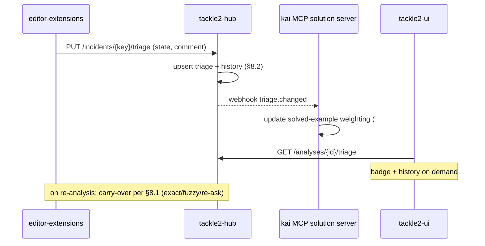
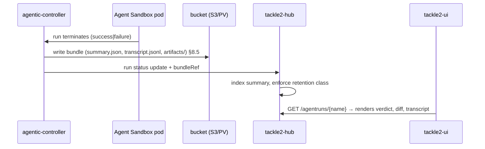
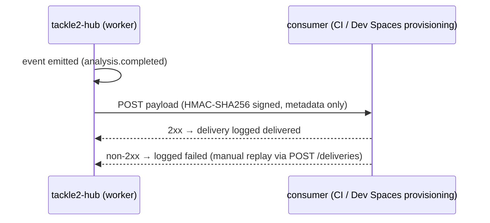
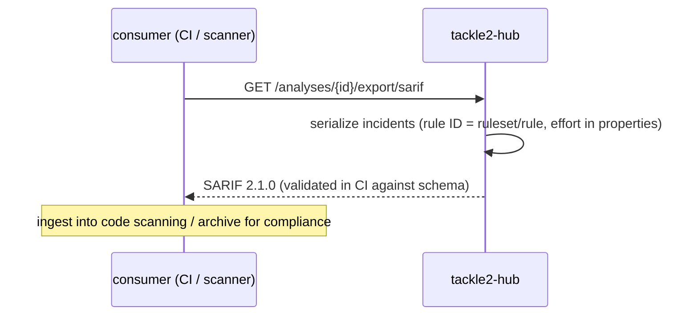

# Konveyor/MTA Improvement Program — Implementation detail backlog

*Split from `design-implementation.md` (2026-11-16). This file holds **Part II — §8–§18**, the detail dimensions the Part I designs need before implementation: data model & schemas (§8), API contracts & RBAC (§9), sequence diagrams (§10), NFRs (§11), security (§12), test plans (§13), rollout (§14), drawbacks (§15), ADR backlog (§16), KPIs (§17), readiness checklist (§18). The designs themselves (§1–§7) and the console governance decisions (§19) live in [design/design.md](../design/design.md). Numbering is unchanged — cite sections as `implementation/implementation.md §N`.*

# Part II — Design detail backlog

*Added v0.3. Ten detail dimensions the Part I designs need before
implementation; each is worked to the depth appropriate for Wave 1 entry.*

## 8. Data model & schemas

### 8.1 Incident identity (keystone for #1/#6/#33/#16)

- **Key composition:** `sha256(ruleset/ruleId | normalizedFilePath | line |
  snippetHash)` where:
  - `normalizedFilePath` = repo-relative, forward slashes, workspace prefix
    stripped, case-preserved
  - `snippetHash` = SHA-256 of the matched code window (line ±3), whitespace-
    normalized — tolerant of line-number drift from upstream edits
- **Carry-over rules:** exact key match → triage carries silently; same
  rule+file with line drift ≤ 10 → carries with `carriedBy: fuzzy` flag and a
  UI "re-confirm" affordance; rule+file only → offer, never auto-carry;
  everything else → new incident. Matching is a pure function, implemented
  once in `tackle2-hub/shared` and mirrored in `kai`.
- **Open question:** whether `line` participates in the exact key at all, or
  only in the fuzzy tier (kai's incident storage blog is the reference).

### 8.2 Triage store (Postgres, `tackle2-hub`)

```sql
CREATE TABLE triage (
  id            BIGSERIAL PRIMARY KEY,
  incident_key  TEXT        NOT NULL,     -- §8.1
  application_id BIGINT     NOT NULL REFERENCES application(id),
  state         TEXT        NOT NULL CHECK (state IN
                  ('confirmed','false_positive','not_an_issue','resolved','deferred')),
  comment       TEXT,
  author        TEXT        NOT NULL,     -- Hub username
  carried       TEXT,                     -- NULL | 'exact' | 'fuzzy'
  created_at    TIMESTAMPTZ NOT NULL DEFAULT now(),
  updated_at    TIMESTAMPTZ NOT NULL DEFAULT now()
);
CREATE INDEX triage_incident_key_idx ON triage (incident_key);
CREATE INDEX triage_application_idx  ON triage (application_id);
-- audit: updates append to triage_history (old_state, new_state, actor, at)
```

One row per incident key (upsert); history table preserves the audit trail.
API exposes state + comment + author; UI renders history on demand.

### 8.3 Toolchain manifest (JSON Schema, shared by analyzer-lsp/Hub/kantra)

```json
{
  "$id": "https://konveyor.io/schemas/toolchain-manifest-1.json",
  "type": "object",
  "required": ["schemaVersion", "analyzerImage", "ruleBundles", "mode"],
  "properties": {
    "schemaVersion":  {"const": 1},
    "analyzerImage":  {"type": "string", "pattern": ".+@sha256:[a-f0-9]{64}"},
    "ruleBundles":    {"type": "array", "items": {
      "type": "object",
      "required": ["name", "digest"],
      "properties": {"name": {"type": "string"}, "digest": {"type": "string"}}}},
    "providerVersions": {"type": "object"},
    "mode":           {"enum": ["source", "source+dependencies", "binary"]},
    "settingsFingerprint": {"type": "string"},
    "hubVersion":     {"type": "string"}
  }
}
```

Analyses recorded before #7 have `toolchain: null`; the UI renders
"pre-determinism run" (no backfill — the manifest is not reconstructible).

### 8.4 Webhook resource + delivery log

```yaml
Webhook:
  id, url (https required), secretRef, enabled,
  events: [task.completed, analysis.completed, triage.changed, application.changed],
  createdAt, createdBy
WebhookDelivery:
  id, webhookId, eventId, payloadRef (bucket), status (pending|delivered|failed),
  attempts, lastAttemptAt, responseCode, durationMs
```

Payload contract: **metadata only** (IDs, kinds, states, timestamps — never
source code or transcript content; §12.2). Retry policy v1: single attempt,
delivery log for manual replay (risk §7.5).

### 8.5 Run-record bundle layout (#16 persistence)

```
/agentruns/{runName}/
  summary.json        # workflow, stages, params, gateway, token totals, verdict
  transcript.jsonl    # ACP transcript, one message per line
  artifacts/          # diffs, commit lists, reports written by stages
  meta.json           # retention class, redaction flag, schemaVersion
```

Written by the controller (or a sidecar) to the run's bucket at
termination; Hub indexes `summary.json` for the run views. Retention default
**90 days, operator-configurable**; deletion is a controller task.

### 8.6 DB migration notes

All Wave-1 schema changes are additive migrations in `tackle2-hub`'s existing
migration mechanism; no destructive changes. Order matters: incident-identity
function + triage tables land **before** the diff endpoint (which consumes
them). Seed data (`tackle2-seed`) untouched.

## 9. API contracts & RBAC

### 9.1 OpenAPI fragments (to merge into `docs/openapi3.json` in-PR)

```yaml
/incidents/{incidentKey}/triage:
  put:
    summary: Create or update triage state
    security: [{bearerAuth: []}]
    requestBody: {state: confirmed|false_positive|not_an_issue|resolved|deferred, comment}
    responses: {"200": triageView, "403": noTriageWrite}
/applications/{id}/analysis/diff:
  get:
    parameters: [{from: taskId}, {to: taskId}]
    responses: {"200": {added[], resolved[], changed[], effortDelta, triageCarryover}}
/report/effort:
  get:
    parameters: [{groupBy: archetype|businessService|wave|tagCategory}, {filters…}]
    responses: {"200": {groups: [{key, effort, applicationCount, issueCounts}]}}
/webhooks: standard CRUD; /webhooks/{id}/deliveries: GET (log), POST (replay)
/batch/analyses: {applicationIds[], profileId} → taskgroup reference
```

Conventions: follow the Hub's existing JSON/pagination patterns; every
endpoint documented in the same PR (§2.3 rule 2); examples embedded in the
spec.

### 9.2 RBAC scope mapping

| Endpoint | Scope | New? | Roles |
|---|---|---|---|
| `PUT /incidents/{key}/triage` | `triage:write` | **new** | migrator, architect, admin |
| `GET /analyses/{id}/triage` | `triage:read` | new (read implied by insights today) | all migration roles |
| `GET /applications/{id}/analysis/diff` | `analyses:read` | existing | all |
| `GET /report/*` | `reports:read` | existing | architect, admin |
| `/webhooks*` | `webhooks:manage` | **new** | admin |
| `/batch/analyses` | `analyses:create` + `applications:update` | existing | migrator, admin |
| `GET /tags/{id}/applications` | `applications:read` | existing | all |

Operator packages the new scopes in the Keycloak realm; the Administration →
Scopes UI picks them up automatically (366 existing scopes verified). Triage
write additionally requires the application's business-service membership for
non-admin roles (rule configurable; §12.3).

### 9.3 Versioning & deprecation

Additive changes in minor versions; breaking changes require a new major API
path or a two-release deprecation window with `Deprecation`/`Sunset` headers;
the contract policy itself is the #18 enhancement.

## 10. Sequence diagrams (cross-repo flows)

### 10.1 Triage round-trip (#6/#26/#33)



### 10.2 Agent-run persistence (#16)



### 10.3 Webhook delivery (#33)



### 10.4 Export (#12)



## 11. Non-functional requirements

| Dimension | Target | Rationale / measurement |
|---|---|---|
| Export latency | ≤ 5 s for 10,000 incidents (SARIF); ≤ 2 s CycloneDX for 5,000 deps | streaming serialization; load test in CI nightly |
| Aggregate queries | p95 ≤ 500 ms at 1,000 applications / 10,000 analyses | the 8.3.3 evidence base is 100+ apps — targets assume 8× your fleet; measure via #30 metrics |
| Triage write | p95 ≤ 100 ms; carry-over computation ≤ 2 s for a 5,000-incident analysis | indexed key lookup (§8.2) |
| Webhook delivery | dispatched ≤ 10 s after event; at-least-once with log | single-attempt v1 |
| Analysis determinism | 0 diff across fixture corpus (nightly, 7 consecutive days before release) | §4.1 harness |
| A11y conformance | WCAG 2.2 AA; axe critical+serious = 0 (baseline shrinking) | #35 gate; EN 301 549 alignment for EU customers |
| Scale floor | all features validated at 1,000 applications, 100 concurrent users | QE fixture corpus |
| Browser support | current − 1 of Chrome/Firefox/Edge + official PatternFly support matrix | tackle2-ui docs |

## 12. Security & data governance

1. **Run records contain cloned source code and transcripts** — access
   restricted to roles holding the application's repository visibility;
   retention default 90 d (operator-configurable, §8.5); optional redaction
   pass (strip file contents from transcript, keep metadata) before upload.
2. **Webhook payloads are metadata-only** by contract (IDs, states,
   timestamps) — no code, no transcript excerpts; schema-published.
3. **Triage authorization**: scope (`triage:write`) + optional business-service
   membership rule (§9.2); audit trail in `triage_history`.
4. **Webhook secrets**: stored Hub-side, write-only via API (never returned),
   HMAC-SHA256 signatures with timestamp to defeat replay.
5. **Threat-model notes per feature** (feeds #29): exports leak effort/risk
   metadata → scope-guarded; triage is an injection surface for downstream LLM
   weighting (#10) → validate state enums, cap comment length; agent-run
   bundles inherit OpenShell/Agent Sandbox isolation posture.
6. **Audit logging**: triage changes, webhook config changes, export requests
   — one structured log line each, correlated by #30's OTEL spans.

## 13. Test plans (per design)

| Item | Unit | Integration | E2E / acceptance |
|---|---|---|---|
| #7 determinism | sort-key unit tests; manifest schema tests | double-run same pod | **nightly double-run corpus harness**, 0 diff |
| #12 export | serializer unit tests | schema validation in CI | consumer smoke: GitHub code-scanning ingest; `cyclonedx-cli validate` |
| #33 triage/diff | carry-over function (exact/fuzzy/no) | API contract tests (OpenAPI-validated) | IDE round-trip (editor-extensions Playwright); UI badge render |
| #33 webhooks | signature/serialization | delivery worker against mock consumer | CI demo: analysis.completed → consumer receives |
| #3 diagnostics | hint-map resolution | filter params API tests | task with seeded PVC failure renders alert (fixture cluster) |
| #35 gate | ratchet-file semantics | — | PR check blocks new violations; registry completeness test |
| #11 parity | — | **three-way contract test** (fixture → Hub JSON → output.js) | release checklist |
| #30 metrics | — | scrape target tests | fault injection: queue-aging alert fires |
| #31 CR | operator validation unit tests | reconcile tests (envtest) | invalid CR rejected with condition; overrides survive upgrade |
| #16 persistence | bundle layout writer | controller termination → bucket write | failed run's reason visible in UI without YAML (closes MTA-7958) |

Negative cases called out where they bite: triage of vanished incidents
(§8.1 tiers); diff across differing toolchain manifests (annotate, don't
block); export of partially-failed analyses (export what exists + errors
block); gateway outage mid-run (run fails with structured stopReason — the
existing behavior, now persisted).

## 14. Rollout mechanics

### 14.1 Feature flags (Hub settings pattern, verified)

| Flag | Default | Ship wave | Removal |
|---|---|---|---|
| `export.sarif.enabled` / `export.cyclonedx.enabled` | off → on after 1 release | 1 | M2 |
| `triage.enabled` | off → on with UI | 1/3 boundary | M3 |
| `webhooks.enabled` | off (ops opt-in) | 1 | M3 |
| `agentrun.persistence.enabled` | off (opt-in per cluster) | 4 | M5 |
| `ui.navigation.v2.enabled` | off (persona workspaces) | 5 | M6 |

### 14.2 UI URL redirects (#36 navigation change)

`/issues/single-app*` → `/issues/all?application={id}` (tab retirement);
`/agent-runs/*` & `/workflow-runs/*` → `/automation/runs?type=…`;
`/agents|/skills|/workflows` → `/automation/catalog#…`; `/controls*` →
`/administration/organization*`; `/gateways` → `/administration/platform/gateways`.
Redirect map shipped for two releases, then 404.

### 14.3 Version matrix (placeholder — set at wave entry)

| Cluster | Upstream Konveyor | MTA train |
|---|---|---|
| Wave 0–1 | next minor after current main | MTA 8.4/8.5 window |
| Waves 2–5 | per wave entry | TBD |

## 15. Enhancement-template mapping (drawbacks & alternatives)

Konveyor's enhancement template expects Drawbacks/Alternatives — currently
the weakest sections. Drafted for the four highest-stakes proposals:

- **#7 determinism** — *Drawback:* strict mode rejects analyses that today
  "complete with errors" (breaking best-effort pipelines); *Alternative
  considered:* normalize results post-hoc (rejected: hides variance instead of
  eliminating it).
- **#33 triage store** — *Drawback:* new write surface + authz on a previously
  read-only API; *Alternatives:* client-side triage (rejected in #26 analysis:
  never syncs), reuse kai solution server as store (rejected: triage is
  portfolio data, not example data).
- **#16 run persistence** — *Drawback:* storage cost + sensitive-content
  handling; revises the ephemerality ADR; *Alternatives:* link-only to git
  branch (rejected: branch may not exist — verified UX failure), persist only
  summary (rejected: loses the audit trail argument).
- **#25 wave planner** — *Drawback:* suggestions can be wrong → over-trust
  risk; *Alternatives:* full optimizer (deferred), manual-only (status quo,
  rejected by #25's evidence).

## 16. ADR backlog

| ADR | Repo | Decision | Status |
|---|---|---|---|
| Incident identity key & carry-over tiers | tackle2-hub (+kai alignment) | §8.1 | proposed |
| Run-record persistence vs. ephemeral-workspace ADR | agentic-controller | §8.5 | proposed (builds on #341) |
| Webhook infrastructure (v1 semantics) | tackle2-hub | §8.4 | proposed |
| Gateway defaults & fallback policy | agentic-controller | #20 design | needed at Wave 4 |
| Triage authorization model (scope + business service) | tackle2-hub | §9.2 | proposed |
| Feature-flag governance (naming, defaults, removal) | tackle2-hub/operator | §14.1 | proposed |

## 17. Success metrics (program KPIs, measured via #30)

| KPI | Source | Target |
|---|---|---|
| Queue health | `mta_tasks_queue_depth{state}` | stuck (Created+Ready+Postponed) < 10% sustained |
| Analysis re-run variance | determinism harness | 0 diff |
| Triage latency | triage.created_at − incident.created_at | median < 3 days for archetyped apps |
| Export adoption | export request metrics | ≥ 30% of analyses exported within 6 months |
| A11y violations | #35 baseline | baseline reaches 0 by M3; gate prevents regressions |
| Agent-run auditability | run-record bundle presence | 100% of runs post-M5 have persisted records |
| Support-case proxy | MTA-6140/5069-class diagnostics | self-service rate measurable via hint-map hits |

## 18. Implementation-readiness checklist

*Added at program freeze. The distance between the five `provisional`
proposals and first merged code, in five categories — ordered by when each
blocks. Owner column is a placeholder for kickoff assignment.*

### 18.1 Blockers before the first PR (human/process — days)

| Item | Detail | Owner |
|---|---|---|
| YAML frontmatter | author confirmed (`@jcordes73`); reviewers/approvers assigned from upstream evidence (kai/solution-server KEP + #279 participants); `@djzager` dropped pending activity verification; two TBDs remain — tackle2-ui maintainer for ④, RHDA/RHTPA-facing reviewer for ⑤ | program lead |
| Socialization | process requires it before the PR — one maintainer conversation per repo; deepest for `analyzer-lsp` (① touches 3 primaries) and kai (identity-fn alignment). See the socialization map below | program lead + proposal authors |
| Wave-entry re-validation | 8.3.3-sandbox assumptions vs. upstream `main` state (risk §7.6: agentic API paths were not in main yet) | per-repo champions |
| Reviewer capacity | §7.7: all five queue behind `tackle2-hub` review bandwidth; agree landing order with maintainers | maintainers |

### 18.2 Socialization map (what "socialize" concretely means)

Channels (verified from `konveyor/community`): Kubernetes Slack
`#konveyor` / `#konveyor-dev`; SIG meetings — **Analyzers**, **Core**,
**Integration**, **UI** — each with its own mailing list; Community meeting
every 3 weeks (Thursdays, 10 AM ET); `konveyor-dev@googlegroups.com`.
Socialization output is *committed reviewers + no objectionable approach +
closed design questions* — not approval, which happens at the
`implementable` milestone. **Ready-made socialization scripts for each conversation live
in `socialization/socialization-scripts.md`** (30-second elevator + 5-minute SIG version
per proposal, each ending in an explicit ask; Konveyor-styled slide decks
in `socialization/presentations/`).

| # | Conversation | With whom / venue | Decision sought |
|---|---|---|---|
| all | Present problem + approach | SIG meeting slot; proposal Summary/Motivation is the script; slide decks in `socialization/presentations/` | "worth doing" buy-in; reviewer/approver confirmations; fill ④'s UI-TBD and ⑤'s RHDA/RHTPA-TBD; settle `@djzager` |
| ① | Identity-key composition (`line` in exact key?); identity-fn ownership | `@shawn-hurley` + kai maintainers — Analyzers SIG | closes ADRs 1–2 (§16); unblocks ① and ② |
| ② | Triage authorization model | `@jortel` — Core SIG | closes the triage-authz ADR |
| ② | ② ↔ #279 relationship | `@fabianvf`, `@abrugaro` (②'s reviewers) | complement-not-duplicate agreement before the PR |
| ④ | Webhook v1 at-most-once floor | `@jortel` — Core SIG | closes the webhook-semantics ADR |
| ⑤ | Sourcing-path semantics | RHDA/RHTPA-facing team | validates the three-tier sourcing design |
| ①③ | `--strict` dependency on MTA-8155 landing | analyzer-lsp maintainers | sequencing agreement |
| all | Landing order + review bandwidth | tackle2-hub/analyzer-lsp maintainers | §6.2 order (identity → triage → aggregates/batch → exports → issue types) vs. hub review queue (§7.7) |

### 18.3 Decisions to close before code (ADR backlog — all undecided)

| Decision | Blocks | Status (§16) |
|---|---|---|
| Incident identity key — is `line` in the exact key? | ①'s data model, ② entirely | proposed |
| Identity-fn ownership (hub-mirrored vs. analyzer-emitted) | ①'s repo split | proposed |
| Triage authorization model | ②'s RBAC implementation | proposed |
| Webhook v1 semantics (at-most-once floor acceptable?) | ④'s largest work item | proposed |
| Flag governance naming/defaults | first flag lands with ③/④/⑤ rollout | proposed |
| Run-record persistence vs. ephemerality ADR | Wave 4 entry (not near-term) | proposed |

Plus the ~14 Open Questions across the five proposals — closing these is
what the `provisional → implementable` transition means. Suggested vehicle:
one design-review session per proposal with the assigned reviewers.

### 18.4 Design work not yet written (deepest gap)

| Item | Detail | When needed |
|---|---|---|
| Waves 2–5 Part-II depth | schemas/OpenAPI/RBAC/test plans exist only for Wave 1; wave planner, run-record redaction pass (§8.5 "optional" — undesigned), plugin spec (#34), Apicurio integration | at each wave entry |
| §14.3 version matrix | upstream release / MTA train per cluster — all TBD | at filing and per wave entry |
| UX artifacts | no wireframes or PatternFly-pattern mapping for the ②/④/⑤ UI work (diff view, triage badges, webhook admin, CVSS columns) | before the first tackle2-ui PR |
| Threat models | §12.5 promises per-feature notes (feeds #29); none written | with each implementable transition |
| Docs plan | template checklist requires user-facing documentation; name the docs-pages/release-notes item per proposal | at implementable |
| Downstream ship vehicle | §7.1: each proposal must state its MTA release train | at implementable |

### 18.5 Test/CI assets to build (nobody owns these yet)

| Asset | Detail | Effort |
|---|---|---|
| Determinism harness | fixture-corpus curation, double-run CI, normalize/diff tooling, zero-diff badge; repo decision (go-konveyor-tests vs. new) — the repo decision is itself an open item | ≈ 2.5 ew (in ①) |
| Scale fixtures | NFRs target 1,000 apps / 10,000 analyses; today's corpus derives from a 100+-app evidence base — an 8× fixture build | unowned — assign at Wave 1 |
| CI credentials/services | GitHub code-scanning ingest for ③'s smoke; RHTPA/Exhort mock services for ⑤ | S |
| Fault-injection fixtures | seeded PVC-failure cluster for #3's tests; slow-consumer mock for ④'s dispatch-latency NFR | S |

### 18.6 Planning artifacts (cheap, needed to start)

| Item | Detail |
|---|---|
| Milestone/sprint plan | map the ≈ 50 ew (§6.3) to the streams and the landing order (§6.2: identity → triage → aggregates/batch → exports → issue types) |
| Definition of done per proposal | aggregate the per-proposal test-plan acceptance criteria into a shared DoD |
| KPI baselines | §17 targets need #30's metrics landed first — the observability baseline is on the critical path for measuring success, not just a feature |

**Bottom line:** nothing here invalidates the proposals — this is the
standard distance between `provisional` and first merged code. The critical
path runs: frontmatter + socialization → ADR decisions (18.2) → harness
build (18.4) → ① implementation; ③ can trail in parallel as the quick win.


## 21. Wireframe-to-PatternFly element mapping (companion to design/design.md §20.5)

The §20.5 wireframes are deliberately greyscale ASCII. This section pins each
drawn convention — and each screen region — to the PatternFly 6 element that
implements it. Everything below is verified against the working mock
(`deliverables/ui-mockup/index.html`, PatternFly 6.7.0 via unpkg; component-node counts
re-counted 2026-11-16: `pf-v6-c-table` ×1654, `-label` ×890, `-button` ×519,
`-menu` ×464, `-card` ×422, `-tabs` ×228, `-modal-box` ×202, `-form` ×171,
`-description-list` ×130, `-menu-toggle` ×95, `-check` ×81, `-pagination` ×54,
`-notification-drawer` ×52, `-toolbar` ×41, `-wizard` ×40, `-switch` ×26,
`-nav` ×26, `-masthead` ×25, `-progress` ×24, `-code-block` ×22,
`-accordion` ×13, `-badge` ×12, `-drawer` ×11, `-empty-state` ×9). The §19
governing rules apply throughout: genuine `pf-v6-c-*` markup + `--pf-t--*`
tokens for all chrome, RHDS crayon/space/focus tokens for the mock's own
layer, and no `rh-*` web components.

### 21.1 The shared vocabulary (conventions repeated on every screen)

| §20.5 convention | PatternFly 6 implementation | Notes |
|---|---|---|
| `═ MASTHEAD` band | `pf-v6-c-masthead` inside `pf-v6-c-page` | dark in both schemes (row 84); content cluster stays single-row |
| persona pills `[Architect\|…]` | `pf-v6-c-toggle-group` in the masthead (single-select, restyled dark) | (36,41); tenancy `[org: …]` is the switcher menu |
| tenancy switcher | `pf-v6-c-menu-toggle` + `pf-v6-c-menu` | disabled tenancy items `aria-disabled="true"` (row 91) |
| `[bell]` | `pf-v6-c-menu-toggle` carrying `pf-v6-c-badge pf-m-unread` → opens `pf-v6-c-notification-drawer` | (42,41,46,30); the React-only notification-badge component is banned — badge-in-toggle is the sanctioned HTML idiom (row 94) |
| `[scheme]` `[EN v]` `[Help v]` | `pf-v6-c-menu-toggle` + `pf-v6-c-menu`; scheme toggle is a `pf-v6-c-button` with a state-reflecting icon | rows 98/100 |
| `│ NAV` sidebar | `pf-v6-c-nav` in `pf-v6-c-page__sidebar` (230px) | 9 items vs RHDS primary-nav max 5 — accepted console-IA deviation (row 87); masthead ☰ collapse keeps main pinned to grid-column 2 (row 102) |
| page title + subtitle | `pf-v6-c-title pf-m-xl` `<h1>` (`.page-title` hook) + muted subtitle | row 94 |
| `┌─┐` cards/regions | `pf-v6-c-card` (`__header`/`__title`/`__body`) | top-level rows sit on the RHDS 12-col grid (`.grid12`); PF grids stay inside components (row 93) |
| `[label]` buttons | `pf-v6-c-button` | one `pf-m-primary` per view; delete triggers `pf-m-secondary` — danger reserved for the confirm modal (row 95) |
| `[filter v]` `[state v]` `[bulk v]` | `pf-v6-c-menu-toggle` + `pf-v6-c-menu` | typeahead variants keep focus in the `__search` input; groups ≤ 7 items; bulk "Select none" disabled at 0 via `bulkNoneDisabled()` (row 91) |
| applied-filter chips | `pf-v6-c-label` + `__actions` close button | PF6 removed the chip component — never hand-roll `pf-v6-c-chip` (row 81) |
| `^` in a column header | `pf-v6-c-table` sortable `<th>` + `aria-sort` + stacked double-triangle glyph (RHDS_ICONS `sort-*`) | rows 86/92 |
| `\|` column separators | `pf-v6-c-table` | `<th>` count == body cell count; card body gets `overflow-x:auto` via `:has(> .pf-v6-c-table)` |
| `…` repeated rows | `<tbody>` rows | empty results → `pf-v6-c-empty-state` (×9); loading → `pf-v6-c-skeleton` (×2) |
| `< 1 2 … >` pager | `pf-v6-c-pagination` | hidden at zero results (`[hidden]` + CSS, row 89) |
| `[x select]` | `pf-v6-c-check` | header checkbox is deliberately not select-all — the toolbar bulk selector owns it (row 95) |
| `o! label` risk cell | `pf-v6-c-label` (+ status icon) | risk never encoded in color alone (#32) |
| `!` expiry/warning | `pf-v6-c-label pf-m-orange` / `pf-m-red` | credentials expiry, quota states |
| form fields + errors | `pf-v6-c-form` + `__form-control` + `__helper-text` | errors state location + cause + fix (row 91) |
| right-hand drawer box | `pf-v6-c-drawer` (right `__panel`) | `&drawer=` deep link; drawer content is a `<div>`, not a landmark (row 85) |
| modal box | `pf-v6-c-modal-box` + `pf-v6-c-backdrop` | focus-in/trap/restore contract (row 89) |
| toast confirmation | custom fixed `role="alert"` banner on PF primitives | RHDS Toast style: top-right, `--rh-box-shadow-xl`, mandatory close (row 90) |
| alerts | `pf-v6-c-alert` (+ one `pf-v6-c-alert-group`) | icon+title minimum, no dismiss action |

### 21.2 Per-screen regions (§20.5 blocks 1–10 → elements)

| §20.5 block | Wireframe region | PatternFly 6 implementation |
|---|---|---|
| Shell | chrome cluster + skip target | `pf-v6-c-skip-to-content` is the first focusable element in the page, targeting `<main id="mtaMain" tabindex="-1">` (row 81) |
| 1 · Home | 4 KPI tiles + 2-card row | `pf-v6-c-card` tiles on `.grid12` (5-tile rows use the centered 10-of-12 placement, row 93); trends render as text/stat captions — no chart library |
| 2 · Applications | `[Applications] [Archetypes]` tab row | `pf-v6-c-tabs` (`&tab=` deep links, row 82) |
| 2 · Applications | toolbar + table + pager | `pf-v6-c-toolbar` (`__content-section`/`__group`/`__item`) + `pf-v6-c-table` + `pf-v6-c-pagination`; hover cards (36 items 6/7, 23) are custom popover-like divs — no PF Popover in the mock (row 91) |
| 3 · Incidents | drawer box | `pf-v6-c-drawer` right panel; triage form = `pf-v6-c-form`; related/diff context = `pf-v6-c-description-list` (the mock's detail-view workhorse, ×130) |
| 4 · Waves | gantt lanes `W2 ──*###` | hand-rolled `.gantt/.lane/.track/.bar` divs inside a `pf-v6-c-card`, colored with PF status tokens; expand carets = `pf-v6-c-button pf-m-plain` + `pf-v6-c-table__toggle-icon`; slippage labels = `pf-v6-c-label pf-m-green/yellow` (46) |
| 4 · Waves | gate progress + per-wave tabs | `pf-v6-c-progress-stepper` for gate steps + compact `pf-v6-c-tabs` per wave (46,47) |
| 5 · Reports | tab hub + card grid | `pf-v6-c-tabs` + `pf-v6-c-card` grid; charts/sparklines have no PF HTML implementation (PF charts are React-only) — text/stat tiles now, chart components at React-port time (row 94) |
| 6 · Agentic | run/registry tables | `pf-v6-c-table` + `pf-v6-c-label` attribution cells (gateway/model, tokens); `.ai-marker` dual indicator (sparkle + "AI-generated" text, RHDS purple tokens) on AI-generated records (row 91) |
| 6 · Agentic | run detail | `pf-v6-c-description-list` + `pf-v6-c-code-block` for event logs (≥5 lines: header with Expand/Collapse + Copy, collapsed by default — row 87) |
| 7 · Credentials | `[kind v]` + table | `pf-v6-c-menu` filter + `pf-v6-c-table`; the secret write-only field (never rendered back, 15) is a #15 target — not yet mock markup |
| 8 · Task manager | queue + structured events | `pf-v6-c-table` with RBAC-guarded bulk verbs (36,38); task detail = `pf-v6-c-description-list` (sandbox/attempts/audit) + `pf-v6-c-accordion` for the structured-events timeline (`&open=` hash expansion, row 82) |
| 9 · Administration | controls CRUD 2-col grid | `pf-v6-c-card` grid + `pf-v6-c-switch` toggles (33 item 11); `[Access]` scopes use `pf-v6-c-check`/`pf-v6-c-radio` |
| 10 · Import wizard | step rail `1. Source > … > 5. Review` | `pf-v6-c-wizard` (`__outer-wrap`/`__header`/`__nav`/`__main`) with `__nav-link` steps; blocking validation renders `pf-v6-c-form` `__helper-text` error state inline (44,39) |

### 21.3 Deliberate non-PF layers (invisible in the wireframes)

- **RHDS token layer**: crayon colors, space scale, border radii, shadows, and
  the universal focus ring are `--rh-*` tokens loaded via `@rhds/tokens`
  (rows 74/77/78/80) — they style the mock's own layer around the PF chrome.
- **Annotation system**: `.anno` badges + the singleton tip (409 `data-tip`s)
  are custom, English-only by design; the wireframes' `(N)` citations render
  from this layer, which the i18n machinery deliberately skips.
- **i18n layer**: 8 locales behind `setLang`; the wireframes show the EN
  byte-exact strings only.
- **Charts**: no HTML PF equivalent exists — anything chart-shaped in a
  wireframe becomes text/stat tiles in the mock and a PF React chart
  component only at `deliverables/ui-react/` port time.
